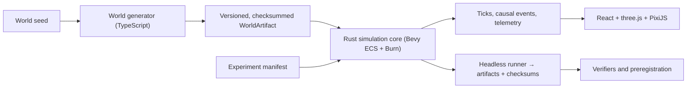

<p align="center">
  
</p>

<h1 align="center">Anima Engine</h1>

<p align="center">
  <b>An artificial evolution laboratory.</b><br>
  Creatures whose bodies and brains come from their genes live on a world with terrain, climate and a closed energy
  ledger, and every experiment is registered in advance and replays to the same result from the same seed.
</p>

<p align="center"><i>English · <a href="README.vi.md">Tiếng Việt</a></i></p>

---

## What this is

Anima Engine is a **Tauri v2** desktop app:
- **Simulation core:** **Rust**, built on **Bevy ECS** and **Burn**, running in the background at 60 ticks per second.
- **Interface:** **React + TypeScript**, with a 3D map built on three.js / React Three Fiber.

It does two things, and the second matters more than the first:

1. **It simulates a living world.**
   - Terrain, rivers, lakes, climate and plants make up the environment.
   - The creatures in it have multi-segment bodies grown from their genome and walk with gaits driven by a central
     pattern generator (CPG). They eat, drink, hunt and breed.
   - Energy moves in a closed loop: plants → herbivores → detritus → plants.
2. **It asks evolutionary questions of that world and answers them with evidence.**
   - Each experiment is a versioned manifest that runs headless.
   - Experiments are registered before any data exists and have negative controls. Negative results are published
     too.

**The flagship question is the island rule:** when a population is isolated on an island, how does body size change,
and does food or predation drive the change? The design is in the
[island evolution observatory proposal](docs/ai/requirements/2026-11-19-feature-island-evolution-observatory.md).
Later, one realm at a time, real ecosystems in water, in the sky and underground will be added.

## What you see when you open the app

- **One shared world.** The map is a supercontinent generated from a seed at 2048². It has sea, coasts, rivers,
  lakes, waterfalls, desert, savanna, rainforest, temperate forest, taiga, swamp, snowy mountains and glaciers. The
  simulation runs on a 256² downsample of the same world. A test stops the world from silently losing an
  environment.
- **Creatures with continuous bodies and eyes at the front.** Each one is shaped by the segments, joints and sizes in
  its own genome, so no two look alike. They walk on land, never on the sea.
- **The map shows the world being simulated.** The lakes, trees and food on the map come from the simulation. Fish,
  birds, background animals and caves are decoration. The app labels them as decoration and has a button to hide
  them.
- **A registered experiment's world opens from its manifest.** This is a viewer prototype for now.

## What makes it different

- **No painting.** Anything that is not simulated is labelled as decoration. The documentation keeps *what is in the
  code* apart from *what has been measured*, and every authoritative number lives in one place.
- **A closed energy budget.** Energy (EU) is never created or lost. Every cost goes through a single place, and tests
  check that the total does not drift.
- **Preregistered experiments.** Decision thresholds, seed counts, the rules for excluding broken runs, and the
  controls are all locked before the run. Smoke runs are blind: they never read the outcome measures. A failed gate
  is a result. It is never re-run and its parameters are never tuned.
- **Reproducible.** The same seed, commit and operating system give the same checksum. Trajectories differ across
  operating systems, so tests compare two runs instead of pinning an absolute number. One exception is being fixed
  (card F051): a headless run still takes its terrain from the app's world file if the machine has one.
- **No Lamarck.** What an individual learns in its lifetime is never written back into its genome.

## Current boundaries (2026-11-19)

The table in the next section lists *what is in the code*. It does not say *what has been measured or proven*.
Measured status, with commands, dates and configuration, lives in one place only:
[`docs/planning/STATE_OF_THE_PROJECT.md` §1](docs/planning/STATE_OF_THE_PROJECT.md#1-bảng-bằng-chứng-có-thẩm-quyền).
This README carries no measurements.

- **There is no strong scientific result yet.**
  - The experiment infrastructure exists.
  - Experiment E2 gave a null result because of a floor effect.
  - The E-SEL1 preregistration was closed before it ran.
  - The status of SEL2-P (the first preregistered experiment on the live world) and of E3 is in
    [STATE §3](docs/planning/STATE_OF_THE_PROJECT.md).
- **The live-world experiment adapter is verified on the headless path only.** The app's "open an experiment world"
  button is a viewer prototype.
- **Every map FPS figure so far was measured in a browser** (the renderer under Vite, with no simulation load), not
  in the desktop app. The desktop app has been run and its tick rate measured once, on 2026-07-27, as a debug build
  with 10 agents. Nobody has run a release build of the app with the current map yet.
- **Mortality, ecological fitness, continuous reproduction and locomotion steering are in the code but off by
  default.** A default world still has no death, and fitness is scored by distance. The land-only walking rule is on
  in the app; in experiments the manifest key `live.land_mask` turns it on.
- **No third-party licence text is unresolved any more, but one row was closed by a choice.** `utf8-chars`
  3.0.7 ships no licence file at all, so the project elects Apache-2.0 under the `MIT OR Apache-2.0` it declares;
  [`licensing/UNRESOLVED.md`](licensing/UNRESOLVED.md) is empty. Whether a bare Cargo `license` field is the
  author's grant remains a legal question; this is not legal advice.

## What is in the code

| Layer | Contents |
|---|---|
| **World** | A TypeScript world generator driven by one seed: layered noise, erosion, lakes by priority flood, rivers, waterfalls at knickpoints, cave mouths, climate from latitude and altitude, 22 biomes. The world reaches the simulation as a versioned, checksummed `WorldArtifact`. Climate, water and soil fields change over time under conserved water and nutrient budgets |
| **Creatures** | `MorphologyGenotype` → a multi-segment phenotype with joint constraints and a CPG-driven gait. Metabolism follows MTE (Kleiber + Arrhenius). The 3D map draws continuous bodies with eyes and distance-based level of detail. Walking on land is checked against the biome |
| **Brains** | By default, one shared actor-critic (Burn). The CPU path, `burn-flex`, is the deterministic reference; the GPU path, `burn-wgpu`, runs only on request. Optional: an **evolved brain per individual** and lifetime learning ([ADR-0003](docs/decisions/ADR-0003-evolved-per-agent-brains.md)) |
| **Behaviour** | Raycasts through a spatial hash, a pheromone grid with diffusion and decay, predator–prey dynamics, combat |
| **Ecology** | A **closed** energy ledger (EU): plants → herbivores → detritus → plants. Holling type II/III functional responses. Lindeman transfer of about 30%. Logistic primary-production regrowth per biome. Seasons. Mortality, continuous reproduction, locomotion and the ecology keys are optional and off by default ([ADR-0005](docs/decisions/ADR-0005-live-population-turnover.md), [ADR-0006](docs/decisions/ADR-0006-locomotion-actuation.md), [ADR-0007](docs/decisions/ADR-0007-live-ecology-sustainability.md)) |
| **Evolution** | MAP-Elites on **ecological niche** axes (body mass × share of energy from predation). Generational replacement. Lineage stored in Neo4j, or in memory without it. Newick export and most-recent-common-ancestor queries |
| **Experiments** | Versioned manifests and a headless runner. Forks from checkpoints. An intervention queue with a causal ledger. Exotic energy ("mana", off by default). An adapter for the live Bevy world. Runners for the preregistered experiments (E-SEL1, SEL2-P, E3) |
| **Interface** | 3D map (`landscape.html`): day and night, weather, PBR terrain materials (CC0), instanced vegetation, several camera modes, four graphics tiers. A PixiJS 8 2D viewport. Ecosystem, evolution, lineage and chronicle panels |
| **Infrastructure** | A 60-ticks-per-second background loop with **no heap allocation on the tick path**. Seeded RNG split into separate streams. Versioned snapshots used as checkpoints. A deterministic mode for replay |

## Where to start

| Need | Document |
|---|---|
| Where the project is and what comes next | [Project state](docs/planning/STATE_OF_THE_PROJECT.md): measurements in §1, progress board in §3.00 |
| The flagship question and its roadmap | [Island evolution observatory](docs/ai/requirements/2026-11-19-feature-island-evolution-observatory.md) |
| Product and architecture | [PROJECT.md](PROJECT.md) |
| The world vision | [WORLD_DESIGN.md](WORLD_DESIGN.md) |
| Simulation rules that must not break | [SIMULATION_RULES.md](SIMULATION_RULES.md) |
| Proven bugs | [FINDINGS.md](FINDINGS.md) |
| Changing genes, bodies or creatures | [Creature Development Contract](docs/reference/CREATURE_DEVELOPMENT_CONTRACT.md) |
| Changing brains or the action space | [ADR-0003](docs/decisions/ADR-0003-evolved-per-agent-brains.md) |
| Running experiments under different world laws | [Evolution Experiment Contract](docs/reference/EVOLUTION_EXPERIMENT_CONTRACT.md) |
| A first trial run with outside users | [First trial run](docs/how-to/OWNER_TRIAL_RUN.md) |
| Working as one of the team's agents | [AGENT_WORKFLOW.md](docs/how-to/AGENT_WORKFLOW.md) |
| All documentation | [Documentation hub](docs/README.md) |

## Architecture at a glance



- Rust is the source of truth for simulation state. The interface only displays it and never invents ecological
  state.
- `WorldArtifact` is the versioned boundary between the two.
- Open-source Python tools are used offline only, for calibration and validation. The desktop app does not depend on
  them at run time.

## Repository layout

```
src/                      React + TypeScript (Vite, two entries: index.html, landscape.html)
  components/Landscape/   3D map, world generator, world cache, materials, creatures
  utils/sharedWorld.ts    the one identity of the shared world
src-tauri/                Rust crate `anima-engine` (lib `anima_engine_lib`)
  src/core/               ECS, tick loop, terrain, ecology, energy ledger, snapshots, experiments
  src/ai/                 Burn models, CPG, pheromones
  src/evolution/          MAP-Elites, genotype, mutation, crossover, brain genes, lineage
  src/commands/           the Tauri IPC command surface
  examples/               runners for the preregistered experiments
  crates/anima-domain/    the world laws
tests/                    separate npm package: Vitest (frontend/) and Playwright (e2e/)
docs/                     Diátaxis documentation (tutorial / how-to / reference / explanation)
scripts/                  gates, manifest and map-evidence generators, benchmarks
artifacts/                pinned, hashed artifacts: the 256² world, map evidence, experiments
```

## Running it

You need Node.js and npm, the Rust toolchain (the version pinned in `rust-toolchain.toml`), and your operating
system's Tauri v2 build prerequisites (on Windows: WebView2 and the MSVC build tools).

For the interface, the 3D map and the world generator only, which is light and enough for most work:

```bash
npm ci
npm run dev
```

`npm run dev` serves Vite on the fixed port **5173**.

For the full desktop app with its backend:

```bash
npm run tauri:dev
```

Use `npm run tauri:dev` and `npm run tauri:build`, **not** bare `tauri dev` or `tauri build`. The npm scripts pass
`--features desktop`, and `tauri.conf.json` has no field for Cargo features. A bare command therefore builds a binary
with no Neo4j lineage, no cross-shard migration and a CPU learner. All three have fallbacks, so nothing reports an
error.

> ⚠️ Building and running the full Bevy/Tauri backend is heavy and has frozen the development machine before. When you
> only need to look at the map or the creatures, use `npm run dev`.

The default founding population is 10. Set `ANIMA_FOUNDING_POPULATION` (at most 10,000) for a fuller world.

## Verification

Frontend:

```bash
npm run lint
npm run test
npm run test:frontend
npm run test:e2e
npm run build
npm run check:docs
```

Backend (run in `src-tauri/`):

```bash
cargo test --features desktop
cargo clippy --all-targets --features desktop -- -D warnings
cargo audit
```

Three constraints that are not optional:

- **`--features desktop` is required.** Without it Cargo does not schedule the test files that need the
  `networking` or `ml-wgpu` features, and the migration, cross-shard and GPU-fallback tests silently do not run.
  `node scripts/check_test_targets.mjs <output> --profile desktop` checks this. Capture the output into one file,
  with both streams in write order.
- **Run one `cargo test` process per machine at a time.** Some suites replace the global allocator to count
  allocations, or read and write environment variables.
- **Run `cargo audit` from inside `src-tauri/`**, because it looks for `.cargo/audit.toml` in the current directory.

Playwright E2E starts Vite itself and needs no release binary. CI (`.github/workflows/ci.yml`) runs the gates above.
Both `main` and `feat/ecological-selection` are protected, so every change lands through a pull request with two
green CI jobs.

## Runtime flags

The backend loads environment variables from `.env` (gitignored) through `dotenvy`. With no flag set, the simulation
takes its original default path.

| Variable | Default | Effect |
|---|---|---|
| `ANIMA_FOUNDING_POPULATION` | 10 | Number of founders, at most 10,000 |
| `ANIMA_SIM_SEED` | the world's seed | Overrides the run's seed |
| `ANIMA_EVOLVED_BRAINS` | off | Each individual gets its own evolved brain instead of one shared network |
| `ANIMA_LIFETIME_LEARNING` | off | Lifetime learning. Takes effect only with the flag above |
| `ANIMA_MORTALITY` | off | Death from starvation and thirst |
| `ANIMA_FITNESS` | distance | Selects ecological fitness instead of distance |
| `ANIMA_DETERMINISTIC` | off | Deterministic mode for replay and checkpoints |
| `ANIMA_USE_GPU` | off | Turns on the `burn-wgpu` GPU learner. The default is CPU `burn-flex`, the deterministic reference |
| `ANIMA_WORLD_ARTIFACT` | temp dir | Path of the World Artifact the app shares between interface and backend |
| `ANIMA_CACHE_DIR` | temp dir | Where the backend caches generated worlds |
| `GEMINI_API_KEY` | empty | Gemini REST for the meta-AI. Empty means a mock |
| Neo4j credentials | empty | Lineage. Empty means in memory |

In experiments the manifest declares the matching values, such as `live.mortality` or `live.land_mask`. A manifest
never reads environment variables.

## IPC contract

The interface talks to the Rust core through Tauri commands and events, for example `get_simulation_status`,
`toggle_simulation`, `start_from_manifest`, `get_environmental_elements`, `save_simulation_state` /
`load_simulation_state`, and the `simulation-tick` event. The full list with payloads is in
[`docs/reference/IPC_CONTRACT.md`](docs/reference/IPC_CONTRACT.md). Update it in the same change whenever you change
the IPC surface: `npm run check:docs` fails when the list and the code disagree.

Save and load take a **save name**, not a path. The name resolves inside the app's data directory
(`<app_data_dir>/saves/<name>.json`) and may contain only `[A-Za-z0-9._-]`. To use an old save from outside that
directory, copy it in and load it by name ([`commands/save_paths.rs`](src-tauri/src/commands/save_paths.rs) explains
why).

## Rules for changes

1. A change to a simulation law updates `SIMULATION_RULES.md` and the matching tests.
2. A change to an exchange format comes with a version, a migration, and fixtures for both Rust and TypeScript.
3. The tick path (physics, CPG, collision) **must not allocate on the heap**. Tests assert `allocs == 0`.
4. EU energy is a closed system: every new cost goes through `total_cost`, never a separate deduction.
5. An architectural decision or a major dependency needs an ADR.
6. Open-source dependencies and assets pass a licence check. Assets come only from ambientCG and Poly Haven (CC0).
7. Never pin an absolute world checksum in a test, because it differs across operating systems. Compare runs instead.

The full rules are in the [documentation policy](docs/governance/DOCUMENTATION_POLICY.md) and the
[open-source policy](docs/governance/OPEN_SOURCE_POLICY.md).

## Contributing

See [CONTRIBUTING.md](CONTRIBUTING.md): the license terms your contribution arrives under, the
required reading per area of the code, and the gates to run before opening a pull request. There is
no CLA.

## License

`Copyright (c) 2026 Duong Nguyen Anh`

Anima Engine is **open source, dual licensed** — take whichever you prefer.

| Scope | License |
|---|---|
| **Source code** (`src/`, `src-tauri/`, `scripts/`, `tests/`) | [MIT](LICENSE-MIT) **OR** [Apache-2.0](LICENSE-APACHE) — `MIT OR Apache-2.0` |
| **Documentation and assets** (`docs/`, `public/`, `src-tauri/icons/`, `.github/assets/` including the logo, preview images at the root) | same dual license |
| **Third-party assets** (textures and models in `public/assets/world/`) | keep their original licence (CC0), sources recorded in [`SOURCES.json`](public/assets/world/SOURCES.json) |
| **The `.anmw` format** (World Artifact) | **open format** — see below |

This is the Rust ecosystem's de-facto default. Why dual rather than Apache-2.0 alone: Apache-2.0 is
**incompatible with GPLv2**, so a downstream GPLv2 project could not use this engine; the MIT branch
removes that barrier, while the Apache-2.0 branch keeps its explicit patent grant (§3) and its
[`NOTICE`](NOTICE) propagation requirement (§4d) available to anyone who wants them.

`NOTICE` carries attribution for the third-party components shipped in binary builds.

### `.anmw` is an open format

`WorldArtifact` — the versioned, FNV-1a-checksummed binary container that Rust and TypeScript
produce **byte-identically** — is an **open format**. Anyone may read it, write it, and reimplement
it in their own software, under any license, without asking. The specification is the reference
implementation in
[`src-tauri/src/core/world_artifact.rs`](src-tauri/src/core/world_artifact.rs), together with the
cross-language fixtures in `src-tauri/tests/fixtures/`.

### Neo4j is optional and separately licensed

Lineage works **without** Neo4j: drop the `neo4j` feature — or simply have no server reachable — and
the in-memory tracker takes over. When enabled, the engine talks to a separately installed Neo4j
process over the Bolt protocol. That is a **process boundary, not linking**, so the GPLv3 of Neo4j
Community Edition does not reach this project's code. Neo4j is not bundled, and licensing it is the
operator's responsibility.

This is not legal advice.
