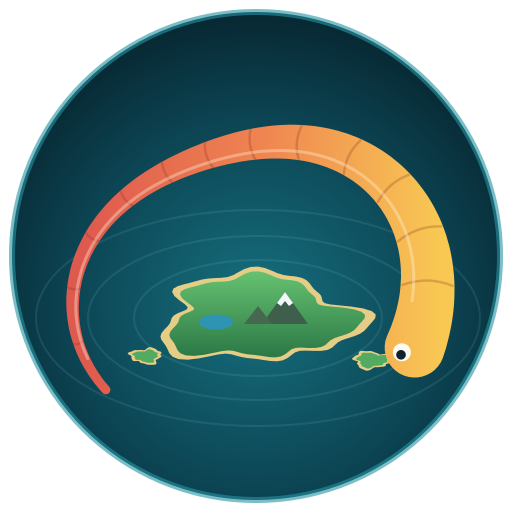
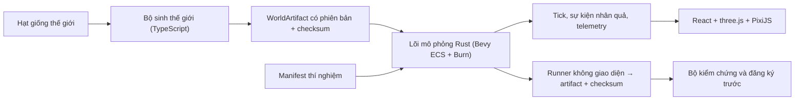

<p align="center">
  
</p>

<h1 align="center">Anima Engine</h1>

<p align="center">
  <b>Một phòng thí nghiệm tiến hoá nhân tạo.</b><br>
  Thân và bộ não của sinh vật do gen quyết định. Chúng sống trên một thế giới có địa hình, khí hậu và một sổ năng lượng
  khép kín. Mỗi thí nghiệm được đăng ký trước, và cùng hạt giống thì chạy lại ra cùng kết quả.
</p>

<p align="center"><i>Tiếng Việt · <a href="README.en.md">English</a></i></p>

---

## Dự án là gì

Anima Engine là ứng dụng desktop **Tauri v2**:
- **Lõi mô phỏng:** **Rust**, gồm **Bevy ECS** và **Burn**, chạy nền ở 60 tick mỗi giây.
- **Giao diện:** **React + TypeScript**, với bản đồ 3D dựng bằng three.js / React Three Fiber.

Dự án có hai việc, và việc thứ hai quan trọng hơn việc thứ nhất:

1. **Mô phỏng một thế giới sống.**
   - Địa hình, sông hồ, khí hậu và thực vật tạo nên môi trường.
   - Sinh vật trong đó có thân nhiều đốt mọc ra từ bộ gen, đi bằng dáng do bộ dao động thần kinh (CPG) điều khiển, và ăn, uống, săn mồi, sinh sản.
   - Năng lượng đi theo một vòng khép kín: thực vật → con ăn cỏ → xác mục → thực vật.
2. **Đặt câu hỏi tiến hoá cho thế giới đó, và trả lời có kiểm chứng.**
   - Mỗi thí nghiệm là một manifest có phiên bản, chạy không cần giao diện.
   - Thí nghiệm được đăng ký trước khi có dữ liệu, có đối chứng âm, và kết quả âm cũng được công bố.

**Câu hỏi chủ lực là quy luật đảo** (*island rule*): khi một quần thể bị cô lập trên đảo, kích thước cơ thể
thay đổi thế nào, và thay đổi đó do thức ăn hay do kẻ săn mồi. Thiết kế nằm ở
[đề xuất Đài quan sát tiến hoá trên đảo](docs/ai/requirements/2026-11-19-feature-island-evolution-observatory.md).
Về lâu dài, mỗi lần một tầng, sẽ có thêm hệ sinh thái thật dưới nước, trên trời và dưới lòng đất.

## Mở app ra sẽ thấy gì

- **Một thế giới dùng chung.** Bản đồ là một siêu lục địa sinh từ hạt giống, độ phân giải 2048², có đủ biển,
  bờ, sông, hồ, thác, sa mạc, xavan, rừng nhiệt đới, rừng ôn đới, rừng taiga, đầm lầy, núi tuyết và sông băng.
  Phần mô phỏng chạy trên bản thu nhỏ 256² của chính thế giới đó. Một test chặn để thế giới không lặng lẽ mất
  đi môi trường nào.
- **Sinh vật có thân liền, mắt ở phía trước.** Hình dạng mỗi con lấy từ số đốt, khớp và kích thước trong bộ gen
  của nó, nên không con nào giống con nào. Chúng chỉ đi trên đất, không đi trên biển.
- **Bản đồ cho thấy đúng thế giới đang được mô phỏng.** Hồ, cây và thức ăn trên bản đồ là của mô phỏng. Cá, chim,
  thú nền và hang chỉ để trang trí: app ghi rõ như vậy, và có nút để ẩn chúng.
- **Mở một thế giới thí nghiệm đã đăng ký** từ manifest của nó. Đây mới là bản thử, chỉ để xem.

## Điều gì làm dự án này khác

- **Không tô vẽ.** Thứ gì không được mô phỏng thì được ghi là trang trí. Tài liệu tách *cái có trong mã* khỏi
  *cái đã được đo*, và mọi con số có thẩm quyền chỉ nằm ở một chỗ.
- **Năng lượng khép kín.** Năng lượng (EU) không tự sinh ra cũng không tự mất đi. Mọi khoản chi đi qua một chỗ duy
  nhất, và test kiểm tra rằng tổng năng lượng không trôi.
- **Thí nghiệm đăng ký trước.** Ngưỡng quyết định, số hạt giống, cách loại bỏ lượt chạy hỏng và các đối chứng đều
  được khoá trước khi chạy. Lượt smoke chạy "mù": không đọc các chỉ số kết quả. Cổng không qua thì đó là một kết
  quả, không được chạy lại và không được chỉnh tham số.
- **Tái lập được.** Cùng hạt giống, cùng commit và cùng hệ điều hành thì cho cùng checksum. Giữa các hệ điều hành,
  quỹ đạo mô phỏng có khác, nên test luôn so hai lượt chạy với nhau, không ghim một con số tuyệt đối. Còn một
  ngoại lệ đang được sửa (thẻ F051): lượt chạy không giao diện vẫn lấy địa hình từ file thế giới của app nếu máy
  có file đó.
- **Không có Lamarck.** Những gì một cá thể học được trong đời không bao giờ được ghi ngược vào bộ gen.

## Ranh giới hiện tại (2026-11-19)

Bảng ở mục kế tiếp liệt kê *cái gì có trong mã*. Nó không nói *cái gì đã được đo hay chứng minh*. Trạng thái đo
được, kèm lệnh, ngày chạy và cấu hình, chỉ nằm ở một chỗ:
[`docs/planning/STATE_OF_THE_PROJECT.md` §1](docs/planning/STATE_OF_THE_PROJECT.md#1-bảng-bằng-chứng-có-thẩm-quyền).
README này không mang số đo.

- **Chưa có kết quả khoa học có sức mạnh.**
  - Hạ tầng thí nghiệm đã có.
  - Thí nghiệm E2 cho kết quả null vì hiệu ứng sàn.
  - Bản đăng ký E-SEL1 bị đóng trước khi chạy.
  - Tình trạng của SEL2-P (thí nghiệm đăng ký trước đầu tiên trên thế giới sống) và E3 nằm ở
    [STATE §3](docs/planning/STATE_OF_THE_PROJECT.md).
- **Adapter thí nghiệm cho thế giới sống mới được kiểm chứng ở đường không giao diện** (*headless adapter
  verified*). Nút mở thế giới thí nghiệm trong app mới là bản thử để xem.
- **Số FPS của bản đồ đến nay đều đo trong trình duyệt** (bộ dựng hình chạy trên Vite, không có tải mô phỏng),
  chưa phải số đo của app desktop. App desktop mới được chạy và đo tick một lần, ngày 2026-07-27, với bản debug và
  10 agent. Chưa ai chạy bản release của app với bản đồ hiện tại.
- **Tử vong, fitness sinh thái, sinh sản liên tục và bộ lái vận động có trong mã nhưng tắt theo mặc định.** Một
  thế giới mặc định vẫn không có cái chết, và fitness được chấm bằng quãng đường. Luật "chỉ đi trên đất" thì bật
  sẵn trong app, còn trong thí nghiệm thì phải bật bằng khoá `live.land_mask`.
- **Phát hành vẫn bị chặn** vì còn một văn bản giấy phép bên thứ ba chưa giải quyết:
  [`licensing/UNRESOLVED.md`](licensing/UNRESOLVED.md).

## Đang có gì trong mã

| Lớp | Nội dung |
|---|---|
| **Thế giới** | Bộ sinh thế giới TypeScript chạy từ một hạt giống: noise nhiều lớp, xói mòn, hồ sinh bằng *priority flood*, sông, thác ở các điểm gãy, cửa hang, khí hậu theo vĩ độ và độ cao, 22 biome. Thế giới được giao sang mô phỏng dưới dạng `WorldArtifact` có phiên bản và checksum. Trường khí hậu, nước và đất biến động theo thời gian, với ngân sách nước và dinh dưỡng được bảo toàn |
| **Sinh vật** | `MorphologyGenotype` → kiểu hình nhiều đốt, có ràng buộc khớp và dáng đi do CPG điều khiển. Chuyển hoá theo MTE (Kleiber + Arrhenius). Bản đồ 3D vẽ thân liền, có mắt và mức chi tiết (LOD) theo khoảng cách. Đi trên đất được kiểm theo biome |
| **Bộ não** | Mặc định là một actor-critic dùng chung (Burn). CPU `burn-flex` là đường tham chiếu tất định; GPU `burn-wgpu` chỉ chạy khi được yêu cầu. Tuỳ chọn có thêm **não di truyền riêng cho từng cá thể** và học trong đời ([ADR-0003](docs/decisions/ADR-0003-evolved-per-agent-brains.md)) |
| **Hành vi** | Raycast qua spatial hash, lưới pheromone có khuếch tán và phân rã, động lực thú săn và con mồi, chiến đấu |
| **Sinh thái** | Sổ năng lượng **khép kín** (EU): thực vật → ăn cỏ → xác mục → thực vật. Phản ứng chức năng Holling II/III. Hiệu suất chuyển hoá Lindeman khoảng 30%. Năng suất sơ cấp tái sinh logistic theo biome. Chu kỳ mùa. Tử vong, sinh sản liên tục, vận động và các khoá sinh thái là tuỳ chọn, mặc định tắt ([ADR-0005](docs/decisions/ADR-0005-live-population-turnover.md), [ADR-0006](docs/decisions/ADR-0006-locomotion-actuation.md), [ADR-0007](docs/decisions/ADR-0007-live-ecology-sustainability.md)) |
| **Tiến hoá** | MAP-Elites trên trục **niche sinh thái** (khối lượng cơ thể × tỉ lệ năng lượng từ săn mồi). Thay thế quần thể theo thế hệ. Phả hệ lưu trong Neo4j, không có thì chạy trong bộ nhớ. Xuất cây Newick và truy vấn tổ tiên chung gần nhất (MRCA) |
| **Thí nghiệm** | Manifest có phiên bản và runner không giao diện. Fork từ checkpoint. Hàng đợi can thiệp kèm sổ nhân quả. Năng lượng ngoại lai ("mana", mặc định tắt). Adapter cho thế giới Bevy sống. Bộ chạy cho các thí nghiệm đăng ký trước (E-SEL1, SEL2-P, E3) |
| **Giao diện** | Bản đồ 3D (`landscape.html`): ngày đêm, thời tiết, vật liệu địa hình PBR (CC0), thảm thực vật instanced, nhiều chế độ camera, bốn mức đồ hoạ. Viewport 2D PixiJS 8. Các bảng hệ sinh thái, tiến hoá, phả hệ và biên niên |
| **Hạ tầng** | Vòng tick 60/giây chạy nền, **không cấp phát heap trên đường tick**. RNG có seed, tách theo từng luồng. Snapshot có phiên bản dùng làm checkpoint. Chế độ tất định cho replay |

## Bắt đầu từ đâu

| Nhu cầu | Tài liệu |
|---|---|
| Dự án đang ở đâu, việc gì kế tiếp | [Trạng thái dự án](docs/planning/STATE_OF_THE_PROJECT.md): số đo ở §1, bảng tiến độ ở §3.00 |
| Câu hỏi chủ lực và lộ trình | [Đài quan sát tiến hoá trên đảo](docs/ai/requirements/2026-11-19-feature-island-evolution-observatory.md) |
| Sản phẩm và kiến trúc | [PROJECT.md](PROJECT.md) |
| Tầm nhìn thế giới | [WORLD_DESIGN.md](WORLD_DESIGN.md) |
| Các quy tắc mô phỏng không được phá | [SIMULATION_RULES.md](SIMULATION_RULES.md) |
| Bug đã chứng minh | [FINDINGS.md](FINDINGS.md) |
| Sửa gen, thân hay sinh vật | [Creature Development Contract](docs/reference/CREATURE_DEVELOPMENT_CONTRACT.md) |
| Sửa bộ não hoặc không gian hành động | [ADR-0003](docs/decisions/ADR-0003-evolved-per-agent-brains.md) |
| Chạy thí nghiệm với luật thế giới khác | [Evolution Experiment Contract](docs/reference/EVOLUTION_EXPERIMENT_CONTRACT.md) |
| Chạy thử app với người ngoài | [Buổi dùng thử đầu tiên](docs/how-to/OWNER_TRIAL_RUN.md) |
| Làm việc như một agent trong nhóm | [AGENT_WORKFLOW.md](docs/how-to/AGENT_WORKFLOW.md) |
| Toàn bộ tài liệu | [Trung tâm tài liệu](docs/README.md) |

## Kiến trúc ở mức cao



- Rust là nguồn sự thật của trạng thái mô phỏng. Giao diện chỉ hiển thị, không tự tạo ra trạng thái sinh thái.
- `WorldArtifact` là biên trao đổi có phiên bản giữa hai bên.
- Công cụ Python nguồn mở chỉ dùng ngoại tuyến để hiệu chuẩn và kiểm chứng. App desktop không phụ thuộc vào chúng
  lúc chạy.

## Bố cục kho mã

```
src/                      React + TypeScript (Vite, hai entry: index.html, landscape.html)
  components/Landscape/   bản đồ 3D, bộ sinh thế giới, cache thế giới, vật liệu, sinh vật
  utils/sharedWorld.ts    danh tính duy nhất của thế giới dùng chung
src-tauri/                crate Rust `anima-engine` (lib `anima_engine_lib`)
  src/core/               ECS, vòng tick, địa hình, sinh thái, sổ năng lượng, snapshot, thí nghiệm
  src/ai/                 mô hình Burn, CPG, pheromone
  src/evolution/          MAP-Elites, gen, đột biến, lai ghép, gen não, phả hệ
  src/commands/           bề mặt lệnh Tauri IPC
  examples/               bộ chạy thí nghiệm đăng ký trước
  crates/anima-domain/    các luật của thế giới
tests/                    gói npm riêng: Vitest (frontend/) và Playwright (e2e/)
docs/                     tài liệu theo Diátaxis (tutorial / how-to / reference / explanation)
scripts/                  cổng kiểm tra, sinh manifest và bằng chứng bản đồ, benchmark
artifacts/                artifact đã ghim và băm: thế giới 256², bằng chứng bản đồ, thí nghiệm
```

## Chạy dự án

Yêu cầu: Node.js và npm, Rust toolchain (phiên bản ghim trong `rust-toolchain.toml`), và các điều kiện build
Tauri v2 của hệ điều hành (trên Windows: WebView2 và MSVC build tools).

Chỉ phần giao diện, bản đồ 3D và bộ sinh thế giới, nhẹ và đủ cho phần lớn công việc:

```bash
npm ci
npm run dev
```

`npm run dev` mở Vite ở cổng cố định **5173**.

Trọn ứng dụng desktop kèm backend:

```bash
npm run tauri:dev
```

Dùng `npm run tauri:dev` và `npm run tauri:build`, **không** dùng `tauri dev` hay `tauri build` trần. Hai script
npm truyền `--features desktop`, còn `tauri.conf.json` không có chỗ khai báo Cargo feature. Lệnh trần vì thế ra
một binary thiếu phả hệ Neo4j, thiếu migration giữa các shard, và có learner chạy CPU. Cả ba đều có đường dự
phòng, nên không có gì báo lỗi.

> ⚠️ Build và chạy trọn backend Bevy/Tauri rất nặng và đã từng làm treo máy phát triển. Khi chỉ cần xem bản đồ
> hay sinh vật, dùng `npm run dev`.

Mặc định có 10 cá thể sáng lập. Đặt `ANIMA_FOUNDING_POPULATION` (tối đa 10.000) để thế giới đông hơn.

## Kiểm chứng

Frontend:

```bash
npm run lint
npm run test
npm run test:frontend
npm run test:e2e
npm run build
npm run check:docs
```

Backend (chạy trong `src-tauri/`):

```bash
cargo test --features desktop
cargo clippy --all-targets --features desktop -- -D warnings
cargo audit
```

Ba ràng buộc không phải tuỳ chọn:

- **`--features desktop` là bắt buộc.** Thiếu nó, Cargo không lên lịch các file test cần feature
  `networking` hay `ml-wgpu`, và các test migration, cross-shard, GPU-fallback lặng lẽ không chạy.
  `node scripts/check_test_targets.mjs <output> --profile desktop` kiểm tra điều này. Hứng output vào một file,
  gộp cả hai luồng theo đúng thứ tự.
- **Mỗi lúc chỉ chạy một tiến trình `cargo test` trên một máy.** Vài suite thay global allocator để đếm cấp phát,
  hoặc đọc và ghi biến môi trường.
- **`cargo audit` phải chạy từ trong `src-tauri/`**, vì nó tìm `.cargo/audit.toml` theo thư mục hiện tại.

E2E Playwright tự khởi động Vite, không cần binary release. CI (`.github/workflows/ci.yml`) chạy các cổng trên.
Cả hai nhánh `main` và `feat/ecological-selection` đều được bảo vệ, nên mọi thay đổi đi qua pull request có hai
job CI xanh.

## Cờ chạy

Backend nạp biến môi trường từ `.env` (gitignored) qua `dotenvy`. Không đặt cờ nào thì mô phỏng chạy theo đường
mặc định cũ.

| Biến | Mặc định | Tác dụng |
|---|---|---|
| `ANIMA_FOUNDING_POPULATION` | 10 | Số cá thể sáng lập, tối đa 10.000 |
| `ANIMA_SIM_SEED` | seed của thế giới | Ghi đè seed của lượt chạy |
| `ANIMA_EVOLVED_BRAINS` | tắt | Mỗi cá thể có bộ não di truyền riêng thay vì dùng chung một mạng |
| `ANIMA_LIFETIME_LEARNING` | tắt | Học trong đời. Chỉ có hiệu lực khi cờ trên đã bật |
| `ANIMA_MORTALITY` | tắt | Tử vong vì đói và khát |
| `ANIMA_FITNESS` | quãng đường | Chọn fitness sinh thái thay cho quãng đường |
| `ANIMA_DETERMINISTIC` | tắt | Chế độ tất định để replay và dùng checkpoint |
| `ANIMA_USE_GPU` | tắt | Bật learner GPU `burn-wgpu`. Mặc định là CPU `burn-flex`, đường tham chiếu tất định |
| `ANIMA_WORLD_ARTIFACT` | thư mục tạm | Đường dẫn World Artifact mà app dùng chung giữa giao diện và backend |
| `ANIMA_CACHE_DIR` | thư mục tạm | Nơi cache thế giới sinh ở backend |
| `GEMINI_API_KEY` | trống | Gemini REST cho meta-AI. Trống thì dùng mock |
| Thông tin Neo4j | trống | Phả hệ. Trống thì chạy trong bộ nhớ |

Trong thí nghiệm, manifest khai báo các giá trị tương ứng, chẳng hạn `live.mortality` hay `live.land_mask`.
Manifest không đọc biến môi trường.

## Hợp đồng IPC

Giao diện nói chuyện với lõi Rust qua lệnh và sự kiện Tauri, ví dụ `get_simulation_status`, `toggle_simulation`,
`start_from_manifest`, `get_environmental_elements`, `save_simulation_state` / `load_simulation_state`, và sự kiện
`simulation-tick`. Danh sách đầy đủ kèm payload nằm ở
[`docs/reference/IPC_CONTRACT.md`](docs/reference/IPC_CONTRACT.md). Hãy cập nhật nó trong cùng thay đổi khi sửa
bề mặt IPC: `npm run check:docs` đỏ khi danh sách lệch với mã.

Save/load nhận **tên save**, không nhận đường dẫn. Tên được phân giải trong thư mục dữ liệu của app
(`<app_data_dir>/saves/<tên>.json`), và chỉ được chứa `[A-Za-z0-9._-]`. Save cũ nằm ngoài thư mục đó cần được
copy vào rồi load bằng tên ([`commands/save_paths.rs`](src-tauri/src/commands/save_paths.rs) giải thích vì sao).

## Quy tắc thay đổi

1. Thay đổi luật mô phỏng phải cập nhật `SIMULATION_RULES.md` và test tương ứng.
2. Thay đổi định dạng trao đổi phải có phiên bản, migration và fixture cho cả Rust và TypeScript.
3. Đường tick (vật lý, CPG, va chạm) **không được cấp phát heap**. Test khẳng định `allocs == 0`.
4. Năng lượng EU là hệ khép kín: mọi khoản chi mới phải đi qua `total_cost`, không trừ riêng lẻ.
5. Quyết định kiến trúc hoặc phụ thuộc lớn phải có ADR.
6. Phụ thuộc và asset nguồn mở phải qua kiểm tra giấy phép. Asset chỉ lấy từ ambientCG và Poly Haven (CC0).
7. Không ghim checksum thế giới tuyệt đối trong test, vì nó khác nhau giữa các hệ điều hành. Hãy so các lượt chạy
   với nhau.

Xem đầy đủ ở [chính sách tài liệu](docs/governance/DOCUMENTATION_POLICY.md) và
[chính sách nguồn mở](docs/governance/OPEN_SOURCE_POLICY.md).

## Đóng góp

Xem [CONTRIBUTING.md](CONTRIBUTING.md): điều khoản license của đóng góp, phần phải đọc trước khi
sửa từng vùng mã, và các cổng kiểm tra cần chạy trước khi mở pull request. Không có CLA.

## Giấy phép

`Copyright (c) 2026 Duong Nguyen Anh`

Anima Engine là **nguồn mở, cấp phép kép**: bạn chọn một trong hai, tuỳ ý.

| Phạm vi | Giấy phép |
|---|---|
| **Mã nguồn** (`src/`, `src-tauri/`, `scripts/`, `tests/`) | [MIT](LICENSE-MIT) **HOẶC** [Apache-2.0](LICENSE-APACHE) — `MIT OR Apache-2.0` |
| **Tài liệu và asset** (`docs/`, `public/`, `src-tauri/icons/`, `.github/assets/` gồm cả logo, ảnh preview ở thư mục gốc) | cùng cấp phép kép như trên |
| **Asset bên thứ ba** (texture và mô hình trong `public/assets/world/`) | giữ giấy phép gốc (CC0), nguồn ghi trong [`SOURCES.json`](public/assets/world/SOURCES.json) |
| **Định dạng `.anmw`** (World Artifact) | **định dạng mở** — xem bên dưới |

Đây là mặc định de-facto của hệ sinh thái Rust. Lý do chọn kép thay vì chỉ Apache-2.0: Apache-2.0
**không tương thích với GPLv2**, nên một dự án GPLv2 ở hạ nguồn sẽ không dùng được engine này; nhánh
MIT gỡ rào đó, còn nhánh Apache-2.0 giữ nguyên điều khoản cấp phép sáng chế (§3) và yêu cầu mang
theo [`NOTICE`](NOTICE) (§4d) cho ai cần.

`NOTICE` liệt kê attribution cho các thành phần bên thứ ba đi kèm bản build nhị phân.

### `.anmw` là định dạng mở

`WorldArtifact` — vùng chứa nhị phân có phiên bản và checksum FNV-1a mà Rust và TypeScript sinh ra
**byte-identical** — là một **định dạng mở**. Bất kỳ ai cũng được đọc, ghi và triển khai lại nó
trong phần mềm của mình, dưới bất kỳ giấy phép nào, không cần xin phép. Đặc tả là mã tham chiếu
[`src-tauri/src/core/world_artifact.rs`](src-tauri/src/core/world_artifact.rs) cùng các fixture
liên ngôn ngữ trong `src-tauri/tests/fixtures/`.

### Neo4j là tuỳ chọn, và có giấy phép riêng

Phả hệ chạy được **không cần** Neo4j: bỏ feature `neo4j` — hoặc chỉ cần không có server nào kết nối
được — thì tracker in-memory nhận việc. Khi bật, engine nói chuyện với một tiến trình Neo4j cài
riêng qua giao thức Bolt; đó là **ranh giới tiến trình, không phải linking**, nên GPLv3 của Neo4j
Community Edition không lan sang mã của dự án này. Neo4j không được đóng gói kèm và người vận hành
tự chịu trách nhiệm về giấy phép của nó.

Tài liệu này không phải tư vấn pháp lý.
