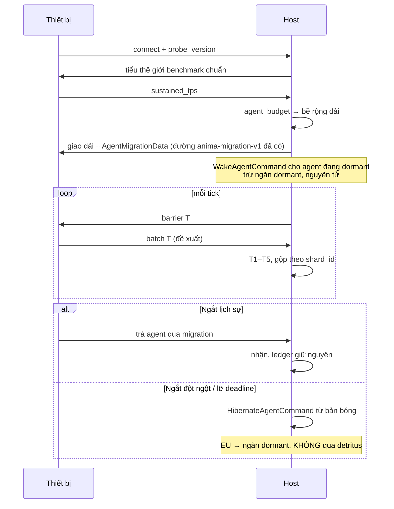

# Design — Tính toán phân tán theo thiết bị

> Bộ tài liệu đầy đủ: [Requirements — Thế giới sống](../requirements/2026-08-25-feature-living-world.md).

Mục tiêu: **nhiều máy cùng góp sức tính cho một thế giới**. Máy nào kết nối thì nhận 1–vài sinh
vật tuỳ cấu hình phần cứng; máy host cũng chạy 1–nhiều sinh vật tuỳ sức mạnh của nó. Sinh vật có
thể **xuất hiện hoặc biến mất** trên bản đồ tuỳ theo thiết bị có đang góp sức hay không.

---

## 1. Hạ tầng đã có — đây không phải xây từ đầu

Repo đã có phần khó nhất của một hệ phân tán:

| Đã có | Symbol | File |
|---|---|---|
| Phân dải thế giới theo cổng | `ShardingConfig { local_port, left_target_port, right_target_port }` | `core/components.rs:441` |
| Vận chuyển agent qua WebSocket | `anima-migration-v1`, ack `accepted`/`rejected` | `core/networking_systems.rs` |
| Payload agent đầy đủ | `AgentMigrationData` — genotype, brain, homeostasis, lineage, generation | `core/components.rs:160` |
| Trần cho input không tin cậy | `MAX_MIGRATION_MORPHOLOGY_NODES = 128`, `MAX_MIGRATION_BRAIN_PARAMETERS = 16_384`, frame ≤ 1 MiB, ≤ 64 kết nối | `core/components.rs`, `networking_systems.rs` |
| Chống nhân đôi sinh khối | chỉ rejection version-1 tường minh mới trả quyền sở hữu | `networking_systems.rs:405` |
| Phân cấp tải theo khoảng cách | `LodTier`, `tier_at`, `LodBands` | `core/simulation_lod.rs` |
| Can thiệp của người quan sát là *khai báo* | `ObserverPolicy`, `ObserverTrace` | `core/observer.rs`, ADR-0004 |

Thiết kế này mở rộng chúng, không thay thế. Cụm comment tại `networking_systems.rs:405` cho thấy
vấn đề "nhân đôi sinh khối giữa các shard" **đã được nghĩ tới** — đó chính là vấn đề trung tâm của
tài liệu này, ở quy mô lớn hơn.

---

## 2. Vấn đề trung tâm: thiết bị tắt máy thì năng lượng đi đâu?

[`ENERGY_LEDGER_CONTRACT.md §3`](../../reference/ENERGY_LEDGER_CONTRACT.md) nói:

> **Mọi thay đổi năng lượng phải nguyên tử với thay đổi vòng đời gây ra nó.**

Và §5 chốt `RESIDUAL_ABS_TOLERANCE_EU = 1e-3` với ghi chú không được nâng ngưỡng để test xanh —
kèm số đo thật: sau 120.000 tick, residual là **0.000000000**.

Nếu một laptop gập lại và 40 sinh vật biến mất, **40 lượng EU biến mất cùng chúng**. Residual nhảy
lên hàng trăm EU và mọi gate năng lượng đỏ. Đây không phải rủi ro xa; đây là hệ quả trực tiếp của
yêu cầu "sinh vật biến mất khi thiết bị ngắt".

### Lời giải: **biến mất khỏi bản đồ ≠ biến mất khỏi sổ**

Tách hai khái niệm đang bị gộp:

| | Hiện diện trên bản đồ | Hiện diện trong ledger |
|---|---|---|
| Đang được thiết bị tính | ✅ thấy, cử động, tương tác | ✅ trong ngăn `animals` |
| Thiết bị ngắt | ❌ **không thấy** | ✅ **vẫn giữ nguyên EU**, trong ngăn `dormant` |
| Chết | ❌ không thấy | reserve → `detritus`, nguyên tử |

Thiết bị ngắt ⇒ agent **ngủ đông**, không chết. Người dùng thấy đúng hiệu ứng họ muốn — sinh vật
biến mất khi máy rời đi và trở lại khi máy quay lại — còn sổ sách không mất một EU nào.

**Ngăn thứ tư `dormant`** thêm vào ba ngăn hiện có (plants, animals, detritus). Nó nằm trong
baseline, nên `lock_baseline` vẫn chốt một lần và residual vẫn đóng.

Lệnh mới, nguyên tử tại một sync point — cùng khuôn với `ReclaimAndDespawnAgentCommand`:

```rust
/// Chuyển agent sang ngăn `dormant` và despawn entity tại CÙNG một sync point.
/// Không đi qua detritus: đây không phải cái chết.
pub struct HibernateAgentCommand { entity: Entity, reason: DormancyReason }

/// Đường ngược lại. Trừ `dormant`, spawn từ phenotype đã lưu — KHÔNG develop lại (D01).
pub struct WakeAgentCommand { snapshot: DormantAgent, at: Vec3 }
```

`WakeAgentCommand` **MUST NOT** gọi development. Ngủ đông rồi thức dậy là cùng một cá thể; theo
D01/D02 nó giữ nguyên phenotype và giữ nguyên brain, y như migration.

---

## 3. Vai trò và ba chính sách liên bang

### 3.1 Vai trò

| Vai trò | Sở hữu | Không sở hữu |
|---|---|---|
| **Host** | world artifact, `EnergyLedger`, lineage, kho asset, phân công, quyết định cuối | không bắt buộc phải tự tính hết |
| **Contributor** | tick agent được giao, trong dải không gian được giao | không được tạo agent, tạo EU, ghi lineage |

Host cũng chạy một contributor cục bộ với ngân sách theo phần cứng của chính nó — đúng yêu cầu
"máy host cũng chạy 1–nhiều sinh vật tuỳ sức mạnh".

### 3.2 Ba chính sách — sao chép đúng khuôn ADR-0004

[ADR-0004](../../decisions/ADR-0004-observer-as-declared-intervention.md) gặp đúng bài toán này ở
dạng khác: camera của người xem quyết định agent nào được suy nghĩ, nên **chỗ người ta nhìn** trở
thành một đầu vào của thế giới. Câu trả lời không phải cấm camera, mà là **khai báo** nó:
`ObserverPolicy::{Absent, Spectate, Inhabit}`, với gate `spectate_matches_absent`.

Ai đang online cũng là một đầu vào y hệt. Dùng lại nguyên khuôn:

| `FederationPolicy` | Thiết bị ảnh hưởng quần thể | Quỹ đạo |
|---|---|---|
| `Solo` | không có thiết bị ngoài | đường tham chiếu |
| `Contribute` | thiết bị **chỉ góp CPU**; quần thể do host quyết | **bắt buộc bằng** `Solo` — gate `contribute_matches_solo` |
| `Inhabit` | thiết bị đến/đi làm sinh vật xuất hiện/biến mất | một **treatment khác**, không phải bản nhiễu của `Solo` |

Điều này giữ được cả hai thứ bạn muốn mà không phải chọn:

- `Contribute` cho **sức mạnh tính toán rời** — nhiều máy chia nhau tick một quần thể lớn hơn,
  và kết quả khoa học vẫn so được với chạy một máy.
- `Inhabit` cho **thế giới sống theo người tham gia** — sinh vật thật sự đến và đi cùng thiết bị.
  Nó vui hơn, và nó **không được** đem so với baseline; ghi rõ trong manifest là treatment riêng.

Trộn hai cái mà không dán nhãn là cách chắc chắn nhất để có một kết quả nghiên cứu không ai bảo vệ
được: không phân biệt nổi "loài này tiến hoá vì áp lực sinh thái" với "loài này tiến hoá vì bạn của
bạn tắt máy lúc 11 giờ đêm".

---

## 4. Xác định tất định dưới phân tán

Mạng giao gói tin theo thứ tự tuỳ hứng. Determinism contract §2 đã nêu đúng bài học này cho
executor đa luồng của Bevy: *bảo đảm không tranh chấp, không bảo đảm thứ tự*. Áp dụng:

1. **Lockstep theo tick barrier.** Host chỉ sang tick `T+1` khi mọi shard đã nộp `T`.
2. **Gộp theo thứ tự `shard_id`**, không theo thứ tự đến. Đây là điểm dễ sai nhất và rẻ nhất để
   làm đúng.
3. **Tương tác xuyên biên** giải quyết ở host, sau khi gộp, theo thứ tự đã sắp — không để hai
   shard cùng ăn một miếng thức ăn ở biên.
4. **RNG stream riêng cho mỗi shard**, dẫn xuất từ `WorldIdentity.seed` + `shard_id` + `tick`.
   Không shard nào rút từ stream sinh thái chung — cùng quy tắc mà AE3 đã phải tuân
   ([EVOLUTION_EXPERIMENT_CONTRACT](../../reference/EVOLUTION_EXPERIMENT_CONTRACT.md)).

**Cái giá:** máy chậm nhất định nhịp. Đây là đánh đổi thật, không né được, và nó dẫn thẳng tới §5.

---

## 5. Phần cứng → ngân sách agent

### 5.1 Đo, đừng hỏi

`navigator.hardwareConcurrency` và dung lượng RAM khai báo đều nói dối về **thông lượng bền vững**:
laptop tiết lưu nhiệt sau vài phút, máy ảo khai báo lõi không thật, trình duyệt nền bị hạn chế.

Vì vậy: chạy **benchmark chuẩn hoá** khi kết nối — `N` tick trên một tiểu thế giới tổng hợp cố
định — rồi đo `sustained_tps`. Cùng một tiểu thế giới cho mọi thiết bị, nên số so sánh được.

```rust
pub struct DeviceCapability {
    pub probe_version: u16,
    pub sustained_tps: f32,     // đo, không khai báo
    pub cost_per_agent_tick: f32,
    pub declared_threads: u32,  // ghi để chẩn đoán, KHÔNG dùng để tính ngân sách
}

pub fn agent_budget(cap: &DeviceCapability, cfg: &FederationConfig) -> u32 {
    let raw = cap.sustained_tps * cfg.headroom / cap.cost_per_agent_tick;
    (raw as u32).clamp(cfg.min_agents_per_device, cfg.max_agents_per_device)
}
```

- `min_agents_per_device = 1` — máy yếu vẫn nhận **ít nhất một** sinh vật. Đúng yêu cầu "1–vài".
- `headroom < 1.0` chừa biên cho tiết lưu nhiệt và cho chính giao diện của thiết bị đó.
- **Hiệu chỉnh lại** bằng trung bình trượt, có trễ (hysteresis). Không đổi ngân sách mỗi tick, hoặc
  quần thể sẽ dao động theo nhiệt độ CPU của người ta.
- Bỏ lỡ deadline liên tiếp ⇒ **giảm ngân sách trước**, chỉ đẩy ra khi vẫn lỡ.

### 5.2 Phân công không gian, không phân công rời rạc

Giao **một dải liên tục** cho mỗi thiết bị, không giao một tập agent rải rác. Tương tác là cục bộ,
nên lưu lượng xuyên shard tỉ lệ với **diện tích biên**, không với số agent. `ShardingConfig` hiện
đã là phân dải 1-D (`left_target_port`/`right_target_port`) — v1 giữ nguyên mô hình đó, mở rộng
sang lưới 2-D là việc sau và là quyết định riêng.

Ngân sách agent ⇒ **bề rộng dải**, không phải danh sách agent. Dải rộng ra hay hẹp lại khi ngân
sách đổi; agent đi qua biên bằng đúng đường migration đã có.

---

## 6. Mô hình tin cậy

Tính toán tình nguyện nghĩa là **client không tin được**. Với một dự án nghiên cứu, đây không phải
lo lắng về bảo mật mà về **tính toàn vẹn của kết quả**: một shard trả về số bịa sẽ làm hỏng chính
kết luận khoa học, và nó sẽ làm hỏng một cách im lặng.

Khuôn mẫu đã có sẵn trong repo: AI ngoài **chỉ được đề xuất**, host quyết định. Áp y hệt:

| Lớp | Kiểm | Vi phạm ⇒ |
|---|---|---|
| **T1** Trần cấu trúc | dùng lại `MAX_MIGRATION_*`, frame ≤ 1 MiB | từ chối gói |
| **T2** Bảo toàn năng lượng theo shard | ΔEU vào = ΔEU ra ± `1e-3` | từ chối batch tick |
| **T3** Hợp lý động học | dịch chuyển ≤ `v_max·Δt`; không teleport; vị trí hữu hạn | từ chối batch |
| **T4** Thẩm quyền | shard chỉ được ghi agent nó **được giao**; không tạo agent/EU/lineage | từ chối, cách ly shard |
| **T5** Kiểm tra chéo | host tính lại ngẫu nhiên ~1% batch, so checksum | lệch ⇒ cách ly, khôi phục từ bản bóng của host |

Host giữ **bản bóng** (shadow) của mọi agent đã giao, cập nhật ở mỗi barrier. Nó là nguồn khôi
phục cho cả ba trường hợp: ngắt đột ngột, T5 lệch, và shard bị đẩy ra.

**Ghi rõ, không vòng vo:** đừng mở host ra internet công cộng cho tới khi có xác thực contributor
và TLS. Code hiện tại giới hạn 64 kết nối và 1 MiB/frame — đủ cho LAN và cho một nhóm tin nhau,
chưa đủ cho một mạng tình nguyện mở. Đó là công việc có tên ở Slice F4, không phải giả định ngầm.

---

## 7. Vòng đời một thiết bị



Điểm mấu chốt ở nhánh `else`: host **không cần thiết bị hợp tác** để giữ sổ đúng. Bản bóng đủ để
ngủ đông toàn bộ agent của shard đó một cách nguyên tử.

---

## 8. Điều gì hiển thị cho người dùng

| Sự kiện | Trên bản đồ | Trong sổ |
|---|---|---|
| Thiết bị vào | agent thức dậy tại vị trí đã lưu, mờ dần hiện ra | `dormant` → `animals` |
| Thiết bị ra | agent mờ dần biến mất | `animals` → `dormant` |
| Agent chết | animation `Die`, xác thành detritus | reserve → `detritus`, nguyên tử |

Hai dòng đầu **phải** dùng hiệu ứng chuyển tiếp, không tắt đột ngột: một con vật biến mất tức thì
không phân biệt được với một lỗi render.

Bảng đóng góp (ai đang góp bao nhiêu agent, thông lượng bao nhiêu) là tính năng phụ rẻ tiền và
đáng làm — nó biến hạ tầng thành thứ nhìn thấy được, và nó là công cụ chẩn đoán khi một shard chậm.

---

## 9. Rủi ro

| Rủi ro | Dấu hiệu sớm | Ứng phó |
|---|---|---|
| **Mất EU khi thiết bị ngắt** | residual > `1e-3` | ngăn `dormant` + `HibernateAgentCommand` nguyên tử; gate G1.1 chạy trong cấu hình liên bang |
| Nhân đôi sinh khối khi agent qua biên lúc shard chết | tổng animal EU tăng | quyền sở hữu chuyển bằng ack tường minh; bản bóng là trọng tài |
| Máy chậm nhất kéo cả thế giới | tick rate tụt khi có thêm người | ngân sách theo `sustained_tps`, giảm trước khi đẩy ra |
| Kết quả nghiên cứu nhiễm bởi lịch online | không giải thích được một xu hướng | `FederationPolicy` khai báo; `Inhabit` không so với baseline |
| Shard gian lận/hỏng | checksum T5 lệch | cách ly + khôi phục từ bản bóng |
| Ngân sách dao động theo nhiệt CPU | quần thể phập phồng | trung bình trượt + hysteresis |
| Phơi host ra internet | — | không bật cho tới Slice F4 (auth + TLS) |

---

## 10. Điều thiết kế này **không** tuyên bố

- Không tuyên bố `Contribute` hiện đã bằng `Solo`. Đó là **gate phải chứng minh**, không phải
  tính chất được thừa hưởng.
- Không tuyên bố ngăn `dormant` đã tồn tại. Ledger hiện có **ba** ngăn; ngăn thứ tư là công việc
  thật và nó chạm vào `lock_baseline`.
- Không tuyên bố mô hình tin cậy chống được đối thủ có động cơ. T1–T5 chặn shard hỏng, shard lệch
  phiên bản và gian lận nghiệp dư. Chống đối thủ thật cần thiết kế riêng.
- Không tuyên bố transport hiện tại sẵn sàng cho internet mở. Nó sẵn sàng cho LAN và nhóm tin nhau.
- Không tuyên bố lưới 2-D. v1 là phân dải 1-D, đúng như `ShardingConfig` hiện có.
