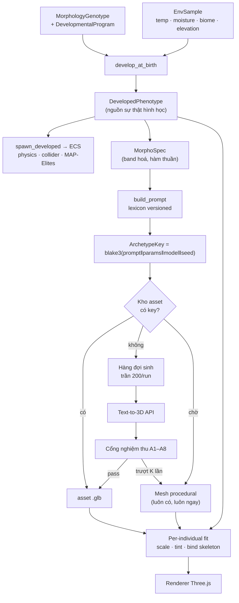

# Design — Từ genome tới mesh

> Bộ tài liệu đầy đủ: [Requirements — Thế giới sống](../requirements/2026-08-25-feature-living-world.md).

Sinh vật trong Anima-Engine hiện là **hình cầu bán kính cố định 1.6**
([`LiveAgents.tsx:44`](../../../src/components/Landscape/LiveAgents.tsx)). Tài liệu này thiết kế
đường đi từ đó tới model 3D thật, sinh bằng text-to-3D API, với đặc điểm suy ra từ gene và môi
trường thay vì do artist vẽ.

Quy tắc prompt nằm ở [`CREATURE_PROMPT_CONTRACT.md`](../../reference/CREATURE_PROMPT_CONTRACT.md);
tài liệu này thiết kế phần còn lại của pipeline.

---

## 1. Ý tưởng trung tâm: sinh theo **archetype**, không sinh theo cá thể

Đây là quyết định làm cho toàn bộ thiết kế chạy được, và nó đến từ một quan sát đơn giản.

Lexicon lượng tử hoá trait liên tục thành **band**. Hai con vật có `chiều_dài_chi = 0.61` và
`0.67` cùng ra cụm từ `long limbs` — nên chúng cùng ra **một prompt**, nên chúng dùng chung
**một mesh**. Cái phân biệt chúng trên màn hình là scale, tỉ lệ trục và màu, tất cả áp bằng
biến đổi rẻ và tất định trong process.

Ba hệ quả:

| | Sinh theo cá thể | Sinh theo archetype |
|---|---|---|
| Số lần gọi API / run | ~10⁵ | **≤ 200** (trần cứng P09) |
| Chi phí một run | ~5.000 USD | **≤ 10 USD**, một lần, run sau dùng lại kho |
| Độ trễ spawn | chờ mạng | **0** — procedural hiện ngay, asset thay khi sẵn sàng |
| Chất lượng hình | 10⁵ mesh chưa ai nhìn | ≤ 200 mesh **duyệt được từng cái** |
| Style nhất quán | trôi nổi | khoá bằng style lock + model pin |

Hàng cuối là hàng quan trọng nhất về mặt thẩm mỹ. Với 200 asset, một người có thể xem hết và
loại con xấu. Với 10⁵ thì không, và một thế giới có 3% quái vật dị dạng nhìn tệ hơn một thế giới
toàn capsule.

Cùng lúc, mỗi cá thể **vẫn giữ số đo riêng**: `Segment`, `SpatialCollider` và MAP-Elites
descriptor đọc `DevelopedPhenotype` như cũ. Mesh chỉ ngồi ở tầng hiển thị. Đó không phải nhượng
bộ — đó chính là điều cho phép một asset phục vụ hàng nghìn cá thể khác nhau.

---

## 2. Kiến trúc



Hai đường màu: **đường xanh luôn tồn tại** (procedural), **đường asset là nâng cấp**. Không có
mũi tên nào từ `API` hay `asset` quay ngược về `DevelopedPhenotype`.

### 2.1 Ranh giới sở hữu

| Thành phần | Sở hữu | Không được sở hữu |
|---|---|---|
| `develop_at_birth` | phenotype từ genotype × môi trường lúc sinh | prompt, mesh, asset |
| `MorphoSpec` | band hoá, phân loại body plan | gọi mạng, đọc môi trường hiện tại |
| `build_prompt` | chuỗi prompt + negative + params | quyết định sinh thái, I/O |
| Asset store | kho `.glb` theo `ArchetypeKey`, sổ trượt | bất kỳ số đo nào physics đọc |
| Cổng nghiệm thu | chấp nhận/từ chối mesh | sửa mesh cho "vừa" phenotype |
| Renderer | vật liệu, LOD, animation blend | suy lại màu/kích thước từ biome |

Dòng cuối là bẫy đã có gate: `Gate P5` của
[CREATURE_MORPHOGENESIS_PLAN.md](../../planning/CREATURE_MORPHOGENESIS_PLAN.md) yêu cầu renderer
không sample biome để đổi màu sinh vật. Nếu renderer tự tô theo ô đang đứng, con vật sẽ đổi màu
khi đi bộ và ta mất bằng chứng thích nghi qua cửa sau.

---

## 3. Đúng đặc điểm: prompt là điều kiện cần, không phải điều kiện đủ

Yêu cầu "các đặc điểm phải đúng" không giải được ở tầng câu chữ. Không prompt nào ép được một
model khuếch tán trả về đúng sáu chân. Thiết kế này đạt độ đúng bằng **bốn lớp chồng nhau**:

| Lớp | Làm gì | Bắt được gì |
|---|---|---|
| 1. Lexicon có kỷ luật | band rời rạc, từ vựng thị giác, không neo loài thật | prompt mơ hồ, prompt bleed |
| 2. Tham số nhà cung cấp | `seed`, `symmetry`, `topology`, `negative_prompt` | nhân hình, bất đối xứng, topo bẩn |
| 3. Cổng nghiệm thu A1–A8 | đo mesh trả về so với phenotype | sai tỉ lệ, thừa/thiếu khối, không skin được |
| 4. Duyệt một lần / archetype | mắt người | cái ba lớp trên không diễn đạt được |

Lớp 3 là lớp duy nhất thực sự *đo* đặc điểm, và nó chỉ khả thi vì số archetype nhỏ. Lớp 4 chỉ
khả thi vì cùng lý do. Kiến trúc archetype không phải mẹo tiết kiệm tiền; nó là **điều kiện tiên
quyết để kiểm soát chất lượng**.

Ba chế độ hỏng đã biết của text-to-3D và cách chặn:

| Chế độ hỏng | Chặn ở đâu |
|---|---|
| Con hai chân ra hình người | `human, humanoid, anthropomorphic` đứng đầu negative prompt |
| Nhắc "dog-sized" nhận về con chó | lexicon cấm neo động vật thật (§5.1 hợp đồng) |
| `no limbs` sinh ra chi | slot vắng mặt thay vì mệnh đề phủ định (§11 hợp đồng, ví dụ D) |

---

## 4. Per-individual fit

Asset là hình dáng; số đo là của cá thể. Áp theo thứ tự cố định:

1. **Chuẩn hoá** asset về hộp đơn vị theo trục dài nhất (A1, tất định).
2. **Scale không đều** theo `axial_len` và `mean_radius` của phenotype.
3. **Bind skeleton**: bone graph lấy từ `nodes`/`edges` của chính phenotype, skin weight từ hai
   bone gần nhất, normalize theo stable node id — cùng quy trình đã mô tả ở
   [§6.2 thiết kế Menagerie](./2026-08-04-feature-anima-menagerie.md).
4. **Tint** material theo `display_color` RGB **thật**, không theo tên band.
5. **Jitter** nhỏ, tất định theo hash của `agent_id`, để một đàn cùng archetype không trông như
   bản sao dán hàng loạt.

Bước 3 là bước có giá trị kỹ thuật cao nhất và dễ bị bỏ qua nhất: **ta đã biết bộ xương trước
khi có mesh**. Nghĩa là asset không cần rig kèm theo, không phụ thuộc auto-rigging của nhà cung
cấp (vốn thường chỉ tốt cho nhân hình), và nó cử động bằng chính CPG đang chạy trong mô phỏng.

---

## 5. Kho asset

```text
artifacts/creatures/
  <lexicon_version>/
    <archetype_key>.glb
    <archetype_key>.json      # prompt, params, model_version, seed, kết quả A1–A8, trạng thái duyệt
  rejected.jsonl              # key + lý do trượt + số seed đã thử
  manifest.json               # style lock, model pin, lexicon version, hash toàn kho
```

- Đặt dưới `artifacts/` cạnh `world_256.anmw` — cùng loại: dữ liệu sinh ra một lần, chia sẻ được,
  hash được.
- `manifest.json` khoá style lock và model version cho cả kho (P05). Đổi một trong hai là **kho
  mới**, không phải vá kho cũ.
- Kho **không** vào hash canonical của run (P08). Nó có hash riêng, công bố riêng.
- File `.json` cạnh mỗi `.glb` giữ đủ để tái sinh lại chính nó: prompt, params, seed, model.
  Không có nó thì asset là một file mồ côi không ai biết từ đâu ra.

---

## 6. Nhà cung cấp

Chưa chọn, và **không nên chọn ở giai đoạn thiết kế**. Tiêu chí đánh giá, xếp theo mức quyết định:

| # | Tiêu chí | Vì sao xếp ở đây |
|---|---|---|
| 1 | Cho **pin phiên bản model** | Model trôi nổi thì kho asset mất tính đồng nhất giữa các đợt sinh |
| 2 | Cho **tải asset về giữ vĩnh viễn** | Nếu asset chỉ sống trên server họ, dự án nghiên cứu không tái lập được |
| 3 | **License đầu ra** cho phép dùng/phát hành | Phải kiểm trước khi sinh 200 file, không phải sau |
| 4 | Có `seed`, `negative_prompt`, `symmetry` | Lớp 2 của §3 phụ thuộc vào đây |
| 5 | Mesh sạch, quad, skin được | Cổng A4/A7 |
| 6 | Chất lượng thẩm mỹ | Quan trọng, nhưng vô nghĩa nếu 1–3 trượt |

Ba tiêu chí đầu quyết định repo có tái lập được kết quả sau một năm hay không, nên chúng xếp trên
chất lượng hình. Bảng năng lực thực tế điền ở Slice 3 **sau khi đo**, không chép từ trang
marketing.

---

## 7. Vị trí của mesh procedural

Không bị bỏ. Nó là:

- **Đường mặc định** khi asset chưa có, đang sinh, hoặc trượt nghiệm thu (P07);
- **Đường duy nhất** khi `ANIMA_DETERMINISTIC` bật hoặc khi chạy headless trong CI;
- **Nền so sánh** để cổng A2 biết "đúng tỉ lệ" nghĩa là gì.

Nó không cần đẹp bằng asset. Nó cần **luôn có mặt, ngay, và đúng số đo**. Một capsule đúng kích
thước hữu ích hơn một khoảng trống chờ mạng.

---

## 8. Ngân sách và hiệu năng

| Đại lượng | Ngân sách | Ghi chú |
|---|---|---|
| Số archetype / run | ≤ 200 | P09, cấu hình được |
| Tam giác / asset sau decimation | ≤ 20.000 | A4 |
| Tam giác hiển thị / frame ở 1.000 agent | theo LOD hiện có | dùng lại `chunkLod`, instancing |
| `build_prompt` | hàm thuần, không cấp phát heap trong hot path | CLAUDE.md: `allocs == 0` |
| Sinh asset | **ngoài** tick loop, luồng riêng, có backpressure | P07 |
| Lần sinh đầu / archetype | phút, chấp nhận được | procedural che chỗ trong lúc chờ |

Điều **không** được phép: bất kỳ `await` nào giữa quyết định spawn và sinh vật xuất hiện.

---

## 9. Rủi ro

| Rủi ro | Dấu hiệu sớm | Ứng phó |
|---|---|---|
| Archetype nổ số lượng | trần 200 chạm liên tục trong run bình thường | lexicon quá mịn ⇒ gộp band, đo lại phân bố |
| Style trôi giữa các đợt sinh | thế giới trông chắp vá | `manifest.json` khoá model + style lock; đợt mới ⇒ kho mới |
| Nhà cung cấp đổi/ngừng model | asset mới lệch asset cũ | kho là bản sao cục bộ; sinh lại toàn kho là thao tác có tên |
| Asset bò vào đường sự thật hình học | có nơi đọc bbox mesh thay vì `Segment` | PR-S08 chạy trong CI |
| Mesh đẹp nhưng sai sinh học | con vật vùng lạnh không có lông | PR-S04 (không band chết) + duyệt A8 |
| Chi phí vượt dự kiến | sổ gọi API tăng | trần P09 là hằng số có tên, fail-closed |

---

## 10. Điều thiết kế này **không** tuyên bố

- Không tuyên bố prompt bảo đảm đặc điểm đúng. Độ đúng đến từ bốn lớp §3, và lớp 4 là mắt người.
- Không tuyên bố `develop_at_birth`, `DevelopedPhenotype`, `EnvSample` đã tồn tại. Kiểm 2026-08-25:
  **chưa có dòng nào**. `MorphoSpec` đọc từ `Segment` + `TerrainMap` ở Slice 1 và chuyển sang
  phenotype khi P1–P2 của morphogenesis plan xong.
- Không tuyên bố con số chi phí là giá hiện hành. Kết luận đến từ **số lần gọi**, không từ đơn giá.
- Không chọn nhà cung cấp, và không chép năng lực API từ tài liệu marketing.
- Không đổi hợp đồng nào đang có hiệu lực. Nhánh API là nguồn phụ thuộc ngoài mới, nên nó cần một
  ADR ghi nhận nó trong [`DETERMINISM_CONTRACT.md`](../../reference/DETERMINISM_CONTRACT.md) §2
  trước khi bật mặc định.
