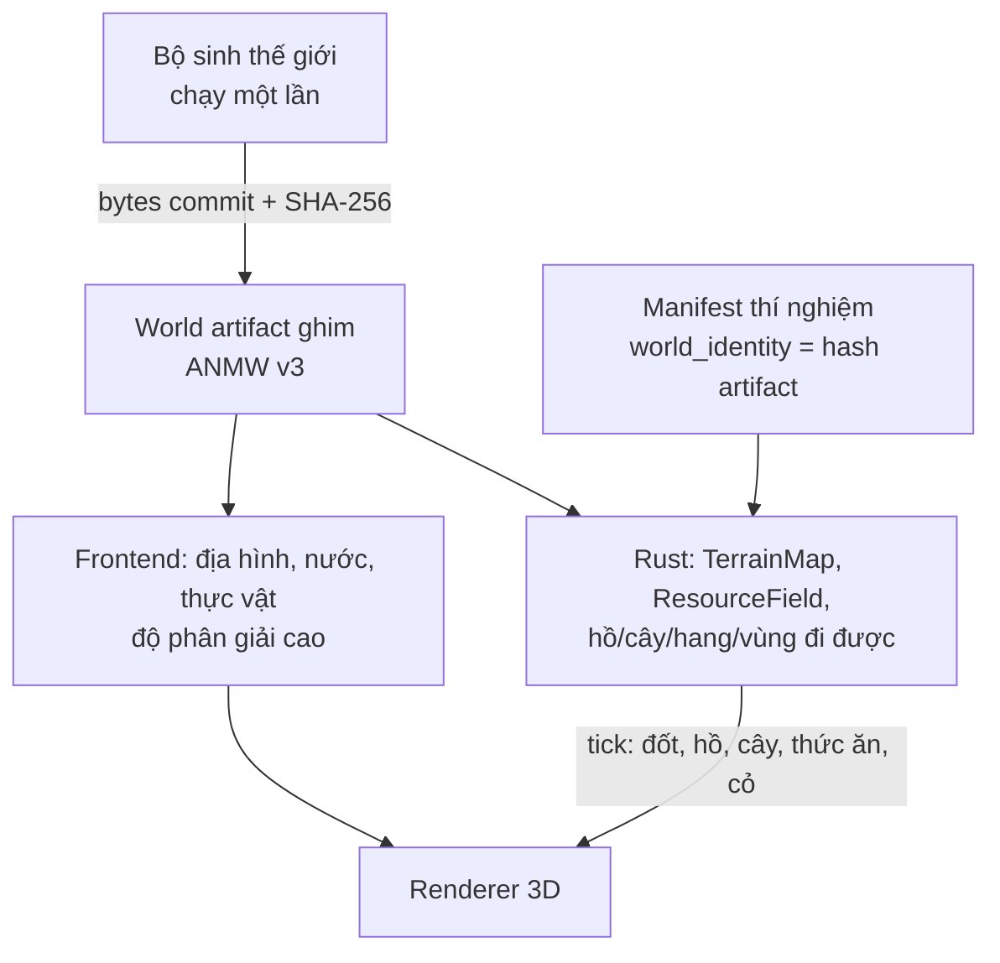

# Thế giới thật trên bản đồ và thân sinh vật mọc từ hình thái

## 1. Quyết định của chủ dự án (2026-11-19, trong chat)

| Câu hỏi | Trả lời |
|---|---|
| Bản đồ nhắm tới gì | **Cả hai**: bản đồ phải *là* thế giới đang mô phỏng, và phải đẹp, "đầy đủ dạng địa hình, núi, hang, rừng… giống như một thế giới thực" |
| Sinh vật trông thế nào | **Thân liền mọc từ hình thái**: hình dạng lấy từ các đốt, khớp và khối lượng của chính cá thể đó |
| Phong cách | **Bán hiện thực** |
| Thứ tự | **Song song** với SEL2-P, giao `anima-case` (Windows 1, RTX 5060 Ti) sau E3-P |

## 2. Hiện trạng đo được (đọc mã tại `91def40`)

**Bản đồ và mô phỏng là hai thế giới khác nhau.**
- Bản đồ 3D (`WorldShowcase.tsx`) vẽ thế giới do `worldGen.ts` sinh ở frontend: lưới 2048², 22 quần xã, hồ, sông, thác, hang, 14 loại thực vật. Cá, chim và thú nền (`WorldFish`, `WorldBirds`, `WorldWildlife`) là trang trí đặt theo băm.
- File gửi sang Rust (`save_world_artifact`, ANMW v2, 256²) chỉ có độ cao, độ ẩm, nhiệt độ, dòng chảy và quần xã. Nó **không có** nước, sông, hang, thác, độ dốc hay vị trí cây (`core/world_artifact.rs:13-29`). Khi đổi sang lưới của Rust, quần xã Lake (14) thành Ocean (1).
- Mô phỏng chỉ dùng quần xã để tính sức chứa cỏ `r_max`.
  - App (`SimulationEngine::start`) đặt 5 hồ và tối đa 50 cây ngẫu nhiên; có hồ rơi xuống biển.
  - Thí nghiệm (`LiveExperimentAdapter`) đặt hồ, cây và founder trên lưới đều, không theo địa hình.
- Hồ, cây và thức ăn của mô phỏng **không được vẽ** trong 3D. Chỉ vị trí x/z của sinh vật đến từ mô phỏng; y lấy từ mặt đất của frontend.
- Artifact Rust dùng lúc chạy nằm ở `$TMPDIR`, do frontend sinh. Bản commit (`artifacts/world_256.anmw`) chỉ test đọc. Bộ sinh JS dùng `Math.pow/exp/atan2`, nên không bảo đảm giống nhau giữa các engine JS; `determinism_matrix.md` ghi rằng mỗi hệ điều hành ra một thế giới.

**Sinh vật.**
- Mỗi tick (khoảng 30 Hz), payload gửi **vị trí và góc của từng đốt**, kèm `length`, `radius`, neo khớp và trục khớp. Payload không có khối lượng, góc khớp, pha CPG, giới tính, màu hay tuổi. `agent_id` có thể bị cá thể sau dùng lại.
- Cỡ payload ước khoảng 410 B JSON mỗi đốt, chưa từng đo.
- Renderer hiện tại vẽ ống trụ, cầu và nón instanced, tối đa 5 lệnh vẽ, LOD chỉ có gần/xa.
- 1.000 sinh vật khoảng chín đốt đã vượt trần tam giác của mức Low (548k so với 300k).
- Founder có ba đốt, neo lệch 1,0 trên thân bán kính 0,2, nên các đốt **không chạm nhau**. CPG xoay đốt quanh trục của chính nó, nên trên một ống trụ gần như không thấy chuyển động.

## 3. Nguyên tắc (giữ nguyên, không thương lượng)

1. **Chỉ vẽ cái mô phỏng có.** Một hồ, cây, hang hay sinh vật trên bản đồ phải là một thực thể hoặc một lớp của thế giới mô phỏng. Lớp chỉ để trang trí phải được đánh dấu là trang trí và không được trông giống dữ liệu (`readable-world` `:100-102`, `CREATURE_MORPHOGENESIS.md:309`).
2. **Hình dạng sinh vật đến từ dữ liệu.** Thân liền là một bề mặt nối các đốt và khớp mà Rust gửi, không phải một mô hình con vật có sẵn.
   - Màu: theo lớp cộng băm `agent_id` cho tới khi có pigment (D08, D09). Không bao giờ đổi màu theo quần xã mỗi khung hình.
   - Chuyển động trang trí (thở, nhún): xác định theo `agent_id`, không thay tư thế backend.
3. **Thế giới thí nghiệm không bị đổi ngầm.** SEL2-P, E3 và các run đã có giữ nguyên khoá và vị trí của chúng. Thứ thay đổi là renderer, để nó vẽ đúng các vị trí đó. Một thế giới mới cho thí nghiệm là một manifest mới.
4. **Ngân sách hiệu năng là cổng.**
   - 1.000 sinh vật trên Iris Xe ở mức Low vẫn phải đạt mục tiêu FPS của tier.
   - Ngân sách bundle chỉ được nâng trong cùng commit gây ra mức tăng, kèm lý do.
   - Không thêm thư viện: `three` đã có `SkinnedMesh`.

## 4. Kiến trúc đích

- **Một artifact ghim làm nguồn sự thật** (hướng A→B của `WORLD_SIMULATION_PLAN.md` §1.3 và §3.1A). Bộ sinh chạy một lần; byte được commit kèm SHA-256. Thế giới vì vậy giống nhau trên mọi máy, dù bộ sinh JS không xác định giữa các engine. Artifact v3 có thêm:
  - mực nước và lưu vực hồ;
  - mạng sông;
  - cửa hang và vùng hang;
  - mật độ và loại thực vật;
  - độ dốc và vùng đi được.
  
  Bản cao (1024² hoặc 2048²) cho renderer, bản 256² cho mô phỏng, cả hai sinh từ cùng một bản cao.
- **Mô phỏng đọc artifact.** App đặt hồ và cây theo lưu vực và rừng của artifact, không ngẫu nhiên. Manifest khai `world_identity` bằng hash artifact, và preflight từ chối artifact không khớp. Thí nghiệm đã đăng ký giữ cách đặt cũ.
- **Renderer vẽ thực thể của mô phỏng.** Gồm hồ, cây, thức ăn và mật độ cỏ (`ResourceField`, lớp phủ bật/tắt được), cộng địa hình và thực vật nền từ artifact. y của sinh vật lấy từ cùng mặt đất đó.
- **App mở được một manifest.** Lệnh IPC mới `start_from_manifest` dựng thế giới bằng đúng `build_live_world`. Nó đổi bề mặt IPC, nên phải sửa `IPC_CONTRACT.md` trong cùng commit.

### Tải theo vùng, như game thế giới mở (chủ dự án, 2026-11-19: "đi đến đâu mới render map đến đó")

- **Artifact lưu theo ô.**
  - Bản cao được cắt thành ô, ví dụ 128×128 ô lưới mỗi ô. Mỗi ô có vài mức chi tiết (mip): độ cao, quần xã, nước, sông, hang và danh sách thực vật của riêng ô đó.
  - Một chỉ mục ghi hash của từng ô, và SHA-256 của artifact là hash của chỉ mục.
  - Mô phỏng vẫn đọc bản 256² phủ cùng diện tích, nên thế giới mô phỏng và thế giới vẽ vẫn là một.
- **Renderer tải theo camera.**
  - Ô gần camera ở mức chi tiết cao nhất, ô xa ở mức thấp (quadtree hoặc clipmap).
  - Ô ra khỏi tầm nhìn cộng một vùng đệm thì được gỡ: giải phóng geometry, texture và instance thực vật.
  - Tải trên Web Worker để khung hình không giật; ô chưa tải xong dùng mức thấp hơn trong lúc chờ.
  - Xây trên `chunkLod.ts`, `floraChunks.ts` và `WorldTerrainLod` hiện có, không viết lại từ đầu.
- **Sinh vật cũng theo vùng.** Chỉ dựng `SkinnedMesh` cho sinh vật ở ô gần. Mô phỏng vẫn chạy cả thế giới; tải theo vùng chỉ áp dụng cho phần vẽ.
- **Ngân sách tính theo vùng nhìn thấy, không theo cả thế giới.** Nhờ vậy thế giới có thể lớn hơn hiện nay (2048²) mà bộ nhớ và số tam giác không tăng theo. Kích thước thế giới mô phỏng là một quyết định riêng, vì nó đổi luật sinh thái và thời gian chạy.
- Đo: thời gian tải một ô, số ô thường trú, bộ nhớ GPU, và FPS khi bay ngang bản đồ, trên cả ba máy.

### Thân sinh vật

- **Mesh theo archetype, không theo tick.**
  - Hình thái sinh ra một bề mặt liền: chuỗi capsule nối tâm các đốt qua neo khớp, làm mịn bằng convolution surface hoặc metaball, rồi lấy lưới ở độ phân giải cố định.
  - Mỗi đốt là một xương. Đỉnh được gán trọng số theo khoảng cách tới đốt.
  - Mesh được lưu theo khoá hình thái (hash của genotype nhìn thấy được). Vertex buffer **không bao giờ** đi trong payload.
- **Mỗi khung hình chỉ cập nhật ma trận xương** từ tư thế từng đốt đã nội suy (`agentInterpolation.ts`). Khoảng hở giữa các đốt của founder được da phủ theo đúng đường nối neo khớp, tức là vẽ liên kết khớp mà dữ liệu có.
- **LOD ba tầng:**
  1. Gần (bán kính `creatureFullDetailRadius` của tier, tối đa K con): `SkinnedMesh`.
  2. Giữa: capsule instanced đơn giản, hình hiện tại thu gọn.
  3. Xa: marker billboard.
  
  Tầng gần giới hạn theo số con chứ không theo tổng quần thể, để trần tam giác giữ được ở 1.000 con.
- **Chất liệu bán hiện thực:**
  - da PBR theo lớp (thú ăn cỏ, thú săn) cộng băm;
  - bóng tiếp đất;
  - mắt và đầu đặt theo đốt gốc và `head_direction`;
  - dáng đi theo tư thế đốt mà backend gửi.

## 5. Thẻ (chia nhỏ; thẻ chỉ frontend đi trước)

| Thẻ | Nội dung | Phụ thuộc | Ước lượng |
|---|---|---|---|
| **V1** | Renderer 3D vẽ hồ, cây và thức ăn của mô phỏng (từ `environmental_state`) cùng lớp phủ mật độ cỏ. Đặt y của sinh vật theo mặt đất. Gắn nhãn "trang trí" cho cá, chim, thú nền và hang chưa có trong mô phỏng. Chỉ sửa frontend | không | 1 ngày |
| **B1** | Thân liền cho tầng gần: mesh theo archetype, skinning theo đốt, LOD ba tầng, chất liệu PBR. Giữ test hiện có hoặc sửa có lý do; đo tam giác, lệnh vẽ và FPS ở 10/200/1.000 con. Chỉ sửa frontend | không | 2 ngày |
| **ADR-0010** | Artifact ghim là nguồn sự thật cho địa hình, nước, hang và thực vật; manifest khai `world_identity`; renderer vẽ thực thể của mô phỏng | chủ dự án chấp nhận | lead soạn |
| **W1** | ANMW v3: thêm các lớp ở §4, lưu theo ô có mip và chỉ mục hash; writer TS, reader Rust, test khứ hồi; bộ sinh chạy một lần ra bản cao và 256² commit kèm SHA-256 | ADR-0010 | 2–3 ngày |
| **W2** | App đặt hồ và cây theo artifact; preflight `world_identity`; lệnh IPC `start_from_manifest` | W1 | 2 ngày |
| **W3** | Địa hình bán hiện thực: terrain splat theo quần xã, normal map, nước có khúc xạ, thực vật instanced, bầu trời và sương. Hang: cửa hang và lòng hang nông (hang đi vào được cần voxel, theo `WORLD_DESIGN.md` §0, để sau) | W1 | 3 ngày |
| **W4** | Tải theo vùng: artifact theo ô có mip, nạp và gỡ ô theo camera trên Web Worker, thực vật và sinh vật theo ô; đo thời gian tải ô, bộ nhớ GPU, FPS khi bay ngang bản đồ | W1 (định dạng ô), W3 | 3 ngày |
| **B2** | Payload: thêm khối lượng đốt, góc khớp hoặc pha CPG, giới tính, id ổn định có generation; mã hoá gọn hơn JSON; đo byte mỗi tick (gate CM-S10) | ADR-0010 hoặc một card IPC riêng | 2 ngày |
| **G** | Cổng: Animal Map Vision cho tám góc nhìn chuẩn; FPS ba máy (RW-C5); 1.000 sinh vật ở Low trên Iris Xe | tất cả | người làm, khoảng 1 giờ |

Mốc nhìn thấy đầu tiên (V1 + B1) mất khoảng 3 ngày công của một agent. Toàn bộ, kể cả tải theo vùng (W4), mất khoảng 3 tuần, tuỳ cổng hiệu năng.

## 6. Cần chủ dự án quyết

1. **Chấp nhận ADR-0010** (artifact ghim là nguồn sự thật; manifest khai `world_identity`). Đây cũng là câu đang mở trong `determinism_matrix.md`.
2. **Bỏ qua thứ tự trong `CREATURE_MORPHOGENESIS_PLAN.md:36`** ("không làm renderer 3D mới trước khi payload 2D và hợp đồng phenotype ổn định"). Lựa chọn "thân liền" ngày 2026-11-19 làm điều đó. Rủi ro: khi `DevelopedPhenotype` xuất hiện, phần dựng mesh phải đọc phenotype thay vì genotype và sẽ phải sửa.
3. **Mục tiêu hiệu năng cho phong cách bán hiện thực.** Có giữ 30 FPS ở Low trên Iris Xe với 1.000 sinh vật không, hay chấp nhận giảm số sinh vật ở tầng gần?

## 7. Không khẳng định

- Không khẳng định hình ảnh mới đúng về sinh học. Nó chỉ hiển thị trung thực hình thái và vị trí do mô phỏng sinh ra.
- Không đổi luật hay kết quả của bất kỳ thí nghiệm nào đã đăng ký.
- Hang đi vào được, cá, chim và thú nền chỉ có thật khi một thẻ mô phỏng thêm chúng; trước đó chúng là trang trí có nhãn.
