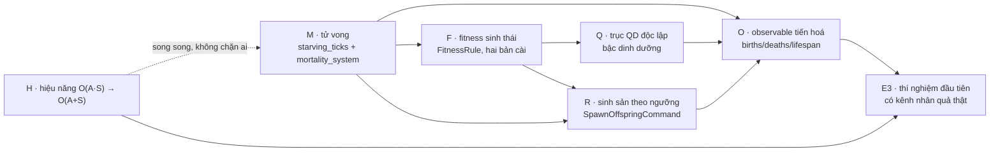

# Plan — Đóng vòng sinh thái

---

## 1. Nguyên tắc thứ tự

1. **Cái rẻ nhất mở khoá nhiều nhất, làm trước.** Tử vong (M) là mục nhỏ nhất trong sáu nhánh và
   là điều kiện tiên quyết của bốn nhánh còn lại. Cơ chế trả năng lượng cho nó đã viết xong.
2. **Không nhánh nào được đo bằng một thí nghiệm trước khi nhánh nó phụ thuộc xanh.** Đây là bài
   học đắt nhất từ E2: một thí nghiệm chạy trên một kênh nhân quả chưa tồn tại sẽ cho một số 0 và
   tốn đúng bằng một thí nghiệm thật.
3. **H (hiệu năng) chạy song song, không xen vào.** Nó là refactor thuần và có gate riêng
   (checksum trước/sau). Nó không chặn ai và không ai chặn nó — nhưng kết quả khoa học ở quy mô
   10 cá thể thì không nói được gì, nên H phải xong **trước** khi chạy thí nghiệm nghiêm túc.
4. **Không mở nhánh R trước khi M và F đều xanh.** R giả định cả hai. Bật R sớm là tạo ra một
   quần thể vừa không chết vừa sinh vô hạn.

---

## 2. Đồ thị phụ thuộc

Mũi tên đứt: H không phụ thuộc và không bị phụ thuộc, nhưng **E3 cần cả O và H** — một thí nghiệm
cần vừa đo được tiến hoá vừa có đủ cá thể để tiến hoá có nghĩa.

---

## 3. Nhánh M — Tử vong

| ID | Việc | Điểm chèn | Bằng chứng |
|---|---|---|---|
| M-1 | `starving_ticks: u32` vào `HomeostaticState`, `#[serde(default)]` | `ai/hrrl.rs:6` | snapshot round-trip |
| M-2 | Tăng/reset trong `metabolic_decay_system` | `core/world_systems.rs:121-178` | unit test |
| M-3 | `MortalityPolicy` resource + đọc `ANIMA_MORTALITY` | `core/resources.rs` | test cờ tắt ⇒ trùng bit |
| M-4 | `mortality_system` gọi `ReclaimAndDespawnAgentCommand` | file mới, khai trong `simulation_schedule.rs` | MO-S01…MO-S04 |
| M-5 | Ghi lịch trình: sau `metabolic_decay`, trước `ecosystem_census` | `core/simulation_schedule.rs` | test thứ tự |

**Gate M:** MO-S01…MO-S05 ở [testing](../testing/2026-08-25-feature-ecological-selection.md).
**Rollback:** đặt `ANIMA_MORTALITY` về unset. Không có trạng thái nào tồn tại ngoài một `u32` mà
snapshot cũ đọc thành 0.

---

## 4. Nhánh F — Fitness sinh thái

| ID | Việc | Điểm chèn | Bằng chứng |
|---|---|---|---|
| F-1 | `trait FitnessRule` + `LocomotionFitness` chép **nguyên văn** dòng hiện tại | file mới | FI-S01 trùng bit |
| F-2 | `EcologicalFitness` đọc `AgentEvaluation` | cùng file | FI-S02 |
| F-3 | Bỏ `_` ở `_eval, _homeo`, truyền vào luật | `core/agent_systems.rs:523` | biên dịch + FI-S01 |
| F-4 | `ANIMA_FITNESS` + trường trong `ExperimentManifest` | `core/resources.rs`, `core/experiment.rs` | FI-S04 provenance |
| F-5 | `id()` vào tick capture export và provenance ensemble | `core/tick_capture.rs` | FI-S04 |

**Gate F:** FI-S01…FI-S05. **Rollback:** `ANIMA_FITNESS=locomotion` (mặc định).

> ⚠️ F-1 là dòng quan trọng nhất của cả nhánh. `LocomotionFitness` phải chép **đúng** biểu thức
> hiện tại, kể cả nếu nó trông thừa. Viết lại cho gọn — ví dụ đổi thứ tự hai số hạng `f32` — có thể
> đổi kết quả làm tròn và làm N3 trượt, và triệu chứng sẽ hiện ra ở một checksum cách đó rất xa.

---

## 5. Nhánh Q — Trục mô tả độc lập

| ID | Việc | Điểm chèn | Bằng chứng |
|---|---|---|---|
| Q-1 | Bộ đếm EU nạp theo nguồn (thực vật / mồi) trên agent | `core/components.rs` | unit test |
| Q-2 | `trophic_ratio` từ bộ đếm | `core/ecology.rs` | QD-S01 |
| Q-3 | Đổi `ecological_descriptors` trục 2, cập nhật doc comment | `core/ecology.rs:170` | QD-S02 độc lập với fitness |
| Q-4 | `descriptor_set_id` vào archive đã lưu; `from_saved` **từ chối** id lệch | `evolution/map_elites.rs:58-110` | QD-S03 |

**Gate Q:** QD-S01…QD-S03. **Rollback:** không có rollback rẻ — Q đổi hợp đồng archive. Vì vậy Q
phải đi **sau** F, khi đã biết công thức fitness cuối cùng không chứa quãng đường.

---

## 6. Nhánh R — Sinh sản theo ngưỡng

> Nhánh rủi ro nhất. Chỉ bắt đầu khi M và F đã xanh.

| ID | Việc | Điểm chèn | Bằng chứng |
|---|---|---|---|
| R-1 | `ReproductionPolicy` + `ANIMA_REPRODUCTION` | `core/resources.rs` | RE-S05 loại trừ epoch |
| R-2 | `SpawnOffspringCommand` — một `Command`, hai vế ledger tại một sync point | `core/agent_systems.rs` | RE-S01 EU đóng |
| R-3 | `reproduction_system`, ngưỡng + trần + counter bị chặn | file mới | RE-S02, RE-S03 |
| R-4 | Ghi cạnh lineage **trong cùng command** | `evolution/lineage.rs` | RE-S04 không cạnh mồ côi |
| R-5 | Preflight: bật cùng lúc với epoch replacement là lỗi cấu hình | `core/experiment.rs` | RE-S05 |

**Gate R:** RE-S01…RE-S05. **Rollback:** `ANIMA_REPRODUCTION` unset ⇒ thay thế theo epoch chạy
như cũ.

---

## 7. Nhánh O — Quan sát được tiến hoá

| ID | Việc | Điểm chèn | Bằng chứng |
|---|---|---|---|
| O-1 | Nối `shannon`/`simpson` từ chỗ đã tính vào observable | `core/simulation_loop.rs:2192`, `core/live_experiment.rs:721` | OB-S01 |
| O-2 | Phân bố khối lượng: mean/var/p10/p90 | `core/live_experiment.rs` | OB-S02 |
| O-3 | `births`/`deaths`/`mean_lifespan` theo cửa sổ | cùng file | OB-S03 |
| O-4 | `archive_coverage` | `evolution/map_elites.rs` | OB-S04 |
| O-5 | Preflight fail khi xin observable mà cấu trúc không tồn tại | `core/experiment.rs` | OB-S05 |

**Gate O:** OB-S01…OB-S05. **Rollback:** observable mới không phát ra là hành vi hợp lệ khi cấu
trúc vắng mặt; không có gì để rollback.

---

## 8. Nhánh H — Hiệu năng

| ID | Việc | Điểm chèn | Bằng chứng |
|---|---|---|---|
| H-1 | Chỉ mục segment→agent theo mẫu `combat_system` | `core/world_systems.rs:121, 236, 337, 436, 454` | PF-S01 checksum trùng bit |
| H-2 | Cùng mẫu cho `update_agent_evaluation_system` | `core/agent_systems.rs:468` | PF-S01 |
| H-3 | Cùng mẫu cho `detect_environmental_collisions_system` | `core/environmental_systems.rs:282` | PF-S01 |
| H-4 | `sensory_system` hỏi `SpatialHashGrid` thay vì quét tuyến tính | `core/agent_systems.rs:877, 890` | PF-S01, PF-S02 |
| H-5 | Đo `full_tick` p50 ở 1000 agent, **bản release**, qua `ANIMA_TICK_CAPTURE` | `BENCHMARK_BASELINE.md` | PF-S03 |

**Gate H:** PF-S01…PF-S03. **Rollback:** revert. H không thêm cờ nào — nó không được đổi hành vi
nên không cần cờ.

> ⚠️ H-5 **cần một con người bấm chạy**: CLAUDE.md cấm chạy full backend trên máy dev, và bốn lệnh
> capture là IPC-only. Agent làm H-1…H-4 và dừng ở H-5, báo cáo rằng nó cần một lần chạy tay.

---

## 9. Điểm dừng có kiểm soát

Feature này có ba mốc mà tại đó dừng lại vẫn là một trạng thái tốt:

| Dừng sau | Trạng thái | Có gì |
|---|---|---|
| **M + H** | Thế giới có cái chết và chạy được ngàn cá thể | Sức chứa môi trường xuất hiện; chưa đo được tiến hoá |
| **M + F + Q + O + H** | Vòng sinh thái đã đóng và đo được | Đủ để tiền đăng ký và chạy thí nghiệm E3 |
| **+ R** | ALife quần thể mở | Bùng–sụp, r/K, đồng tiến hoá có chỗ xuất hiện |

Mốc giữa là mốc đáng nhắm nhất. Nó đóng đúng vòng nhân quả mà báo cáo khảo sát nêu, và nó không
mang rủi ro phân kỳ quần thể của R.

---

## 10. Việc kế tiếp, sau khi feature xong

Không thuộc phạm vi feature, nhưng đây là chỗ ghi để phiên sau không phải tìm lại:

- **E3 — thí nghiệm đầu tiên có kênh nhân quả thật.** Tiền đăng ký theo đúng khuôn E2. Câu hỏi
  đề xuất: *một gradient NPP giữa hai biome có tạo ra phân hoá khối lượng cơ thể không?* Metric
  chính lấy từ nhánh O, không lấy từ 11 observable cũ.
  > 📌 **Cập nhật 2026-08-26 — dự thảo đã có, và nó đổi nhân tố.** Đọc mã cho thấy câu hỏi đúng
  > nguyên văn ở trên chưa trả lời được: `biome_npp()` là hàm hằng của `BiomeType` (không có núm
  > chỉnh), bản đồ biome cố định ở seed `1337`, và các observable khối lượng của nhánh O là **toàn
  > cục** nên không đọc được tương phản theo vùng. Dự thảo tiền đăng ký thay gradient-NPP-theo-biome
  > bằng gradient-năng-suất-bằng-can-thiệp (`Deforest` nửa Tây / `AddNutrient` nửa Đông, kéo dài),
  > và khai rõ nó đo **phân tán** chứ không đo **phân hoá không gian**:
  > [`2026-08-26-experiment-e3-productivity-gradient-body-mass.md`](2026-08-26-experiment-e3-productivity-gradient-body-mass.md).
  > Hai dụng cụ mở khoá câu hỏi gốc nằm ở §10 của tài liệu đó.
- **Công cụ đọc kết quả.** `anima-lab` quét lưới tham số, xuất CSV dạng tidy, và một trang HTML
  tự sinh từ `EnsembleSummary`. Thư mục E2 có `runs.csv`, `effects.json`, `paired-report.json`
  nhưng chưa có gì vẽ chúng.
- **Trình xem lại (replay).** Snapshot đã lưu vị trí draw của RNG và round-trip đã có gate; tua
  lại một run đã lưu trong khung cảnh 3D là công cụ quan sát rẻ nhất còn chưa xây.
