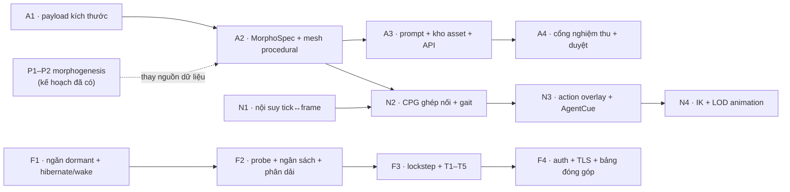

# Plan — Thế giới sống

Ba nhánh: **A** (appearance/mesh), **N** (animation), **F** (federated compute). Chúng chạy song
song được ở phần lớn thời gian; chỗ ràng buộc nhau ghi rõ ở §2.

---

## 1. Nguyên tắc thứ tự

1. **Cái nhìn thấy được trước.** A1 và N1 mỗi cái tự nó đã đổi hẳn hình ảnh sản phẩm, và cả hai
   không phụ thuộc gì. Làm chúng trước để có ảnh before/after sớm.
2. **Không nhánh nào được chặn bởi nhánh khác quá một bước.**
3. **Không mở nhánh AI trước khi có đường procedural đứng vững** — nếu không, một lỗi mạng sẽ trông
   giống một lỗi engine.
4. **Không bật liên bang trước khi ngăn `dormant` đóng sổ.** Đây là ràng buộc cứng duy nhất trong
   kế hoạch: bật trước là tự tạo ra một rò rỉ EU mà gate sẽ bắt được nhưng khó truy nguyên.

---

## 2. Đồ thị phụ thuộc

Mũi tên đứt: `MorphoSpec` đọc tạm từ `Segment` + `TerrainMap` ở A2, và **chuyển sang
`DevelopedPhenotype`** khi P1–P2 của
[CREATURE_MORPHOGENESIS_PLAN](../../planning/CREATURE_MORPHOGENESIS_PLAN.md) xong. Đây là nợ có
tên, không phải thiết kế cuối.

---

## 3. Nhánh A — hình thái

### A1 — Payload chở kích thước *(không phụ thuộc gì, làm được ngay)*

| ID | Việc | Điểm chèn | Bằng chứng |
|---|---|---|---|
| A1-1 | Thêm `length`, `radius` vào `SegmentState` | `core/simulation_state.rs:23` | serde snapshot |
| A1-2 | Điền từ component `Segment` trong tick payload builder | `core/simulation_loop.rs` | parity test |
| A1-3 | Sinh lại binding ts-rs | `src/types/generated/SegmentState.ts` | `git diff --exit-code` |
| A1-4 | Bỏ hằng `SEGMENT_RADIUS`, scale instance theo payload | `src/components/Landscape/LiveAgents.tsx:44,77` | Vitest + ảnh |

**Gate A1:** `cargo test --features desktop`, `npm run test:frontend`, `npm run build`, parity
Rust↔TS. Không thêm gate mới — dùng gate đã có.

### A2 — `MorphoSpec` và mesh procedural

| ID | Việc | Điểm chèn | Bằng chứng |
|---|---|---|---|
| A2-1 | Phân loại `BodyPlan` từ graph | crate thuần mới | PR-S04 fixture 0/2/4/6 chi |
| A2-2 | Band hoá size/build/limb/covering/color | crate thuần | PR-S01 |
| A2-3 | Compiler capsule → mesh liền, bone tại node origin | crate thuần, không import Three | GM-S02, GM-S03 |
| A2-4 | Renderer dùng mesh compiler thay `SphereGeometry` | `LiveAgents.tsx` | ảnh + benchmark |

**Gate A2:** GM-S01…GM-S05.

### A3 — Prompt, kho asset, API

| ID | Việc | Bằng chứng |
|---|---|---|
| A3-1 | `build_prompt` theo [`CREATURE_PROMPT_CONTRACT`](../../reference/CREATURE_PROMPT_CONTRACT.md) | PR-S01…PR-S07 |
| A3-2 | `ArchetypeKey`, kho `artifacts/creatures/`, manifest khoá style+model | PR-S05, PR-S06 |
| A3-3 | **Đo** năng lực 2–3 nhà cung cấp theo tiêu chí design §6; chốt một | bảng đo, không phải trang marketing |
| A3-4 | Client sinh ngoài tick loop, backpressure, trần P09 | PR-S09 |
| A3-5 | Fallback procedural ở mọi nhánh lỗi | PR-S08 |

**Gate A3:** PR-S01…PR-S10 + GM-S06…GM-S08.

### A4 — Nghiệm thu và duyệt

A1–A8 của [hợp đồng prompt §9](../../reference/CREATURE_PROMPT_CONTRACT.md), cộng UI duyệt một lần
cho mỗi archetype và sổ `rejected.jsonl`.

---

## 4. Nhánh N — animation

### N1 — Nội suy tick ↔ frame *(không phụ thuộc gì)*

Giữ hai payload gần nhất, nội suy vị trí tuyến tính và xoay bằng slerp theo `alpha` phân số.
Đây là **thay đổi có tác động thị giác lớn nhất trên mỗi dòng code** trong cả kế hoạch.

**Gate N1:** không giật theo nhịp tick ở 30/60/144 Hz; ảnh chuỗi khung.

### N2 — CPG ghép nối và gait thủ tục

| ID | Việc | Điểm chèn |
|---|---|---|
| N2-1 | CPG có ghép nối, lệch pha giữa các chi suy từ topology | `ai/cpg.rs` |
| N2-2 | Blend `Idle↔Walk↔Run` theo tốc độ, **giữ pha liên tục** | frontend + backend cue |
| N2-3 | `Sleep`/`Rest`: biên độ → 0 cộng dao động thở | |
| N2-4 | Fixture gait cho 0/2/4/6 chi | |

**Gate N2:** AN-S01…AN-S04.

### N3 — Action overlay và `AgentCue`

`Feed`/`Drink`/`Attack`/`Hurt`/`Die` là additive ngắn trên chuỗi trục và đầu. `AgentCue` per-agent
trong `SimulationTickPayload`, ≤ 20 byte.

**Gate N3:** AN-S05…AN-S07.

### N4 — IK và LOD animation

IK hai xương xuống `surfaceHeight`, chỉ `LodTier::Hot`. Dùng lại `tier_at`, **không** dựng hệ LOD
thứ hai.

---

## 5. Nhánh F — tính toán phân tán

### F1 — Ngăn `dormant` *(chặn toàn bộ nhánh F)*

| ID | Việc | Điểm chèn | Bằng chứng |
|---|---|---|---|
| F1-1 | Thêm ngăn `dormant` vào `EnergyLedger`, vào baseline | ledger | G1.1 trong cấu hình mới |
| F1-2 | `HibernateAgentCommand` — chuyển ngăn + despawn tại **một** sync point | cùng khuôn `ReclaimAndDespawnAgentCommand` | FD-S01 |
| F1-3 | `WakeAgentCommand` — trừ `dormant`, spawn từ phenotype, **không** develop lại (D01) | | FD-S02 |
| F1-4 | `dormant` vào save/restore (câu hỏi mở Q4 = **có**) | snapshot | FD-S03 |

**Gate F1:** residual ≤ `1e-3` qua chu kỳ hibernate → save → load → wake.

### F2 — Probe, ngân sách, phân dải

| ID | Việc | Ghi chú |
|---|---|---|
| F2-1 | Tiểu thế giới benchmark chuẩn, versioned | cùng một cho mọi thiết bị |
| F2-2 | `DeviceCapability` **đo**, không khai báo | `declared_threads` chỉ để chẩn đoán |
| F2-3 | `agent_budget` clamp `[1, max]`, trung bình trượt + hysteresis | tối thiểu **1** |
| F2-4 | Ngân sách → **bề rộng dải**, mở rộng `ShardingConfig` | giữ mô hình 1-D |

### F3 — Lockstep và tin cậy

| ID | Việc |
|---|---|
| F3-1 | Tick barrier; gộp theo **`shard_id`**, không theo thứ tự đến |
| F3-2 | RNG stream riêng mỗi shard từ `seed + shard_id + tick` |
| F3-3 | T1–T5 (trần, bảo toàn EU, động học, thẩm quyền, kiểm chéo 1%) |
| F3-4 | Bản bóng ở host; khôi phục khi ngắt/cách ly |
| F3-5 | `FederationPolicy::{Solo, Contribute, Inhabit}` + ghi vào manifest |

**Gate F3:** `contribute_matches_solo`, FD-S04…FD-S08.

### F4 — Vận hành

Auth contributor, TLS, rate limit, bảng đóng góp. **Không mở host ra internet trước bước này.**

---

## 6. Ba việc triển khai đầu tiên

Nếu chỉ làm được ba việc, làm ba việc này — mỗi cái độc lập, mỗi cái thấy được ngay:

1. **A1** — sinh vật có kích thước thật. Vài chục dòng, dùng dữ liệu backend đã biết.
2. **N1** — nội suy tick↔frame. Chuyển động hết giật.
3. **F1-1/F1-2** — ngăn `dormant` và lệnh hibernate. Không thấy được, nhưng nó mở khoá cả nhánh F
   và nó là thứ **phải** đúng trước khi bất kỳ thiết bị nào kết nối.

---

## 7. Rollback

| Nhánh | Cách tắt | Còn lại gì |
|---|---|---|
| A3–A4 | xoá kho asset / tắt cờ | mesh procedural, checksum không đổi (PR-S08) |
| A2 | quay lại `SphereGeometry` | A1 vẫn giữ kích thước thật |
| N2–N4 | tắt cue, vẽ tư thế tĩnh | N1 vẫn giữ chuyển động mượt |
| F2–F4 | `FederationPolicy::Solo` | chạy một máy như trước |
| F1 | **không rollback được sau khi có agent dormant** | vì vậy F1 phải đúng ngay lần đầu |

Hàng cuối là lý do F1 nằm ở đầu nhánh F và có gate riêng: một ngăn ledger đã chốt baseline không
gỡ ra được mà không viết migration.
