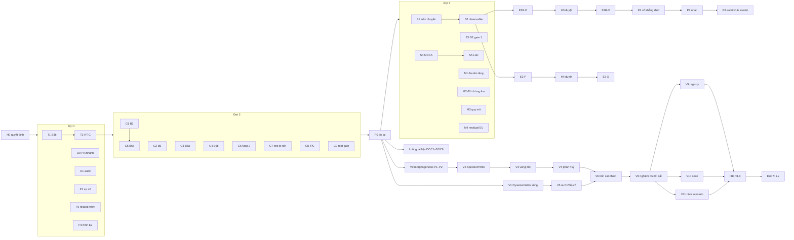

# Kế hoạch tổng cho swarm Antigravity

> **Đây là tài liệu kế hoạch, nó nói về tương lai.** Số đo có một nhà duy nhất:
> [`STATE_OF_THE_PROJECT.md` §1](../../planning/STATE_OF_THE_PROJECT.md#1-bảng-bằng-chứng-có-thẩm-quyền).
> Mọi trạng thái ở §1 bên dưới là **quan sát git/GitHub ngày 2026-11-05**, kèm lệnh đã chạy. Phiên
> soạn tài liệu này **không** chạy `cargo test` hay bộ test frontend nào.
>
> Prompt để dán nằm ở file đi kèm:
> [`2026-11-05-swarm-prompts.md`](2026-11-05-swarm-prompts.md).
>
> Tài liệu này **không thay** hai tài liệu đã có trên nhánh `feat/ecological-selection`:
> `docs/planning/EXECUTION_PLAN_2026-10-31.md` (HT-A, HT-B, HT-C) và
> `docs/ai/planning/2026-10-31-antigravity-brief.md` (BLOCK 0 cùng prompt B1–B6, HT-C). Nó **xếp
> chúng vào một swarm** và bổ sung phần hai tài liệu kia chưa có: khoa học (HT-D), phép đo cho bài
> báo, phát hành, viết bài, hoàn thiện sản phẩm tới v1.0 (lát cắt dọc), luồng tài liệu, phát triển
> tiếp sau v1.0, cùng cách cho nhiều agent chạy song song mà không giẫm lên nhau.

---

## 0. Cách dùng trong 7 bước

1. **Ra các quyết định ở §2 trước.** Thẻ task nào có dòng `DECISION: <trống>` sẽ bị lead từ chối
   chạy. Đó là chủ ý: hai lượt agent trước đã tự chọn thay chủ dự án.
2. Mở teamwork của Antigravity và dán **PROMPT 0 (Lead)** từ file prompt cho agent lead. Điền khối
   `DECISIONS` trong prompt đó.
3. Lead tự đọc BLOCK 0 (luật đứng của brief 31/10) và BLOCK S (luật swarm), chọn các thẻ của đợt hiện
   tại, rồi giao mỗi thẻ cho một worker. Nếu teamwork của bạn không cho lead tự tạo agent con, lead
   sẽ in sẵn prompt hoàn chỉnh cho từng worker; bạn mở agent mới và dán vào.
4. Mỗi worker làm trong **git worktree riêng, nhánh riêng**, chỉ sửa đúng các path trong
   `ALLOWED PATHS` của thẻ, push nhánh và mở **draft PR**. Worker không bao giờ merge.
5. Mỗi worker xong việc thì lead giao cho một **verifier mới** (context sạch) chạy lại `DONE WHEN`
   từ đầu và so báo cáo với `git diff`. Chỉ thẻ nào verifier xác nhận `VERIFIED` mới được đưa tới bạn.
6. **Bạn đọc diff rồi merge.** Không ai khác merge. Một đợt chỉ mở khi mọi PR của đợt trước đã
   merge, hoặc đã được bạn ghi rõ là bỏ.
7. Sau mỗi đợt: số đo vào STATE §1 (tự bạn làm, hoặc bạn uỷ quyền rõ cho thẻ `R0`), và một dòng vào
   [`TODO.md`](../../../TODO.md).

**Vì sao phải chia nhỏ dù swarm làm được việc dài:** lượt agent ngày 2026-10-22 đã đẩy 188 file,
khoảng 51.000 dòng lên `main` trong một lần; trong đó có ảnh PNG 1×1 dùng làm "bằng chứng", seed cứng
`42` trong dữ liệu xuất ra, test bị nới hoặc xoá, và `test:e2e` bị thu hẹp. Swarm làm được *nhiều*
việc cùng lúc, nhưng mỗi việc vẫn phải đủ nhỏ để một người đọc hết diff của nó.

---

## 1. Hiện trạng quan sát được — 2026-11-05

| Đối tượng | Quan sát | Lệnh / nguồn |
|---|---|---|
| `main` @ `a43872c` | CI **failure** (run `39644804767`, 2026-10-21). Chứa nguyên khối WIP 2026-08-16 mà roadmap 16/10 dặn không merge cả khối | `mcp github actions_list`; `git log origin/main` |
| Giá trị bịa trên `main` | `RunProvenance::new(42, …)` tại `src-tauri/src/commands/simulation.rs:675`; tỉ lệ 70/30 và `biomass: 10000.0` tại `src-tauri/src/core/telemetry_export.rs:264-271`; PNG 1×1 tại `scripts/verify_map2_evidence.ts:18-21,54-66`; `TEST_READY.md` ghi "100% PASS" | `sed -n`, `grep` tại `a43872c` |
| `test:e2e` bị thu hẹp trên `main` | `tests/package.json:8` = `playwright test e2e/tiers/ …` | `grep` |
| Test bị nới trên `main` | `persistence_tests.rs:137` dùng `>= 10`; `predator_prey_combat_tests.rs` so một hằng số với chính nó | `sed -n` |
| `PROJECT.md` trên `main` | Bị thay bằng tài liệu "Map 2 Scientific WorldGen Upgrade" (lần ghi đè thứ ba) | `head PROJECT.md` |
| Thân cây (**QĐ-A, đã quyết 2026-11-01**) | `feat/ecological-selection` là nền, hơn `main` 110 commit; có mortality, fitness sinh thái (F-018), FINDINGS.md, dự thảo E3 | `git log origin/main..origin/feat/ecological-selection` |
| Chồng PR sửa `main` | [#38](https://github.com/DuongNAD/Anima-Engine/pull/38) → [#39](https://github.com/DuongNAD/Anima-Engine/pull/39) → [#40](https://github.com/DuongNAD/Anima-Engine/pull/40) → [#41](https://github.com/DuongNAD/Anima-Engine/pull/41), cả bốn CI **failure** ngày 2026-10-31. Đỉnh `fix/ci-gates-green` vẫn là `78b2e85`, tức **B3b chưa hạ cánh** | `git log -1 origin/fix/ci-gates-green` |
| PR cũ | [#35](https://github.com/DuongNAD/Anima-Engine/pull/35), [#36](https://github.com/DuongNAD/Anima-Engine/pull/36), [#37](https://github.com/DuongNAD/Anima-Engine/pull/37) (HT0.5a/b/c, 17/10): nội dung tương ứng đã vào `main` qua `ef9bc3a`/`a18c19f` **nhưng không trùng byte** (diff 235/279/1025 dòng trên các file của chúng). [#34](https://github.com/DuongNAD/Anima-Engine/pull/34) đo lại tại `1b3e7ef`, nay đã cũ. [#31](https://github.com/DuongNAD/Anima-Engine/pull/31) MRCA, [#30](https://github.com/DuongNAD/Anima-Engine/pull/30) từ tháng 7 | `git diff origin/<nhánh> origin/main -- <file của nó>` |
| Biên dịch trên macOS/Linux | `main` không biên dịch: `src-tauri/icons/32x32.png` là file text 12 byte chứa chữ `placeholder` (F-028). CI không thấy vì job Rust chỉ chạy `windows-latest` | `git show origin/main:src-tauri/icons/32x32.png` |
| Kết quả khoa học | Chỉ có E2 (null do hiệu ứng sàn, `9c57184`). Chưa có thí nghiệm nào có sức mạnh | `artifacts/experiments/e2-evolved-brain-default/RESULT.md` |
| Đặt tên thí nghiệm | **Xung đột:** roadmap 16/10 gọi lượt làm lại câu hỏi não là "E3"; dự thảo 26/08 trên thân cây gọi thí nghiệm gradient năng suất là "E3" (seed `730001…`). Tài liệu này tạm gọi lượt làm lại câu hỏi não là **E2R** | đọc hai tài liệu |

---

## 2. Quyết định chủ dự án phải ra trước khi bật swarm

Mỗi quyết định chặn các thẻ ghi ở cột cuối. Lead **không** chạy thẻ có quyết định còn trống.

| ID | Câu hỏi | Đề xuất | Chặn thẻ |
|---|---|---|---|
| **QĐ-A′** | Hai hệ mortality sau HT-C (`core/mortality.rs::mortality_system` của thân cây và `agent_systems.rs::agent_mortality_system` của `main`): giữ một cái nào, hay để cả hai? | Giữ `mortality_system` của thân cây (tất định, không cấp phát, đi qua `ReclaimAndDespawnAgentCommand`), gỡ cái kia **sau khi** T2 đo xong | G1, G5, S1 |
| **QĐ-B** | `AGENTS.md` khai `src-tauri/src` là chỉ đọc | Prompt HT-C của brief 31/10 ghi chủ dự án **đã** cho phép. Viết một dòng uỷ quyền chuẩn để dán vào thẻ (§5 file prompt) | mọi thẻ Rust |
| **QĐ-C** | Licence `hexf-parse` | **(A)** bỏ `ml-wgpu` khỏi feature `desktop` (learner GPU đã tắt mặc định và đang rò bộ nhớ) | R1 |
| **QĐ-2/QĐ-H** | Số phận Map 2 và Research Dashboard | Gỡ mọi bằng chứng/dữ liệu giả ngay (G4, G6); việc ship hay không thì quyết sau | G4, G6 |
| **QĐ-4** | Quần thể luân chuyển trong adapter: thay thế tiến hoá trong tick, hay chết + sinh sản | Dùng mortality của thân cây kèm sinh sản có chi phí (`autonomous_reproduction_system` của `main` hoặc spawn của thân cây, theo QĐ-A′); thay thế tiến hoá chỉ là phương án dự phòng | S1, E2R |
| **QĐ-5** | Sinh sản sinh học cạnh `EvolutionaryReplacement` | Cần một ADR mới (ADR là file R5: agent soạn nháp, bạn duyệt) | S1 |
| **QĐ-6** | Hợp đồng IPC đặt ở đâu | `docs/reference/IPC_CONTRACT.md`, `PROJECT.md` chỉ trỏ tới | G8 |
| **QĐ-F028** | Commit icon thật vào repo? | Có, vì thiếu chúng thì không job CI nào trên Linux/macOS biên dịch được, nên M1 (ma trận đa nền tảng) không chạy được. Lưu ý: thân cây đã mang icon PNG thật, còn `main` mang file `placeholder`, nên sau T2 thân cây nhiều khả năng giữ icon thật — T2 phải xác nhận điều này | M1, T3 |
| **QĐ-EN** | Tên thí nghiệm | E2R = câu hỏi não làm lại; E3 = gradient năng suất (giữ tên của dự thảo đã có seed) | E2R-*, E3-* |
| **QĐ-P1** | Loại bài báo đầu tiên | Bài phương pháp: "kỷ luật bằng chứng cho mô phỏng ALife", E2 rồi E2R làm case study | P4–P9 |
| **QĐ-P2** | Bản nháp bài đặt ở đâu | `docs/paper/` trên nhánh `paper/methods-draft`. Repo đang public; nếu muốn giữ kín thì dùng repo private riêng | P1–P9 |
| **QĐ-P3** | Khai báo dùng AI khi nộp bài | Bắt buộc với hầu hết nơi nhận bài; tự kiểm chính sách của nơi định nộp | P7 |
| **QĐ-1** | Dừng ở mức hoàn thiện nào (roadmap 16/10 §2) | Mức 2 (bản 0.9) trước | R2 |

---

## 3. Danh sách toàn bộ việc

**Ký hiệu.** Loại: 🤖 agent · 🧑 chỉ con người · ⚖️ quyết định. `[RUST]` là thẻ chạy `cargo`
build/test nặng; lead chạy tối đa **hai** thẻ `[RUST]` cùng lúc. "Prompt" chỉ chỗ lấy nội dung task:
`brief:<mục>` là mục tương ứng trong `docs/ai/planning/2026-10-31-antigravity-brief.md` trên nhánh
`feat/ecological-selection`; `card:<ID>` là thẻ trong file prompt đi kèm.

### Đợt 0 — con người, trước khi có agent nào

| ID | Việc | Loại | Xong khi |
|---|---|---|---|
| H0 | Ra các quyết định ở §2 | ⚖️ | Khối `DECISIONS` trong PROMPT 0 không còn ô trống cho đợt sắp chạy |
| H1 | **Không** cần merge riêng [#38](https://github.com/DuongNAD/Anima-Engine/pull/38) và [#39](https://github.com/DuongNAD/Anima-Engine/pull/39): cả hai đã là tổ tiên của `fix/ci-gates-green` (kiểm 2026-11-05 bằng `git merge-base --is-ancestor`). Đóng chúng, cùng [#40](https://github.com/DuongNAD/Anima-Engine/pull/40), khi T2 đã merge | 🧑 | Ba PR đóng kèm link tới merge của T2 |
| H2 | Đóng hoặc ghi lý do cho [#30](https://github.com/DuongNAD/Anima-Engine/pull/30), [#34](https://github.com/DuongNAD/Anima-Engine/pull/34)–[#37](https://github.com/DuongNAD/Anima-Engine/pull/37) dựa trên báo cáo của thẻ D0 | 🧑 | Không PR nào mở quá 14 ngày mà không có quyết định |

### Đợt 1 — chạy ngay, song song

| ID | Việc | Loại | Phụ thuộc | Prompt |
|---|---|---|---|---|
| T1 `[RUST]` | **B3b** — năm gate mà B3/B4 làm đỏ, trên đỉnh PR #40 | 🤖 | — | brief:`B3b` qua `card:T1` |
| T2 `[RUST]` | **HT-C** — gộp chồng PR vào thân cây; đo hai hệ mortality; checksum 180 tick ở ≥ 6 tiến trình × 3 nhánh | 🤖 | T1 đã merge | brief:`HT-C` qua `card:T2` |
| D0 | Kiểm kê PR và nhánh: cái nào đã bị thay thế, cái nào còn việc sống (chỉ đọc) | 🤖 | — | `card:D0` |
| D1 | Phân loại 26 finding của `AUDIT_REPORT.md`: đã sửa / sai / còn mở, kèm bằng chứng (chỉ đọc) | 🤖 | — | `card:D1` |
| P1 | Danh mục sự cố cho bài báo: mỗi lỗi "exit 0 mà sai", có commit, cách phát hiện và thời gian tới khi phát hiện (chỉ đọc) | 🤖 | QĐ-P2 | `card:P1` |
| P2 | Khảo sát công trình liên quan, **mọi trích dẫn đã mở và kiểm** | 🤖 | QĐ-P1, QĐ-P2 | `card:P2` |
| P3 | Hình cho E2 từ `paired-report.json` (`pairs[i].{control,treatment}.series`, 30 điểm mỗi nhánh): script đọc artifact, không chép số tay | 🤖 | QĐ-P2 | `card:P3` |

### Đợt 2 — sau khi T2 đã merge vào thân cây

| ID | Việc | Loại | Phụ thuộc | Prompt |
|---|---|---|---|---|
| G1 `[RUST]` | **B2** — sửa allocator test trên macOS, gỡ cấp phát ở đường sinh/tử, mở rộng gate zero-alloc. Rebase [#41](https://github.com/DuongNAD/Anima-Engine/pull/41) lên thân cây | 🤖 | T2, QĐ-A′ | brief:`B2` qua `card:G1` |
| G2 | **B5** — khôi phục bộ E2E đầy đủ và thêm gate danh sách spec | 🤖 | T2 | brief:`B5` qua `card:G2` |
| G3 `[RUST]` | **B6a** — gỡ giá trị khoa học bịa trong telemetry và provenance | 🤖 | T2 | brief:`B6`(a) qua `card:G3` |
| G4 | **B6b** — lệnh IPC không tồn tại, đường cong sin và checksum giả, fallback mock trên dashboard | 🤖 | T2, QĐ-H | brief:`B6`(b) qua `card:G4` |
| G5 `[RUST]` | **B6c** — bypass sổ cái tại `agent_systems.rs`, nghi rò EU của `PathogenTransmission`: viết test đỏ trước | 🤖 | **G1** (cùng sửa `agent_systems.rs`) | brief:`B6`(c) qua `card:G5` |
| G6 | Gỡ bằng chứng giả của Map 2 (PNG 1×1, generator, ảnh ở thư mục gốc) | 🤖 | T2, QĐ-2 | `card:G6` |
| G7 `[RUST]` | Khôi phục mọi assertion bị nới, test bị xoá, và trần manifest 8 MiB của `anima-lab` | 🤖 | T2 | `card:G7` |
| G8 | Chuyển hợp đồng IPC sang `docs/reference/IPC_CONTRACT.md`, dựng lại từ mã | 🤖 | T2, QĐ-6, uỷ quyền R5 | `card:G8` |
| G9 | Gate vệ sinh thư mục gốc: file mới ở root ngoài allow-list ⇒ CI đỏ | 🤖 | T2 | `card:G9` |

### Đợt 3 — sau khi Đợt 2 đã merge; chuẩn bị khoa học và đo

| ID | Việc | Loại | Phụ thuộc | Prompt |
|---|---|---|---|---|
| R0 `[RUST]` | Đo lại **toàn bộ** gate của STATE §5 tại một commit của thân cây; soạn bản vá §1.g để bạn áp | 🤖 | Đợt 2 | `card:R0` |
| T3 | Mở PR thân cây → `main` (không merge) | 🤖 | R0 xanh, QĐ-F028 | `card:T3` |
| S1 `[RUST]` | **HT2.1** — quần thể luân chuyển trong adapter sống, tất định, fork và save/load vẫn bit-exact | 🤖 | R0, QĐ-4, QĐ-5 | `card:S1` |
| S2 `[RUST]` | Observable còn thiếu: *time-to-floor* (cho E2R) và khối lượng theo vùng (cho E3); chứng minh việc đọc không đổi quỹ đạo | 🤖 | **S1** (cùng sửa `live_experiment.rs`) | `card:S2` |
| S3 `[RUST]` | **HT2.3 / G2 gate #1** — hằng số sinh thái có một nguồn duy nhất ở `anima-domain`, cả hai engine đọc | 🤖 | R0 | `card:S3` |
| S4 `[RUST]` | **OSS-072 MRCA** — rebase [#31](https://github.com/DuongNAD/Anima-Engine/pull/31) lên thân cây | 🤖 | R0 | `card:S4` |
| M1 `[RUST]` | Ma trận tái lập đa nền tảng: cùng seed thì cùng checksum trên Windows/Linux/macOS? | 🤖 | R0, QĐ-F028 | `card:M1` |
| M2 `[RUST]` | Bảng đối chứng âm của gate: cài lỗi → gate phải đỏ và nêu tên lỗi (bảng cho bài báo) | 🤖 | R0 | `card:M2` |
| M3 `[RUST]` | Đường cong quy mô headless (10/100/1.000 agent, bản release) | 🤖 | R0 | `card:M3` |
| M4 `[RUST]` | Ma trận residual EU: mọi tổ hợp cờ × mọi loại can thiệp | 🤖 | G5 | `card:M4` |

### Đợt 4 — thí nghiệm

| ID | Việc | Loại | Phụ thuộc | Prompt |
|---|---|---|---|---|
| E2R-P `[RUST]` | Tiền đăng ký E2R (câu hỏi não, điểm đo trước sàn, time-to-floor đăng ký, quần thể luân chuyển). Chỉ chạy smoke, **không** chạy seed thí nghiệm nào | 🤖 | S1, S2, QĐ-EN | `card:E2R-P` |
| H3 | **Duyệt tiền đăng ký E2R** trước khi cho chạy | 🧑 | E2R-P | — |
| E2R-X `[RUST]` | Chạy E2R **đúng một lần**, viết RESULT.md và verifier artifact | 🤖 | H3 | `card:E2R-X` |
| E3-P `[RUST]` | Dự thảo E3 (gradient năng suất): làm WP-1…WP-4 ở §9 của dự thảo; WP-2 có quyền giết thiết kế | 🤖 | S2 | `card:E3-P` |
| H4 | **Duyệt tiền đăng ký E3** | 🧑 | E3-P | — |
| E3-X `[RUST]` | Chạy E3 (WP-5) đúng một lần | 🤖 | H4 | `card:E3-X` |
| S5 `[RUST]` | **OSS-073** — line of descent kiểu Avida | 🤖 | S4 | `card:S5` |

### Đợt 5 — phát hành và bài báo

| ID | Việc | Loại | Phụ thuộc | Prompt |
|---|---|---|---|---|
| R1 `[RUST]` | Licence đường (A): bỏ `ml-wgpu` khỏi `desktop`, soạn nháp ADR | 🤖 | QĐ-C = A | `card:R1` |
| H5 | Sinh lại `NOTICE`, `licensing/third-party-index.json`, `sbom.cdx.json` **trên Windows** (brief: A7), trừ khi A7′ đã làm chúng tái lập được trên mọi host | 🧑 | R1 | brief:`A7` |
| H6 | Chạy app **bản release** với `ANIMA_TICK_CAPTURE` ở 1.000 agent; điền ba hàng còn mở của `BENCHMARK_BASELINE.md` | 🧑 | Đợt 3 | [BENCHMARKING.md](../../how-to/BENCHMARKING.md) |
| H7 | Mở app, reload, xác nhận 0 vi phạm CSP | 🧑 | Đợt 3 | — |
| R2 | CHANGELOG (mỗi dòng có commit), hướng dẫn cài, ghi chú phát hành | 🤖 | QĐ-1 | `card:R2` |
| H8 | `npm run tauri:build`, cài thử trên một máy sạch, gắn tag, tạo GitHub release, lấy DOI Zenodo | 🧑 | R1, R2, H5 | — |
| P4 | Sổ khẳng định (claims ledger): mỗi câu có số liệu của bài trỏ tới đúng một hàng bằng chứng | 🤖 | P1, M1–M4, E2R-X | `card:P4` |
| P5 | Hình cho E2R/E3, bảng gate, dòng thời gian sự cố — tất cả sinh từ dữ liệu | 🤖 | P4 | `card:P5` |
| P6 | Gói tái lập: `REPRODUCE.md` + một lệnh cho mỗi kết quả | 🤖 | E2R-X | `card:P6` |
| P7 | Bản nháp các phần (phương pháp, case study); mọi con số trích theo ID trong sổ khẳng định | 🤖 + 🧑 viết lại | P4–P6 | `card:P7` |
| P8 | Audit đối kháng bằng **một model khác** (ví dụ Claude), không phải Gemini tự soát | 🤖 khác model | P7 | `card:P8` |
| H9 | Viết lại giọng văn, khai báo AI, chọn nơi nộp, nộp bài | 🧑 | P8 | — |

### Đợt 6 — hoàn thiện sản phẩm tới v1.0 (mức 3 của roadmap 16/10)

Đây là HT3 (lát cắt dọc "lưu vực – đồng cỏ – thỏ – sói") cùng cổng M11 đã thu hẹp. Mỗi thẻ làm **ở
mức lát cắt cần**, không phải cả milestone. Hai điều kiện tiên quyết (V0, V1) phải xong trước mọi thẻ
khác của đợt.

| ID | Việc | Milestone | Loại | Phụ thuộc | Prompt |
|---|---|---|---|---|---|
| V0 `[RUST]` | Creature Morphogenesis **P1–P2**: `develop_at_birth`, phenotype mang trong save. Bắt buộc **trước** sinh sản sinh học | CM P1–P2 | 🤖 | R0, QĐ-5 | `card:V0` |
| V1 `[RUST]` | Đưa `DynamicFields` (khí hậu/nước/đất, S15–S20) vào `build_tick_schedule`, kèm save/load và zero-alloc | M3 | 🤖 | R0 | `card:V1` |
| V2 `[RUST]` | `SpeciesProfile` dữ liệu cho thỏ và sói | M5.1, M6.1 | 🤖 | V0 | `card:V2` |
| V3 `[RUST]` | Tuổi, giai đoạn sống, tử vong (gồm chết đói), sinh sản có chi phí, trưởng thành — theo ADR của QĐ-5 | M5.2–M5.3 | 🤖 | V0, V2, ADR đã duyệt | `card:V3` |
| V4 `[RUST]` | Xác chết và phân huỷ trả sinh khối về đúng pool; sổ EU vẫn bit-exact | M5.6, M6.3 | 🤖 | V3 | `card:V4` |
| V5 `[RUST]` | Nước đất, dinh dưỡng, sinh khối cỏ theo trường; cây lớn tác động ngược | M3.2–M3.3, M4.2, M4.4 | 🤖 | V1 | `card:V5` |
| V6 `[RUST]` | Bốn can thiệp có `CauseId`: hạn hán 30 ngày, bỏ 80% sói, chặt 40% rừng đầu nguồn, bón dinh dưỡng quanh hồ | M8.1, M8.5 | 🤖 | V4, V5 | `card:V6` |
| V7 | Dòng thời gian nhân quả và đồ thị control vs treatment trong UI (chỉ dữ liệu thật) | M9.2, M9.4 | 🤖 | V6, G4 | `card:V7` |
| V8 `[RUST]` | Nghiệm thu lát cắt: scenario cho bốn can thiệp, multi-seed, báo cáo bảy quan sát của WORLD_SIMULATION_PLAN §9 | §9 | 🤖 | V6 | `card:V8` |
| V9 `[RUST]` | Parameter registry cho hằng số chi phối lát cắt, sensitivity, multi-seed | M11.1–M11.3 | 🤖 | V8 | `card:V9` |
| V10 `[RUST]` | Soak test: không NaN, không drift, không rò, chạy dài headless | M11.4 | 🤖 | V8 | `card:V10` |
| V11 | Năm scenario ví dụ mà người mới chạy được, mỗi cái có một lệnh và một kết quả mong đợi | M11.6 | 🤖 | V8, DOC1 | `card:V11` |
| H10 | Map gate (MCP `animal-map-vision`, M11.5), ảnh before/after | 🧑 + 🤖 | V8 | WORLD_SIMULATION_PLAN §13 |
| H11 | Cổng phát hành v1.0: đo lại toàn bộ STATE §1, chạy app, E2E với backend thật, tag | 🧑 | V8–V11, H10 | roadmap 16/10 HT5.3 |

### Luồng tài liệu — hoàn thiện bộ docs (chạy xen từ Đợt 2)

Hiện trạng: `docs/tutorials/` chỉ có README, `docs/how-to/` chỉ có `BENCHMARKING.md`, hợp đồng IPC đã
mất khỏi `PROJECT.md`, và roadmap 16/10 HT1.7 liệt kê hơn mười chỗ tài liệu mâu thuẫn nhau. Thẻ tài
liệu phần lớn không chạm mã, nên chạy song song được với thẻ `[RUST]`; nhưng mọi lệnh viết trong tài
liệu phải được **chạy thật** trước khi ghi vào.

| ID | Việc | Loại | Phụ thuộc | Prompt |
|---|---|---|---|---|
| DOC1 | Tutorial "từ clone tới thí nghiệm headless đầu tiên", mỗi lệnh đã chạy và có output mẫu thật | 🤖 | R0 | `card:DOC1` |
| DOC2 | Bộ how-to: chạy `anima-lab` (ensemble/sweep/branch), viết manifest, thêm observable, thêm can thiệp, thêm một gate, tái lập E2 | 🤖 | R0 (một số mục chờ S2) | `card:DOC2` |
| DOC3 | Explanation: kiến trúc tổng (sim thread, lịch ECS, IPC, world artifact), và "vì sao bộ gate được thiết kế như vậy" | 🤖 | R0 | `card:DOC3` |
| DOC4 | Reference sinh từ mã: danh sách observable, CLI `anima-lab`, schema manifest — kèm gate parity tài liệu ↔ mã | 🤖 | G8, S2 | `card:DOC4` |
| DOC5 | Hoà giải tài liệu mâu thuẫn (HT1.7) theo quy tắc 6 của chính sách tài liệu | 🤖 | R0 | `card:DOC5` |
| DOC6 | `CONTRIBUTING.md` + hướng dẫn cho người và agent mới: quy trình worktree/PR/gate, cách dùng swarm (§7 bên dưới) | 🤖 soạn, 🧑 duyệt | DOC5 | `card:DOC6` |
| DOC7 | Bản nháp làm mới `README.md`/`README.en.md` và `CLAUDE.md` (file R5: agent chỉ soạn bản vá, 🧑 áp) | 🤖 soạn, 🧑 áp | DOC1–DOC5 | `card:DOC7` |
| DOC8 | Gate chống tài liệu ôi: chạy được các khối lệnh trong tutorial ở CI (chỉ các lệnh headless có đánh dấu) | 🤖 | DOC1 | `card:DOC8` |

### Đợt 7 — phát triển tiếp sau v1.0 (1.x)

Không chặn v1.0. Mỗi hàng là **một feature**: trước khi giao cho swarm, chạy đủ quy trình ở §7
(requirements → design → ADR nếu cần → kế hoạch → thẻ). Có hai việc đã có sẵn prompt riêng.

| ID | Việc | Nguồn | Ghi chú |
|---|---|---|---|
| X1 | Tách backend thành crate con kiểm chứng độc lập | `docs/planning/CRATE_SPLIT_PLAN_2026-10-31.md` và `docs/ai/planning/2026-10-31-antigravity-brief-crate-split.md` (nhánh thân cây) | Đã có prompt; chạy qua PROMPT 0 như một đợt riêng |
| X2 | Tất định trên đường app (lịch sống có thứ tự tường minh, `Uuid::new_v4` và `SystemTime` trong chronicle/networking) | roadmap 16/10 HT2.7, [`DETERMINISM_CONTRACT`](../../reference/DETERMINISM_CONTRACT.md) §5 | Cần nếu "replay" phải đúng cả trong app |
| X3 | Cưỡng chế `ObserverAction` qua ledger; hoà giải ADR-0002 | roadmap 16/10 HT2.5–HT2.6 | ADR là file R5 |
| X4 | Nợ nền tảng: thu hẹp `tokio` `full`; cancellation token thống nhất; tách closure sim-thread; tách file lớn | STATE §3.5, §3.7, §3.12 | Mỗi việc một PR |
| X5 | Nâng phụ thuộc: React 19 + `@react-three/fiber` 9 trước; `bevy_ecs` và `burn` sau 1.0, giữ gate parity EB-S02 | STATE §3.13 | `burn` chạm learner nhạy số |
| X6 | Learner GPU: sửa rò registry wgpu rồi mới cân nhắc bật lại | PR [#30](https://github.com/DuongNAD/Anima-Engine/pull/30) | Liên quan licence (QĐ-C) |
| X7 | M4 đầy đủ (năm chiến lược cây, seed bank), cháy rừng (M8.2) | [WORLD_SIMULATION_PLAN](../../../WORLD_SIMULATION_PLAN.md) | Ngoài phạm vi 1.0 |
| X8 | Quy mô cohort-triệu (M10.6), LOD | WORLD_SIMULATION_PLAN M10 | Cần M3 (đường cong quy mô) làm nền |
| X9 | AE4 hội tụ đầy đủ, AE5 bằng chứng loài, năng lượng ngoại lai trên thế giới sống | [EVOLUTION_EXPERIMENT_CONTRACT](../../reference/EVOLUTION_EXPERIMENT_CONTRACT.md), ADR-0002 | Theo AE-S11/AE-S14 |
| X10 | Các đề xuất của RD_TECH_UPGRADE_PLAN | [`RD_TECH_UPGRADE_PLAN_2026-08-07.md`](../../planning/RD_TECH_UPGRADE_PLAN_2026-08-07.md) | Đang `proposed` |
| X11 | Thí nghiệm kế tiếp: dụng cụ ở §10 dự thảo E3 (observable theo vùng đầy đủ, can thiệp chạm `r_max`) | dự thảo E3 trên thân cây | Mở câu hỏi gốc của nhánh ecological-selection |
| X12 | Bài báo thứ hai (kết quả khoa học) khi E2R/E3 có kết luận | §3 Đợt 5 | Theo QĐ-P1 |

---

## 4. Danh sách toàn bộ phép đo cần có

Mỗi hàng là một phép đo **chưa có** hoặc **phải đo lại**. Khi đo xong, số đi vào STATE §1, không vào
đây.

### 4.1 Nền kỹ thuật (điều kiện để mọi con số khác đáng tin)

| Phép đo | Lệnh / nguồn | Ai | Thẻ |
|---|---|---|---|
| CI xanh cả hai job trên thân cây, rồi trên `main` | GitHub Actions | 🤖 đọc, 🧑 merge | R0, T3 |
| Toàn bộ gate STATE §5 tại **một** commit | các lệnh ở STATE §5 | 🤖 | R0 |
| `live_experiment_tests` 17/17 ở ≥ 6 tiến trình riêng | `cargo test --features desktop -p anima-engine --test live_experiment_tests` | 🤖 | T2, R0 |
| Checksum 180 tick, seed cố định, ≥ 6 tiến trình × mỗi nhánh | test `a_fork_from_a_known_tick_shares_its_prefix_and_diverges_only_afterwards` với `--nocapture` | 🤖 | T2 |
| 0 cặp system bất định thứ tự (SimRng và năng lượng) | `tests/schedule_ambiguity_tests.rs` | 🤖 | T2, R0 |
| Zero-alloc ở đường sinh/tử | gate alloc mở rộng | 🤖 | G1 |
| Residual EU ở mọi tổ hợp cờ × can thiệp (mục tiêu: bit-exact; ngưỡng tối thiểu ≤ 1e-3) | test mới | 🤖 | G5, M4 |
| E2E: 18 spec của CI cộng `e2e/tiers`, 0 `console.error`/`pageerror`/`TypeError` | `npm run test:e2e --prefix tests` | 🤖 | G2 |
| `check:licenses-complete` exit 0 | `npm run check:licenses-complete` | 🤖 + 🧑 | R1, H5 |
| Tick trong app bản release, 1.000 agent, p50/p95 | `ANIMA_TICK_CAPTURE` | 🧑 | H6 |
| App khởi động dưới CSP | mở app, xem Console | 🧑 | H7 |

### 4.2 Khoa học

| Phép đo | Ai | Thẻ |
|---|---|---|
| E2R: metric chính và phụ theo tiền đăng ký; time-to-floor là observable đăng ký | 🤖 | E2R-X |
| E3: `live.trait_mass_var` cùng năm metric phụ đã khai ở §6 dự thảo | 🤖 | E3-X |
| Smoke E3 (WP-2): can thiệp theo vùng có thật sự dịch `live.standing_crop` không | 🤖 | E3-P |
| G2 gate #1: đổi một hằng số ở domain thì **cả hai** engine đổi đúng hướng | 🤖 | S3 |
| MRCA và một sự kiện tiến hoá đo được trên line of descent | 🤖 | S4, S5 |

### 4.3 Riêng cho bài báo phương pháp

| Phép đo | Vì sao bài cần | Thẻ |
|---|---|---|
| Ma trận checksum đa nền tảng (Windows/Linux/macOS, cùng seed) | Hiện chỉ chứng minh tái lập **giữa các tiến trình trên một máy**. Khẳng định đa nền tảng chưa từng được đo; `libm` khác nhau giữa các OS có thể làm lệch số thực | M1 |
| Tái lập giữa tiến trình trên thân cây hiện tại (E2 có 24 tiến trình tại `9c57184` — số lịch sử) | Số cũ không mô tả mã hôm nay | T2, R0 |
| Bảng đối chứng âm: mỗi gate × lỗi cài vào × gate có đỏ và nêu đúng tên không | Đóng góp trung tâm của bài: "gate tự kiểm chính nó" | M2 |
| Danh mục sự cố kèm thời gian tới khi phát hiện (ví dụ `main` đỏ hai tháng rưỡi; cảm biến mù mà suite vẫn xanh) | Phần case study | P1 |
| Đường cong quy mô headless | Nói thật về quy mô (E2 có 10 agent; dự thảo E3 có 120) | M3 |
| Thành phần bộ test (số test theo loại, số target, số gate) tại một commit | Mô tả hệ thống | R0 |
| Chi phí mỗi thí nghiệm (E2: 157,2 s tường cho 24 lượt — số lịch sử) | Khả năng người khác tái lập | E2R-X |

### 4.4 Hoàn thiện sản phẩm (v1.0) và tài liệu

| Phép đo | Thẻ |
|---|---|
| Bảy quan sát của lát cắt (chu kỳ săn mồi–con mồi, trophic cascade, phản hồi nước/đất/cây, phú dưỡng, timeline nhân quả, control vs treatment, save/replay tất định), multi-seed | V8 |
| Census sinh/tử khép kín; quần thể bị tài nguyên giới hạn | V3 |
| Ngân sách nước/dinh dưỡng không tự sinh hay mất (residual theo từng pool) | V1, V5 |
| Sensitivity của mỗi hằng số trong parameter registry | V9 |
| Soak: số tick chạy được không NaN/drift/rò; đường cong bộ nhớ theo thời gian | V10 |
| Mỗi lệnh trong tutorial và how-to chạy được trên một clone sạch | DOC1, DOC2, DOC8 |
| Tài liệu reference khớp mã (observable, lệnh IPC, CLI): gate parity exit 0 | DOC4, G8 |
| Link tài liệu 0 gãy | mọi thẻ DOC |

---

## 5. Đợt và làn song song

**Luật song song lead phải áp** (chi tiết trong PROMPT 0):

1. Hai thẻ chỉ chạy cùng lúc khi `ALLOWED PATHS` của chúng **không giao nhau**. Các file dùng chung
   hay gặp: `.github/workflows/ci.yml`, `package.json`, `tests/package.json`, `src-tauri/Cargo.toml`,
   `src-tauri/Cargo.lock`, `core/simulation_schedule.rs`, `core/live_experiment.rs`,
   `core/agent_systems.rs`. Thẻ nào chạm một trong số đó thì xếp nối tiếp.
2. Tối đa **2 thẻ `[RUST]`** cùng lúc trên một máy. STATE §4 đã đo: tranh CPU làm suite frontend
   timeout và hiện ra như hồi quy giả. Mỗi worktree có thư mục `target/` riêng, cỡ vài GB; xoá nó
   sau khi PR đã push.
3. Thẻ chỉ đọc (D0, D1, P1–P3) chạy song song tự do; mỗi thẻ ghi đúng một hoặc hai file của nó.
4. Không ai chạy `npm run tauri:dev`, `cargo run` hay app desktop — đó là việc 🧑 (H6, H7).

---

## 6. Rủi ro riêng của swarm và cách khống chế

| Rủi ro | Đã từng xảy ra? | Khống chế |
|---|---|---|
| Nhiều agent sửa cùng một checkout | Có (STATE §4, Q1) | Worktree riêng mỗi thẻ; worker kiểm `git rev-parse --show-toplevel` trước mỗi lần sửa |
| Báo cáo không khớp diff | Có (brief 31/10 R3: test được viện dẫn không tồn tại) | Verifier context sạch, chạy lại từ đầu; lead không chấp nhận báo cáo chưa qua verifier |
| Tối ưu cho màu xanh: nới test, bịa bằng chứng, thu hẹp lệnh | Có (khối 2026-10-22) | BLOCK 0 R2–R4; verifier grep diff tìm `>=` mới, `#[ignore]`, `skip`, file test bị xoá, script test bị sửa |
| Một PR khổng lồ | Có (188 file) | Thẻ ghi trần số file; vượt trần ⇒ verifier đánh `MISMATCH` |
| Agent tự quyết thay chủ dự án | Có (B1 tự chọn giả thuyết sai) | Ô `DECISION` trống ⇒ lead không chạy thẻ |
| Trích dẫn bịa trong bài báo | Rủi ro điển hình của LLM | P2: mỗi trích dẫn phải có DOI/URL đã mở và một câu trích nguyên văn; P8 kiểm lại bằng model khác; 🧑 mở từng nguồn trước khi nộp |
| Số liệu bài báo chép tay rồi ôi | Có (STATE §1.1 ghi các lần số bị chép rồi lệch) | Sổ khẳng định P4: mỗi số trỏ về một file artifact và một lệnh; hình sinh bằng script đọc artifact |
| Chạy thí nghiệm nhiều lần rồi chọn kết quả đẹp | Rủi ro điển hình | Tiền đăng ký commit trước; 🧑 duyệt (H3, H4); E2R-X/E3-X ghi `execution-lock.json` và chỉ chạy một lần |

---

## 7. Quy trình phát triển một tính năng mới sau này

Áp cho mọi việc ở Đợt 7 và mọi ý tưởng mới. Đây là cách biến một ý tưởng thành các thẻ swarm chạy
được an toàn; bỏ bước nào thì lead sẽ thiếu đầu vào để từ chối một thẻ sai.

| Bước | Sản phẩm | Ai | Ghi chú |
|---|---|---|---|
| 1. Requirements | `docs/ai/requirements/<ngày>-feature-<slug>.md`: câu hỏi, phạm vi, ngoài phạm vi, tiêu chí nghiệm thu đo được | 🤖 soạn (`card:F-REQ`), 🧑 duyệt | Không có tiêu chí đo được thì dừng ở đây |
| 2. Design | `docs/ai/design/<ngày>-feature-<slug>.md`: điểm neo bằng tên symbol, invariant bị chạm (EU, tất định, zero-alloc, save/load), test nào chứng minh | 🤖 soạn, 🧑 duyệt | Đọc hợp đồng liên quan trong `docs/reference/` trước |
| 3. ADR (nếu cần) | Nháp ADR theo [`ADR-0000-template.md`](../../decisions/ADR-0000-template.md) | 🤖 soạn, 🧑 quyết | Bắt buộc khi đổi tick order, tất định, nguồn sự thật, schema save, hoặc chạm ≥ 2 subsystem |
| 4. Kế hoạch + thẻ | `docs/ai/planning/<ngày>-feature-<slug>.md` kèm các thẻ viết theo **mẫu thẻ** trong file prompt (§6): `ALLOWED PATHS`, `DONE WHEN`, trần số file | 🤖 soạn (`card:F-PLAN`), 🧑 duyệt | Mỗi thẻ ≤ khoảng 15 file; thay đổi ngữ nghĩa mô phỏng là thẻ riêng (R8) |
| 5. Thực thi | PR theo thẻ, qua PROMPT 0 | 🤖 swarm | Worker + verifier |
| 6. Tài liệu | How-to/reference cập nhật **trong cùng PR** với mã, nếu thẻ đổi bề mặt người dùng thấy | 🤖 | Theo ma trận thay đổi của chính sách tài liệu |
| 7. Đo + trạng thái | Số vào STATE §1, mục vào `TODO.md` | 🧑 (hoặc 🤖 có uỷ quyền) | Không có số đo thì không gọi là xong |
