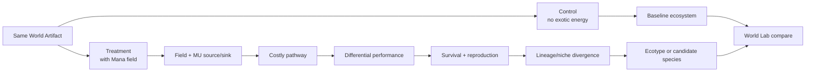

# Alternate Evolutionary Regimes

> *Vietnamese version / Bản tiếng Việt: [ALTERNATE_EVOLUTIONARY_REGIMES.vi.md](ALTERNATE_EVOLUTIONARY_REGIMES.vi.md).*

> **Implementation status, full-text audit 2026-11-17.** This document explains the target design model. What exists in code today is the headless slice AE1–AE3: manifests and runner, budgeted exotic-energy field, and selective reference population — all opt-in. **The live Bevy world has no MU field yet**: `LiveExperimentAdapter` rejects manifests declaring `laws.exotic_energy`. **World Lab (UI) does not exist yet**: control–treatment comparisons currently run headlessly only (`genesis_fork`, `checkpoint_fork`, `run_ensemble`, binary `anima-lab`) on the reference engine, not inside the user-visible world. [ADR-0002](../decisions/ADR-0002-world-laws-and-exotic-energy.md) was accepted on 2026-11-17 within the scope of the headless slice. Contract and gates: [`EVOLUTION_EXPERIMENT_CONTRACT.md`](../reference/EVOLUTION_EXPERIMENT_CONTRACT.md).
>
> How to read this page: any section describing functionality **not yet in code** carries an *Implementation status* note stating that fact explicitly. Sections without one were verified against the codebase on 2026-11-17.

## Core Idea

The goal is not to "add mana to make creatures stronger." The goal is to let a user introduce a novel law or resource early in a world's history and watch lineages independently discover divergent evolutionary strategies across generations.



Both branches can start from the exact same terrain, initial climate, biomass, and seed. The sole difference is `WorldLawSet`. Any subsequent divergence can therefore be attributed cleanly to the altered law rather than unrelated worlds.

## Why "Mana" Must Be a General Substrate

Game UI may display **Mana**, while core simulation code uses the generic module `core::exotic_energy`: `ExoticEnergyLaw` carries an `EnergySourceId` key and a `display_name` strictly for display, backed by `ExoticEnergyField`. There is no Rust type named `ExoticEnergy` or `ExoticEnergySource`. The same abstraction can model:

- geothermal energy;
- chemosynthesis near hydrothermal vents;
- radiation that a lineage learns to harvest;
- fictional energy-emitting crystals or particles;
- a supernatural field in a fantasy setting.

Each source can vary in topology, flux, decay, toxicity, and harvesting cost without building a separate magic engine.

## Four Layers That Must Stay Separate

### 1. World Law — What Can Exist

Illustrative example (not the literal schema: the actual fields of `ExoticEnergyLaw` are `source_model`, `topology`, `diffusion_rate`, `decay_rate`, plus required `unit`, `initial_amount`, `max_density`, `boundary`):

```text
exotic_energy:
  id: arcane_flux
  display_name: Mana
  mode: Renewable
  source_topology: PatchyHotspots
  source_rate: 0.02 MU/cell/ecology-tick
  diffusion: 0.08
  decay: 0.005
```

This is a run-level law, not an organism trait.

### 2. Environment Field — Where and When the Source Is Available

`ExoticEnergyField` stores density and flux by cell/chunk. It may be uniform, patchy, seasonal, tied to geology, or pulsed. The field must preserve a closed/auditable budget and render/inspect directly from simulated data.

*Implementation status:* the field stores per-cell MU density alongside MU ledger counters; topology supports `Uniform` or `Patchy`. There are no chunks, seasonal/geological coupling, or visual renderers yet.

### 3. Organism Pathway — How Creatures Exploit It

Genotypes can evolve:

- source sensing;
- uptake organs;
- internal storage;
- metabolic utilization;
- toxicity tolerance;
- hotspot-seeking behavior.

Every capability carries maintenance, morphological, or opportunity costs. An organism investing in mana inside a world with no mana can lose out to competitors without that overhead.

*Implementation status:* `EnergyPathwayGenotype` (`core/evolution_pathway.rs`) implements sensing, uptake, storage, utilization, tolerance, maintenance, and allocation, with maintenance paid whether or not MU is present. It belongs to the AE3 reference population (two aggregate cohorts rather than spatial map individuals), so "hotspot-seeking behavior" does not exist yet.

### 4. Evolutionary Outcome — What Persists Over Generations

The field does not "command" speciation. It changes the selection landscape. Morphs/species emerge via:

```text
variation → differential performance → survival/reproduction
→ trait frequency change → niche partition → lineage persistence
→ reduced gene flow / species-candidate threshold
```

## How Mana Interacts With Closed EU

The current MVP defines EU as biomass-equivalent and closed:

```text
plants + animals + detritus + dormant = constant
```

The `dormant` bucket holds the EU of hibernating agents and equals `0` whenever none are dormant ([`ENERGY_LEDGER_CONTRACT.md`](../reference/ENERGY_LEDGER_CONTRACT.md) §1.1).

Mana therefore uses its own unit, MU. The MVP forbids converting `1 MU → biomass from thin air`. Instead, MU may:

- offset part of work costs for locomotion, sensing, or thermoregulation;
- accelerate organism conversion of detritus/nutrients into biomass while still debiting matter from the closed EU pools;
- power trade-off-bearing defense, repair, or behavior;
- serve as a contested resource that structures ecological niches.

*Implementation status:* the four couplings above are design options; none are implemented yet. In the shipped slice, the MU field never writes into EU pools; spent MU translates purely into reproductive performance in the AE3 reference population.

If a future milestone allows mana to materialize physical mass, mass and physical-energy ledgers must first be separated under a new ADR.

## Source Modes to Support

| Mode | Meaning | Evolutionary Question |
|---|---|---|
| `Disabled` | No exotic source; baseline | Are costly pathways purged by selection? |
| `Finite` | Initial stock only, no regeneration | Boom–bust dynamics, contest competition, extinction debt |
| `Renewable` | Source rate and sink | Can stable specialists emerge? |
| `Pulsed` | Seasonal or event-driven pulses | Which wins: storage, dormancy, or migration? |
| `Patchy` topology | Heterogeneous hotspots | Do local adaptation and ecotypes partition space? |

MVP targets `Disabled` + `Renewable/Patchy`; remaining modes follow the same contract later.

*Implementation status:* the table above is the target roadmap. `ExoticSourceModel` implements `Renewable` only. Disabling the source corresponds to `exotic_energy = None` on `WorldLawSet`, and the code **intentionally omits** a `Disabled` enum variant so a present law can never be mistaken for baseline. `Finite` and `Pulsed` are not yet implemented; pulsing exists only as runtime forcing `ExoticInterventionKind::Pulse`. `Patchy` is a `SourceTopology`, not a mode.

## Candidate Organism Strategies That May Emerge

Species names are never hardcoded, yet recognizable ecological strategies may evolve:

| Selection Pressure | Candidate Strategy | Trade-Off Cost |
|---|---|---|
| Dense, stable Mana | High specialist uptake | Heavy organs, higher maintenance |
| Sparse/patchy Mana | Long-range sensors + migration/foraging | Locomotion and neural cost |
| Pulsed Mana | Large storage / dormancy | Slower reproduction or heavier body |
| Toxic Mana at high density | Tolerance / detoxification | Lower conversion efficiency |
| High consumer competition at hotspots | Territorial / social defense | Injury, stress, or group cost |
| Producer-only Mana uptake | Mana-producer-anchored food web | Dependency on the new trophic base |

These are hypotheses to test, not scripted outcomes.

## Two Meanings of "Act From the Earliest Stage"

### Genesis Fork

Change the world law before `t=0`. Run two histories across hundreds/thousands of generations. Answers:

> How does a world that always had mana evolve differently from baseline?

### Checkpoint Fork

Run a shared history to generation G, snapshot, then add or withdraw the source on one branch. Answers:

> How does an established ecosystem respond to, depend on, or recover when a law or resource changes?

Both are required; enabling mana mid-run cannot answer the genesis-history question.

*Implementation status:* checkpoint fork cannot alter `WorldLawSet`. Treatment branches apply runtime forcings carrying a `CauseId` (`AddSource`, `RemoveSource`, `Pulse`) on a world whose laws **already** declared the exotic source at genesis; exotic forcings on a world without an exotic law are rejected. Accordingly, "inject mana mid-run into a baseline world" is not yet expressible. `RemoveSource` halts source regeneration without draining existing MU.

## World Lab — What the User Inspects

*Implementation status:* this entire section is target design. No World Lab UI exists yet, and the desktop app backend has no fork or branch commands yet. Branch trees and comparisons exist headlessly (`core/branch_tree.rs`, `experiment_runner`).

### Map Overlays

- MU density, source flux, uptake, and depletion;
- existing biomass, resource, climate, water, and soil layers;
- pathway phenotype spatial distributions;
- birth, death, migration, and reproductive-success zones;
- niche/species clusters over time.

### Charts

- source → field → uptake → storage → expenditure flows;
- EU and MU budgets;
- trait/allele frequencies;
- population, species richness, extinctions;
- phenotype distributions and MAP-Elites coverage;
- emerging food-web edges;
- control–treatment effect sizes with confidence intervals.

### Inspector

Click a cell, organism, lineage, or species to view:

- current value and unit;
- time-series history;
- parent/root cause;
- genotype vs developed phenotype vs runtime state;
- energy transactions;
- ancestor/descendant links;
- rationale for candidate-species splitting or merging.

### Branch Timeline

World Lab displays the experiment tree:

```text
run-0 baseline
  ├─ run-1 mana from genesis
  ├─ run-2 mana patchy from genesis
  └─ checkpoint generation 100
       ├─ run-3 continue
       └─ run-4 remove mana
```

Users can replay runs, vary a factor, spawn branches, and compare trajectories along a shared timeline.

## How to Prove Differences Are Truly Evolutionary

Three tiers of evidence:

1. **Mechanism:** MU field and pathway yield transaction/performance differences consistent with contract.
2. **Selection:** pathway shifts survival or reproductive success; trait frequencies shift over generations.
3. **Divergence/speciation:** persistent, repeatable lineage, niche, or mating divergence across an ensemble.

Visually distinct creatures, a newly occupied MAP-Elites cell, or spatial hotspot correlation alone are descriptive only.

## Proposed Vertical Slice

Extend the `"watershed – grassland – rabbit – wolf"` vertical slice with a patchy Mana field:

- control: no Mana;
- treatment A: Mana accelerates producer detritus → plant biomass conversion;
- treatment B: add consumer pathway with sensing/uptake/storage/cost;
- treatment C: after 100 generations, remove Mana from the same checkpoint.

Observations:

- EU/MU budgets;
- plant/herbivore/predator dynamics;
- pathway frequencies;
- foraging range and morphology cost;
- niche divergence;
- extinction/recovery;
- causal chains;
- multi-seed effect sizes.

This vertical slice yields early observable outcomes without waiting for spells, fantasy combat, or full biological taxonomy.

*Implementation status:* treatment A is not implemented yet (MU is uncoupled from EU). Treatment B exists as the aggregate reference population rather than spatial rabbits and wolves on the map. Treatment C can already be represented via a checkpoint fork with `RemoveSource`.

## Honest Limitations

- The live Bevy world already has a deterministic experiment adapter (`LiveExperimentAdapter`: `ExperimentModel`), verified headlessly via `tests/live_experiment_tests.rs`. It has not yet run inside the multi-threaded desktop executor, rejects `laws.exotic_energy`, and contains no AE3 reference population. Legacy `SimModel` (M2) is implemented only by `ReferenceEcosystem`; AE1–AE3 run on `ReferenceEvolutionWorld`.
- No biological species clustering or species policy exists in code yet. Continuous energy-threshold reproduction exists (ADR-0005), not yet the M5–M7 lifecycle.
- The causal ledger currently stores a single parent and lacks multi-cause attribution.
- Visual map evidence (Animal Map Vision) does not exist yet and is excluded for the headless slice (ADR-0002, decision log dated 2026-11-17).
- Therefore, beyond the headless AE1–AE3 slice noted at the top of this page, this document is a design and experiment proposal, not a claim of running features.
