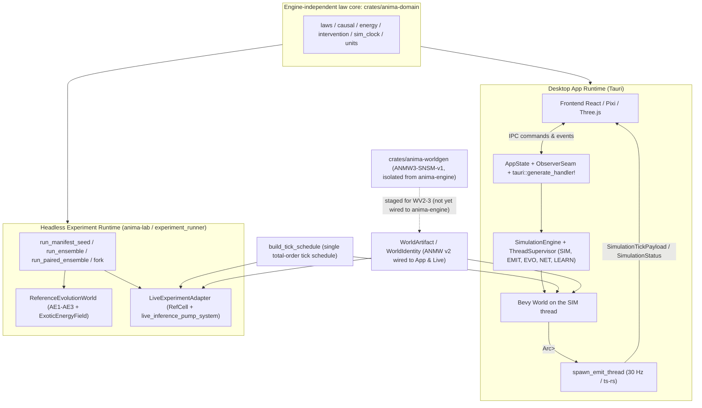

# System Architecture — Why the Boundaries Are Drawn Here

This document explains **why** Anima Engine places its crate boundaries, runtime threads, ECS schedule, IPC seam, world artifact, and experiment runners where they sit on trunk. It is Diátaxis *Explanation*, **not** a contract definition or measurement ledger:

- Directory and module inventory: [`PROJECT.md`](../../PROJECT.md).
- Testable contracts (IPC, determinism, energy ledger, snapshots, creature development, experiments): [`docs/reference/README.md`](../reference/README.md).
- Settled architectural decisions: [`docs/decisions/README.md`](../decisions/README.md).
- Authoritative measurements, test counts, and G0–G4 maturity status: [`STATE_OF_THE_PROJECT.md` §1](../planning/STATE_OF_THE_PROJECT.md#1-bảng-bằng-chứng-có-thẩm-quyền) and [`STATE_OF_THE_PROJECT.md` §2](../planning/STATE_OF_THE_PROJECT.md#2-điều-đã-đúng-và-đúng-ở-mức-nào).

---

## 1. Two Runtimes and Separating World Laws from the Engine

From the directory tree alone, Anima Engine can look like a monolithic Tauri app wrapped around Bevy ECS. In practice, the system is structured around **two runtimes** sharing one pure domain-law core (`anima-domain`) and one total-order tick scheduler (`build_tick_schedule`):

1. **Desktop App Runtime (Tauri + 5 supervised OS threads):** users interact through React / PixiJS / Three.js, send commands into `AppState` (`src-tauri/src/lib.rs`), and receive throttled telemetry snapshots from `SimulationEngine` (`src-tauri/src/core/simulation_loop.rs`).
2. **Headless Experiment Runtime (`anima-lab` + `experiment_runner`):** runs multi-seed ensembles, paired control/treatment arms, and counterfactual forks (`genesis_fork`, `checkpoint_fork`) behind the `ExperimentModel` trait (`src-tauri/src/core/experiment_runner.rs`) with no window or webview.

### Why the Three-Crate Split (`anima-domain` · `anima-engine` · `anima-worldgen`)

| Crate | Permitted Dependencies | Rationale for the Boundary |
|---|---|---|
| `anima-domain` (`src-tauri/crates/anima-domain/Cargo.toml`) | `serde` only, plus opt-in `bevy` feature (`bevy_ecs`) | Keeps invariant world laws (`causal`, `energy`, `intervention`, `laws`, `sim_clock`, `units`) outside Bevy/Tauri/Burn. Enabling `bevy` lets `anima-engine` attach `#[derive(Resource)]` directly without newtype wrappers, while reference models and pure domain tests avoid pulling in the engine. Re-exports in `src-tauri/src/core/` preserve existing call sites. |
| `anima-engine` (`src-tauri/Cargo.toml`) | Bevy ECS, Burn (`burn-flex` CPU default), custom physics, Tauri v2, Tokio; optional `desktop`, `networking`, `ml-wgpu` features | Keeps headless/experiment builds free of Neo4j (`neo4rs`), WebSocket (`tokio-tungstenite`), and GPU stacks (`burn-wgpu`, `wgpu`). CI verifies the resolved dependency graph with `cargo tree`, not merely compilation. |
| `anima-worldgen` (`src-tauri/crates/anima-worldgen/Cargo.toml`) | `default = []`; layered features `reader` → `generate` → `bake` | Isolates the offline geomorphic World v2 generator (`ANMW3-SNSM-v1`) from Bevy/Tauri/WGPU to preserve cross-platform bit-exactness (`#![forbid(unsafe_code)]`, `libm`, `ChaCha12Rng`) and avoid inflating `anima-engine` compile times before `WV2-3` wiring is ready. |

Isolating `anima-domain` followed an earlier finding where simulation logic tightly coupled to the Tauri shell blocked both fuzzing and Miri ([`FINDINGS.md`](../../FINDINGS.md#f-007--logic-sim-hàn-chặt-vào-vỏ-tauri-chặn-cả-fuzz-lẫn-miri)).

---

## 2. Dedicated Simulation Thread, `ThreadSupervisor`, and World Initialization

### Why Bevy `World` Lives Exclusively on the `SIM` Thread

Bevy `World` requires exclusive `&mut World` access on every tick (`schedule.run(&mut world)`). Placing `World` directly behind a `Mutex<World>` shared with Tauri async command handlers would stall the UI thread or risk lock-order deadlocks whenever an interface command inspects state mid-step.

Instead, `SimulationEngine` (`src-tauri/src/core/simulation_loop.rs`) serves as the control plane, communicating across threads via:

- the `running` flag and bounded channels (`save_request_tx`, `manual_migration_trigger`),
- safe shared handles (`SharedLodFocus`, `SharedObserverActions`),
- telemetry snapshots protected by `Arc<RwLock<...>>` so the emit thread reads published state without blocking simulation steps.

When `SimulationEngine::start` runs, it spawns five OS threads using constants in `thread_supervisor.rs`: `sup::SIM` (`"sim"`), `sup::EMIT` (`"emit"`), `sup::EVO` (`"evo"`), `sup::NET` (`"net"`), and `sup::LEARN` (`"learn"`). The `World` instance is owned strictly inside the `SIM` thread closure.

### Why `ThreadSupervisor` and `ExitToken` Replace Raw `JoinHandle::join()`

Bare `std::thread::JoinHandle::join()` has two blind spots for both the desktop app and CI: (1) it blocks indefinitely if a worker thread stalls (for example, deadlocked on a channel or external client), and (2) `join()` alone cannot report which threads remain alive during shutdown.

`ThreadSupervisor` (`src-tauri/src/core/thread_supervisor.rs`) closes both gaps with three small mechanisms:

1. Tracks live thread names in `Arc<Mutex<BTreeSet<&'static str>>>` for deterministic diagnostic ordering (recovering the mutex if poisoned so shutdown visibility is never lost).
2. `ThreadSupervisor::token` issues an RAII `ExitToken` moved directly into each spawned thread closure.
3. `Drop for ExitToken` removes the thread's name from `live` on normal return **and** during panic unwinding. `SimulationEngine::stop` calls `supervisor.wait_for_exit` bounded by `SHUTDOWN_GRACE_SECS` (30 s): if all threads exit early it returns immediately; on timeout, `stop()` calls `supervisor.live()` to name the stalled thread, detaches rather than hanging forever, and still joins finished threads to surface panics.

### Why `TerrainSource::Generated` Is Separated from `TerrainSource::AppArtifactOrGenerated`

During initialization via `init_world` and `init_world_with` (`src-tauri/src/core/ecs.rs`), the engine inserts `ResourceField`, `EcosystemBiomass`, `EnergyLedger`, `SeasonClock`, `SimRng`, `BrainPolicy`, `DeterministicMode`, `SpatialHashGrid`, and accounting resources into `World`.

If headless experiments shared the desktop app's default terrain loader, they would silently read `ANIMA_WORLD_ARTIFACT`, `ANIMA_CACHE_DIR`, or a local disk cache (`<temp_dir>/anima_world_artifact.anmw`), leaking machine state into experiments. `TerrainSource` enforces the firewall at world creation:

- `TerrainSource::AppArtifactOrGenerated` (used by `init_world` for the desktop app): loads an artifact from env / temp cache / `ANIMA_CACHE_DIR`, or generates and caches one.
- `TerrainSource::Generated` (used by `LiveExperimentAdapter` and determinism tests): always generates deterministic in-memory terrain (memoized via `OnceLock`), ignoring environment variables and disk cache files.

---

## 3. Single Total-Order Schedule, Tick Phases, and Determinism

Normative rules covering the five sources of non-determinism reside in [`DETERMINISM_CONTRACT.md` §2](../reference/DETERMINISM_CONTRACT.md#2-năm-nguồn-rò-rỉ-thế-giới-bên-ngoài). This section explains **why** the tick schedule is built as one total-order sequence.

### Why Desktop and `LiveExperimentAdapter` Both Call `build_tick_schedule`

Previously, headless tests assembled ad-hoc `.chain()` schedules of their own. Divergent system sets and `apply_deferred` sync points meant bugs in the desktop app could stay hidden in headless runs and vice versa. Worse, local `.after(...)` constraints allow Bevy's default scheduler to choose arbitrary topological tie-breaks across unconstrained system pairs based on internal hash iteration order ([`FINDINGS.md` F-041](../../FINDINGS.md)).

Therefore `build_tick_schedule` (`src-tauri/src/core/simulation_schedule.rs`) is the **single source of truth** for the live tick schedule, invoked identically by `SimulationEngine::start` and `LiveExperimentAdapter::build`:

1. Sets `auto_insert_apply_deferred: false` so Bevy cannot inject implicit sync points between systems.
2. Chains all systems across four consecutive sub-tuples into **one strict total order**, placing explicit `apply_deferred` boundaries after entity spawn/despawn and spatial-grid transitions. Non-ambiguity is guarded by `the_tick_schedule_has_no_ambiguous_pair_at_all` (`src-tauri/tests/schedule_ambiguity_tests.rs`).
3. When `DeterministicMode` (`src-tauri/src/core/determinism.rs`) is active: `build_tick_schedule` selects `EXECUTOR_SINGLE_THREADED` (`"single-threaded"` via `executor_name`, instead of `EXECUTOR_MULTI_THREADED`), routes ID allocation through counter-based `RunIdentity` (instead of `Uuid::new_v4()`), derives timestamps from `tick_timestamp_ms`, and disables external AI calls (`allows_external_ai()`).

*Honesty boundary:* the interactive desktop app still defaults to the multi-threaded executor unless deterministic mode is enabled; both share the exact system chain in `build_tick_schedule`, and deterministic configuration pins single-threaded execution.

### Why Tick Phases Use Inline Checkpoints Instead of a Benchmark Schedule

To profile tick stages without creating a separate "benchmark schedule" that drifts from production, `TickPhase` (`src-tauri/src/core/tick_capture.rs`) partitions each tick into seven variants: `FullTick`, `Schedule`, `SensorBrain`, `PhysicsMovement`, `EcologyResources`, `ScheduleTail`, and `TelemetryPublish`.

Three boundary marker systems — `capture_checkpoint_sensor_brain_system`, `capture_checkpoint_physics_system`, `capture_checkpoint_ecology_system` — sit permanently inside `build_tick_schedule` taking `Option<ResMut<TickCaptureSink>>`. When capture is off (`None`), they perform no allocations and touch no simulation state. In addition, `UnavailablePhase` records phases **absent** from the live schedule (such as `core::dynamic_fields::plant_soil_weather`) so readers never mistake an unscheduled phase for a `0 ms` cost.

---

## 4. IPC Boundary, `ObserverSeam`, and the Rust ↔ TypeScript Contract

The authoritative command and event surface lives in [`IPC_CONTRACT.md`](../reference/IPC_CONTRACT.md). Architecture at this seam prevents three silent failure modes: observer state leakage, 30 Hz heap churn, and Rust/TypeScript schema drift.

### `ObserverPolicy` and `ObserverSeam`: Closing the Fifth Leak Source

Under [ADR-0004](../decisions/ADR-0004-observer-as-declared-intervention.md) and [`DETERMINISM_CONTRACT.md` §2.1](../reference/DETERMINISM_CONTRACT.md#21-nguồn-thứ-năm-camera-adr-0004), if camera position (`LodFocus`) automatically demotes distant agents to `Cold` to save CPU, merely "looking at a different corner of the map" changes the world's evolutionary trajectory while masquerading as rendering.

To seal this leak:

- `ObserverPolicy` (`src-tauri/src/core/observer.rs`) separates three explicit modes: `Absent` (no observer), `Spectate` (observer present, **forbids** any tiering/physics effect — verified by `spectate_matches_absent`), and `Inhabit { cause_id }` (permits `Cold` demotion under `LodFocus` — verified by `cold_agents_stop_asking_entirely` — while logging every intervention causally).
- Tauri commands enter through `AppState` and `tauri::generate_handler!` (`src-tauri/src/lib.rs`). Mutations affecting evolution or migration (`ObserverAction`) pass through `ObserverSeam`, a level-A wrapper that records into `SharedObserverActions` (a 64-slot bounded queue) **before** mutating shared state.
- Inside the tick schedule, `drain_observer_actions_system` drains the queue without heap allocation, and `record_observer_trace_system` runs after `LodFocus` sync to record the active observer focus for that tick.

### Why `emit.rs` Throttles to 30 Hz, Reuses Buffers, and Drains Even Headless

The `SIM` thread can step rapidly (60 Hz target or unconstrained speed), whereas serializing JSON over IPC into the WebView every tick would saturate serialization and the DOM. `spawn_emit_thread` (`src-tauri/src/core/emit.rs`) polls `EmitChannels` at `EMIT_INTERVAL` (`33 ms`, ~30 Hz) and throttles `pheromone-update` to `PHEROMONE_EMIT_INTERVAL` (`100 ms`):

- `new_tick_payload` pre-allocates `SimulationTickPayload` capacities; subsequent frames call `refresh_tick_payload`, using `clear()` and `extend_from_slice()` on existing vectors/maps for zero steady-state heap allocation.
- Even when `app_handle` is `None` (in headless `SimulationEngine` tests without a Tauri window), the emit loop still drains `combat_events` so the queue cannot grow without bound.

### Why `ts-rs` and Scientific Snapshots Are Kept Separate from Ordinary Saves

Instead of hand-maintaining duplicate TypeScript interfaces (which historically allowed `head_directions` map-vs-array drift), structs crossing IPC — notably `SimulationTickPayload` and `SimulationStatus` (`src-tauri/src/core/simulation_state.rs`) — derive `#[derive(ts_rs::TS)]` so `cargo test --lib export_bindings` regenerates `.ts` files in `src/types/generated/`. CI enforces `git diff --exit-code` on that directory so stale generated types fail immediately.

Likewise, `SavedSimulationState` is wrapped in `SnapshotEnvelope` (`src-tauri/src/core/snapshot.rs`) with SHA-256 verification, `serde_json` `float_roundtrip`, and atomic writes rather than lossy or crash-vulnerable plain saves (contract details in [`SNAPSHOT_CONTRACT.md`](../reference/SNAPSHOT_CONTRACT.md)).

---

## 5. World Artifact and Extracting `anima-worldgen`

Why package terrain into a single immutable artifact rather than letting frontend and backend generate from the same seed? Even with identical seeds, noise implemented in JS/WebGL vs Rust can diverge at floating-point rounding boundaries, placing rendered water where the backend sees walkable cliffs ([`WORLD_DESIGN.md` §4](../../WORLD_DESIGN.md#4-kiến-trúc-mục-tiêu-một-world-artifact-sinh-1-lần-cache-dùng-chung); coordinate and biome contracts in [`COORDINATE_CONTRACT.md`](../../COORDINATE_CONTRACT.md), [`BIOME_TAXONOMY.md`](../../BIOME_TAXONOMY.md), and [`MAP_MANIFEST.md`](../../MAP_MANIFEST.md)).

### Current ANMW v2 (`world_artifact.rs`)

On trunk today, the live bridge between frontend and backend is the flat little-endian ANMW v2 binary format (`src-tauri/src/core/world_artifact.rs`):

- `WorldArtifact` (`WORLD_ARTIFACT_MAGIC = b"ANMW"`, `WORLD_ARTIFACT_VERSION = 2`, `CANONICAL_WORLD_SCALE = 200.0`) carries elevation, moisture, temperature, river flow, and 22-biome grids. `WorldArtifact::peek_seed` reads the header seed without decoding the payload; `WorldArtifact::from_bytes` validates magic bytes, version, float finiteness, and a dependency-free `fnv1a_32` checksum matching the TypeScript frontend byte for byte.
- `WorldIdentity` (`WorldIdentity::from_terrain`, `WorldIdentity::mismatch_against`) attaches the world fingerprint (`seed`, `generator_version`, `terrain_checksum`, dimensions) as an ECS `Resource` and stores it inside snapshots so a save from World A cannot silently load onto World B.

### Why `anima-worldgen` (World v2 / `ANMW3-SNSM-v1`) Is a Separate Crate

To upgrade to macro-scale worlds with tectonic uplift, hydrology, and fluvial/thermal erosion ([ADR-0010](../decisions/ADR-0010-pinned-world-artifact.md)), `src-tauri/crates/anima-worldgen/` organizes modules `config` (`schema_tag` `"ANMW3-SNSM-v1"`), `tectonic`, `hydrology`, `erosion_fluvial`, `erosion_thermal`, `rng`, plus `WORLD_EXTENT_M` / `normalize_elevation`:

- **Cross-OS bit-exactness:** enforces `#![forbid(unsafe_code)]`, `#![deny(clippy::disallowed_methods)]`, and `clippy.toml` banning `std` transcendentals (`f32::sin`, `f64::powf`, etc.) so all math routes through `libm` and explicit per-stage/per-cell `ChaCha12Rng`.
- **Compile isolation:** keeps `default = []`, layered features `reader` → `generate` → `bake`, and CI `cargo tree` checks preventing `bevy_ecs`, `tauri`, or `wgpu` from entering `anima-worldgen`.

*Trunk code status:* `anima-worldgen` is **not yet** wired into `anima-engine` (planned for `WV2-3`; CI actively asserts `anima-worldgen` is absent from `anima-engine`'s default dependency tree). Thus ANMW v2 (`world_artifact.rs`) remains the active runtime bridge in the desktop app and `LiveExperimentAdapter`.

---

## 6. `anima-domain`, Experiment Runner, and Two Simulation Adapters

Detailed experiment contracts live in [`EVOLUTION_EXPERIMENT_CONTRACT.md`](../reference/EVOLUTION_EXPERIMENT_CONTRACT.md), closed-EU accounting in [`ENERGY_LEDGER_CONTRACT.md`](../reference/ENERGY_LEDGER_CONTRACT.md) and [`SIMULATION_RULES.md`](../../SIMULATION_RULES.md), and exotic energy design in [ADR-0002](../decisions/ADR-0002-world-laws-and-exotic-energy.md).

### Why `ExperimentModel` Is Decoupled from `ExperimentManifest` and the Runner

Every scientific experiment in Anima splits three concerns with distinct lifecycles:

1. **Immutable input specification:** `ExperimentManifest` (`src-tauri/src/core/experiment/manifest.rs`) hashes world identity, `WorldLawSet` (`BaselineEnergyLaw` plus optional `exotic_energy`), `InitialConditionSet`, interventions, seed list, and sampling period into a canonical fingerprint. For paired experiments, `FactorDiff` verifies that control and treatment differ **solely** on the declared factor path(s), returning structured `ExperimentError` values on misconfiguration.
2. **Typed observables & interventions:** `ObservableRegistry` (`reference_default` and `live_default` in `src-tauri/src/core/experiment/observables.rs`) fixes each metric's unit and aggregation mode. `InterventionKind`, `InterventionCommand`, and `InterventionQueue` (`anima-domain`) are validated before execution; on the live Bevy world, `apply_live_interventions_system` applies them at scheduled ticks and logs causal entries into `CausalLedger`.
3. **Orchestration & failure preservation (`experiment_runner`):** via the `ExperimentModel` trait, `run_manifest_seed`, `run_ensemble`, `run_paired_ensemble`, and `run_paired_ensemble_with_control` run each seed inside `catch_unwind` isolation, returning `RunResult` with explicit `RunStatus` (`Completed` or `Failed`) — never silently dropping or zero-filling failed seeds. `genesis_fork`, `checkpoint_fork`, and `checkpoint_fork_with_exotic` spawn counterfactual arms from `t=0` or checkpoints, producing `EnsembleSummary` / `PairedEnsembleReport` and separating paired inference (`paired_effect`) from unpaired comparisons (`compare_ensembles`).

*(Note the two distinct structs sharing the name `RunProvenance`: `core::experiment_runner::RunProvenance` records deterministic provenance metadata for headless runs, whereas `core::telemetry_export::RunProvenance` is the `ts-rs`-exported desktop telemetry metadata struct.)*

### Why Two Adapters (`ReferenceEvolutionWorld` vs `LiveExperimentAdapter`)

| Criterion | `ReferenceEvolutionWorld` (`src-tauri/src/core/reference_world.rs`) | `LiveExperimentAdapter` (`src-tauri/src/core/live_experiment.rs`) |
|---|---|---|
| Model version | `MODEL_VERSION` (`"reference-evolution-world/1"`) | `LIVE_MODEL_VERSION` (`"live-bevy-world/2"`) |
| Role | Fast synthetic reference model implementing headless AE1–AE3 slices | Wraps `RefCell<World>` + `build_tick_schedule` + `TerrainSource::Generated` to test on the real Bevy ECS tick schedule |
| Exotic energy (`MU`) | Supports `ExoticEnergyField` and `ReferencePopulation` | **Explicitly rejects** manifests with `laws.exotic_energy` because the live schedule has no `MU` field |
| Agent brain inference | No per-agent spatial brain loop | Uses `live_inference_pump_system` running synchronously over frozen `BrainModel` with pre-allocated buffers (tick *n* requests resolve deterministically on tick *n+1*) |
| Keys & drift controls | Aggregates on ecology step | Exposes 29 `LIVE_KEYS`, 12 pinned `LIVE_OBSERVABLE_IDS` plus 15 `LIVE_EXTENDED_OBSERVABLE_IDS`, separates `live_observables` (window-draining) from `live_observables_peek`, and supports paired `run_live_drift_pair` / `run_live_drift_ensemble` via `TurnoverSchedule` |

Both adapters share the unified `anima-lab` CLI (`src-tauri/src/bin/anima-lab.rs`) through `Model::Reference` or `Model::Live`.

Keeping two adapters prevents a category error: running 10,000 steps of a fast 7-variable synthetic reference model does not establish equivalence with the spatial 256×256 Bevy physics/ecology loop, or vice versa. What they share is **the same `anima-domain` invariant laws and `ExperimentModel` harness**, not numerical identity.

*Honesty boundary:* per documentation evidence-boundary rules, verifying headless paths in `LiveExperimentAdapter` (including opt-in modes from [ADR-0005](../decisions/ADR-0005-live-population-turnover.md), [ADR-0006](../decisions/ADR-0006-locomotion-actuation.md), [ADR-0007](../decisions/ADR-0007-live-ecology-sustainability.md), and timescale work in [ADR-0008](../decisions/ADR-0008-world-past-and-time.md)) does **not** automatically entail full desktop readiness or World Lab UI completion; exact verified status is maintained per item in [`STATE_OF_THE_PROJECT.md` §1](../planning/STATE_OF_THE_PROJECT.md#1-bảng-bằng-chứng-có-thẩm-quyền).
