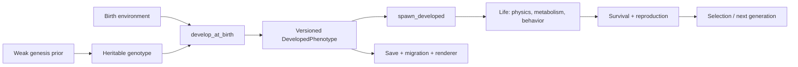
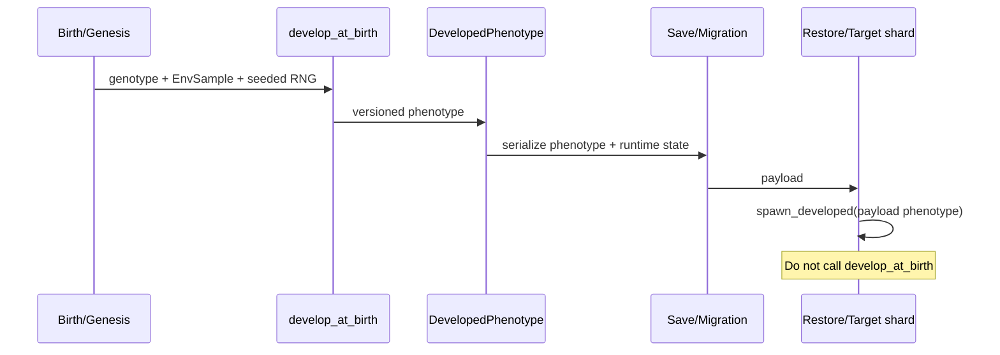

# Creature Morphogenesis

> *Vietnamese version / Bản tiếng Việt: [CREATURE_MORPHOGENESIS.vi.md](CREATURE_MORPHOGENESIS.vi.md).*

This document explains how Anima Engine develops a new creature so that morphology responds meaningfully to its environment while preserving emergent evolution. It is not an API contract; binding rules live in [`CREATURE_DEVELOPMENT_CONTRACT.md`](../reference/CREATURE_DEVELOPMENT_CONTRACT.md).

## Short Answer

Do not "repaint" a creature to match its biome on every frame. Anima separates three distinct mechanisms:

1. **Genesis prior:** when creating an entirely new founding lineage, the environment gently biases the initial genotype distribution so founders do not die immediately.
2. **Developmental plasticity:** genotype + birth environment develop a phenotype once at birth.
3. **Natural selection:** the environment determines which phenotypes survive and reproduce across generations.

Only mechanism 3 demonstrates evolutionary adaptation. Priors and plasticity set initial conditions or within-lifetime responses; by themselves they do not prove evolutionary fitness.



## Current Engine State

> **Full-text audit 2026-11-17.** Originally written in July; the entire page was re-checked against the trunk codebase. Three aspects of engine status changed:
>
> - The closed-EU ledger now has **four** buckets: adding `dormant` for hibernating agents ([energy ledger contract §1.1](../reference/ENERGY_LEDGER_CONTRACT.md)).
> - Reproduction is no longer solely epoch replacement. `autonomous_reproduction_system` (continuous energy-threshold reproduction where offspring capital is debited from the parent's reserve) is wired into the shared tick schedule. **In the desktop app it runs by default**, because an absent `ReproductionPolicy` means enabled. **In the live experiment adapter it stays off** unless a manifest declares `live.reproduction` ([ADR-0005](../decisions/ADR-0005-live-population-turnover.md)). Starvation and dehydration mortality are off by default in both paths: enabled via `ANIMA_MORTALITY` in the app and `live.mortality` in the adapter. This is not yet the M5 lifecycle: offspring still spawn via `decode_genotype` with no development step.
> - None of the target lifecycle types or functions (`DevelopedPhenotype`, `EnvSample`, `EnvironmentSnapshot`, `RuntimeState`, `LocomotionMedium`, `develop_at_birth`, `spawn_developed`, `development_version`) **exist in code yet**. The "Current Danger Points" warning below therefore remains fully active, and `decode_genotype` now has **seven** call sites instead of four: adding `SpawnOffspringCommand::apply`, `live_experiment::genesis`, and `RehydrateCommand::apply` ([table in contract](../reference/CREATURE_DEVELOPMENT_CONTRACT.md)).
>
> How to read the rest: from "Four Data Layers" onward describes **target design**. Where existing code implements a subset or differs, an *Implementation status* note explains the exact difference.

### Already Implemented

- `MorphologyGenotype`: node/edge graph storing segment length, radius, mass, joint anchor, and joint axis.
- `decode_genotype`: instantiates root/child entities, rigid bodies, colliders, CPG oscillators, and homeostasis.
- `TerrainMap`: elevation, moisture, temperature, biome, and flow fields.
- `ResourceField`: standing resource `r` and carrying capacity `r_max`.
- Closed-EU ledger: plants, animals, detritus, plus the added `dormant` bucket.
- MAP-Elites archive, mutation/crossover, lineage tracking, and cross-shard migration.
- Pixi 2D simulation view and Three.js 3D landscape view.

### Missing

- Separate developed phenotype representation distinct from genotype.
- Environment-independent species/habitat profile.
- Development version and birth-environment snapshot.
- Heritable pigment, thermal strategy, and plasticity slopes.
- Full M5 reproduction. In July only epoch replacement existed; continuous threshold reproduction now exists (see banner note above), still not full M5 lifecycle.
- M7.1 terrain, water, and shade sensors.
- Persistence and migration of developed phenotypes.

### Current Danger Points

`decode_genotype` is called both for newborn/founder individuals and when restoring or migrating existing individuals. Consequently it must never sample the environment implicitly. Until development is split from instantiation, migrating into a warmer shard would effectively "re-grow" an adult creature into a different body.

## Four Data Layers

### 1. Genotype — What Is Heritable

- Base morphology node/edge graph.
- Pigment gene (or `None` for legacy saves).
- Developmental reaction slopes.
- Habitat/locomotion preference.
- Thermal strategy once M5.4 begins.

Genotypes contain neither the current environment nor the realized outcome of development.

### 2. Birth Environment — Developmental Cue

`EnvSample` is a compact scalar snapshot:

```text
legacy_biome, field_temperature, moisture, elevation, flow,
resource_capacity, standing_resource
```

MVP uses the backend's 11-biome projection. Expanding to a full ecotone or 22-biome taxonomy requires updating the artifact and backend contracts first; never assume lost categories survive downsampling.

### 3. Developed Phenotype — Stable Realized Body

- Developed nodes and edges.
- Realized total mass.
- Mutually coherent collider, rigid-body, and joint-anchor geometry.
- Display color.
- Habitat/thermal phenotype.
- Development version and birth-environment fingerprint.

Physics, MAP-Elites descriptors, and renderers must all read this single authoritative structure.

### 4. Runtime State — What Changes Every Tick

- Position, rotation, and velocity.
- Energy, hydration, and body temperature.
- CPG phase, brain transitions, evaluation metrics, and feature trackers.

Save/load pairs `DevelopedPhenotype` with `RuntimeState` without ever re-running development.

## Biological Rules Are Scoped Policies Only

Bergmann's, Allen's, and Gloger's rules help shape initial priors and response curves, not universal laws:

- Bergmann/Allen trends hold mainly for endotherms and can be nonlinear or invert under thermal extremes.
- Gloger's rule has multiple mechanisms; humidity and temperature do not yield one universal pigment equation across all clades.
- Resource productivity often caps total biomass, population density, and trophic structure; it does not universally dictate individual body mass.

Every developmental response must therefore declare:

| Element | Requirement |
|---|---|
| Cue | Which field, units, and valid domain |
| Scope | Which thermal strategy or locomotion medium applies |
| Heritable strength | Reaction slopes and bounds stored in genotype |
| Cost / trade-off | Gains in environment A carry a bound or physiological cost |
| Clamping | Geometry and physiology stay within valid bounds |
| Evidence | Property tests and controlled experiments, never screenshots alone |

Supporting scientific literature:

- [Temperature-dependent plasticity and limits of Bergmann/Allen rules](https://pmc.ncbi.nlm.nih.gov/articles/PMC10503470/)
- [Review of Gloger's rule](https://onlinelibrary.wiley.com/doi/10.1111/brv.12503)
- [Costs and limits of adaptive plasticity](https://pmc.ncbi.nlm.nih.gov/articles/PMC2842679/)
- [Local adaptation and reciprocal transplants](https://www.nature.com/articles/nrg3522)

## MVP Policies

### Morphology

Developmental slopes default to `0` for legacy genotypes. New genesis founders may sample small bounded slopes. Any response applies at most once:

```text
developed_value = clamp(genetic_value × response(genetic_slope, cue))
```

Never apply the same Bergmann multiplier twice in both the genesis prior and developmental plasticity. Priors shift the initial distribution of `genetic_value` and slope; development applies the slope at birth.

### Habitat

Locomotion medium belongs to the organism:

```text
Aquatic | Terrestrial | Amphibious | Arboreal | Alpine | Aerial
```

The environment is classified separately into water, land, elevation, and slope classes. S27 tests both sides independently rather than inferring organism medium from its current cell and asserting a match.

*Implementation status:* `LocomotionMedium` does not exist yet. Only this page lists those six variants; the contract sketches `HabitatPreference { medium, elevation_range }` without enumerating variants.

*Cost candidates (undecided):* two energy terms could accompany medium, both added into `total_cost` inside `metabolic_decay_system` like `cognition_cost` and never subtracted outside it: sensory organ maintenance (eyes costing more than antennae or chemoreceptors, letting selection prune eyes in darkness) and flight-muscle mass overhead for `Aerial`, fixed at birth. Sources and constraints: [`QD_REALMS_HABITATS_RESEARCH_2026-11-22.md`](../research/QD_REALMS_HABITATS_RESEARCH_2026-11-22.md).

### Pigment

Pigment genes supply a base coloration. Developmental slopes can nudge coloration slightly from birth cues. Phenotype color is stored at birth and stays fixed when a creature crosses biome boundaries. Crypsis may only be claimed as adaptive when reciprocal-transplant selection proves higher fitness.

Legacy genotypes keep `pigment: None`; renderers continue falling back to predator/prey colors so old saves never turn black from `Default`.

*Implementation status:* no pigment field exists yet. Both renderers currently color creatures by predator vs prey.

### Thermal and Water Physiology

Early phases store strategy and trait fields only, without hooking them into survival:

- Body temperature couples to the environment once M3/M5 heat exchange lands.
- `temp_target` represents a preferred range/strategy, not a naive linear function of climate.
- Hydration efficiency must carry a trade-off cost and must not assume conserved surface water before M3.

## Genesis, Birth, and Replacement

### Genesis

Genesis sets the `t=0` boundary condition:

1. Select a spawn region compatible with habitat.
2. Sample environment.
3. Sample genotype from a weak prior.
4. Develop once.
5. Spawn entity hierarchy.
6. Lock closed-EU baseline (`plants + animals + detritus + dormant`).

*Implementation status:* only step 6 exists (`EnergyLedger::lock_baseline` on the first census). Genesis currently places founders along a line, or across a grid when `ANIMA_FOUNDING_POPULATION` is set, all sharing one genotype; it performs no habitat filtering, environment sampling, priors, or development.

### M5 Birth

Biological birth requires parent entities, maturity, and a conserved energy transaction. Newborns never materialize `100 EU` for free. This belongs to M5.3/S29 and must not be patched onto epoch replacement.

*Implementation status:* one energy-conserving birth path exists today: `autonomous_reproduction_system` → `SpawnOffspringCommand`, single parent, newborn endowment debited from parent reserves. It lacks maturity gating and mate choice, and still instantiates via `decode_genotype`, so it is not yet full M5.3.

### Legacy Evolutionary Replacement

The current mechanism replaces individuals at epoch boundaries from the archive (`apply_staggered_evolution_system` → `SpawnGenotypeCommand`). `EvolutionaryReplacement` is the contract's conceptual term; no code type bears that name. A replaced creature's reserves return to detritus, and the replacement draws capital from detritus via ledger event `EnergyEvent::Replacement`; when detritus is insufficient, the shortfall increments `refused` rather than creating energy out of thin air. Replacement is not yet recorded in `CausalLedger`. It can continue serving MAP-Elites until full M5 reproduction is ready.

## Save, Load, and Migration



*Implementation status:* the diagram above shows target behavior. Today `SerializedAgent` stores genotypes only, and both snapshot restore and migration invoke `decode_genotype`.

Legacy saves lacking a serialized phenotype pass through one versioned migration path. That migration may develop a legacy phenotype from the saved genotype and position, recording `development_version` so subsequent loads never re-develop.

## Determinism

The canonical seed source is `WorldIdentity.seed`. Streams are keyed cleanly:

```text
derive_seed(world_seed, event_kind, tick_or_epoch, lineage_key)
```

Mutation, crossover, and development all accept an RNG from the caller. Deterministic paths never call `thread_rng()` or random UUID v4; lineage IDs derive deterministically from seed plus counter/hash.

*Implementation status:* the four-part `derive_seed` helper does not exist yet. Each stream is separated via `derived_seed(run_seed, stream)` (`core/resources.rs`) using per-stream constants. Mutation and crossover already accept caller RNGs and never call `thread_rng()`. UUID v4 still runs in the default desktop app mode; deterministic mode derives IDs from `RunIdentity`.

## Rendering and IPC

Rust `SegmentState` (`core/simulation_state.rs`) already carries `length` and `radius`; `color` and `phenotype_version` are still missing. Its TypeScript counterpart is generated via ts-rs (`src/types/generated/SegmentState.ts`) and must not be hand-edited: change the Rust struct and regenerate. Frontend files that stay synchronized:

- `src/utils/agentHierarchy.ts` (`RenderSegment`, `buildAgentHierarchy`);
- `src/types/index.ts::RenderSegment`;
- `src/PixiViewport.tsx`;
- 3D renderer `src/components/Landscape/LiveAgents.tsx`;
- `PROJECT.md` Interface Contracts and test mocks.

The older July list also named `src/hooks/useSimulation.ts` and duplicate type definitions in `src/App.tsx`. The first file was removed, and `App.tsx` now imports from `utils/agentHierarchy`.

Renderers never sample biome fields to alter phenotype appearance; they solely render serialized data sent from Rust.

## Proving Adaptation

Three tiers of evidence:

1. **Mechanism:** cues alter developed phenotypes within declared bounds.
2. **Performance:** realized phenotypes create expected differences in intake, cost, or movement.
3. **Adaptation:** local genotypes achieve higher reproductive fitness than foreign genotypes in multi-seed reciprocal transplants.

Trait–biome correlations alone are purely descriptive and never establish tier 3. `S43` remains reserved for Red-Queen predator–prey coevolution; local adaptation uses `CM-S11`.

## Out of Scope for Phase 1

- Full 22-biome backend preservation.
- Dynamic camouflage.
- Complete aerial/swimming physics.
- True biological species taxonomy.
- Full reproduction, age/life stage, and mate choice.
- Hydrology and water balance prior to M3.

Each of these belongs to its own dedicated card or ADR rather than being smuggled into Phase 1.
