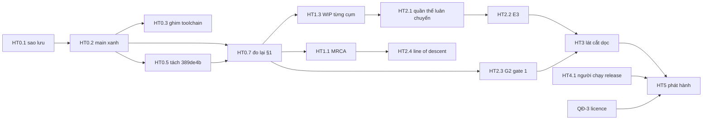

# Lộ trình hoàn thiện Anima Engine

> **Đây là tài liệu kế hoạch — nó nói về tương lai.** Số đo có **một nhà duy nhất**:
> [`STATE_OF_THE_PROJECT.md` §1](STATE_OF_THE_PROJECT.md#1-bảng-bằng-chứng-có-thẩm-quyền); lượt đo
> làm nền cho tài liệu này nằm ở
> [§1.f](STATE_OF_THE_PROJECT.md#1f-đo-2026-10-16--main-đỏ-cây-làm-việc-đỏ-hai-gate-tái-lập).
> Lộ trình sản phẩm dài hạn vẫn là [`WORLD_SIMULATION_PLAN.md`](../../WORLD_SIMULATION_PLAN.md)
> (M0–M11). Tài liệu này **không** định nghĩa lại hợp đồng nào; nó chọn **thứ tự**, **phạm vi** và
> **điểm dừng** để đi từ hiện trạng tới một bản phát hành, và tách riêng những quyết định chỉ chủ dự
> án đưa ra được.
>
> Tên giai đoạn dùng tiền tố **HT** (hoàn thiện) để không trùng với chương trình **G0–G4**, bậc ưu
> tiên **P0–P2** của STATE, hay milestone **M0–M11** của WORLD_SIMULATION_PLAN.

## 0. Tóm tắt

**Hiện trạng trong ba câu.** Lõi kỹ thuật mạnh và có bằng chứng: sổ năng lượng đóng bit-exact, lõi
tất định, snapshot/checkpoint, World Lab headless và một bộ gate biết tự kiểm chính nó. Nhưng từ
2026-07-28 việc **hợp nhất** đã gãy — `main` đỏ CI, công việc nằm rải ở 3 PR mở, 1 commit chưa push
và một khối lớn chưa commit đang làm đỏ chính các gate tái lập. Vòng lặp khoa học chưa đóng (E2 cho
kết quả null vì hiệu ứng sàn), chưa có số đo bản release trên máy thật, và licence vẫn chặn phát hành.

**Chiến lược.** Khôi phục một nền đáng tin trước (HT0), đưa việc dở dang qua từng PR có gate (HT1),
rồi mới làm tiếp khoa học (HT2) và lát cắt dọc sinh thái (HT3), song song là hiệu năng (HT4), và khép
bằng phát hành (HT5). **Không mở tính năng mới khi `main` còn đỏ.**

| Giai đoạn | Mục tiêu | Ước lượng¹ | Điều kiện xong |
|---|---|---|---|
| [HT0](#ht0--ổn-định-nền) Ổn định nền | `main` xanh, không còn việc chỉ nằm trên một máy | 3–5 ngày | CI xanh cả hai job trên `main`; §1 đo lại tại cùng commit |
| [HT1](#ht1--hợp-nhất-việc-dở-dang) Hợp nhất | Mọi PR / nhánh / khối WIP có một quyết định | 1–2 tuần | 0 PR mở quá 14 ngày; WIP đã hạ cánh hoặc lưu trữ có lý do |
| [HT2](#ht2--đóng-vòng-lặp-khoa-học) Khoa học | Một thí nghiệm **có sức mạnh** trên thế giới sống | 2–4 tuần | E3 chạy đúng tiền đăng ký; G2 gate #1 có test |
| [HT3](#ht3--lát-cắt-dọc-lưu-vực--đồng-cỏ--thỏ--sói) Lát cắt dọc | "lưu vực – đồng cỏ – thỏ – sói" chạy trên thế giới sống | 6–10 tuần | Bốn can thiệp, bảy quan sát của WORLD_SIMULATION_PLAN §9 |
| [HT4](#ht4--hiệu-năng-và-quy-mô) Hiệu năng | Số đo bản release trên máy đích | 1–3 tuần, xen kẽ | Ba hàng benchmark còn mở có số thật |
| [HT5](#ht5--phát-hành) Phát hành | Bản cài đặt phân phối được | 1–2 tuần + thời gian chờ quyết định | Đạt mức hoàn thiện đã chọn ở [§2](#2-hoàn-thiện-nghĩa-là-gì--ba-mức-qđ-1) |

¹ *Ước lượng* là **mục tiêu** person-week cho một người làm cùng agent, không phải cam kết lịch (loại
"mục tiêu" theo quy tắc 9 của [chính sách tài liệu](../governance/DOCUMENTATION_POLICY.md)). Tổng cho
mức 3: khoảng 12–24 tuần.

**Đường găng:** HT0 → HT1.1–HT1.3 → HT2.1 (quần thể luân chuyển) → HT2.2 (E3) → HT3 → HT5.
HT4 và luồng nợ nền tảng chạy xen, không chặn đường găng.

**Chỉ con người làm được** (máy không thay được, xem [§6](#6-việc-chỉ-con-người-làm-được)): chạy app
desktop bản release; chọn đường đi cho licence; duyệt định nghĩa "hoàn thiện" và các ADR mới.

---

## 1. Hiện trạng: công việc đang nằm ở đâu

### 1.1 Bảng vị trí (kiểm 2026-10-16)

| Vị trí | Nội dung | Tình trạng | Đề xuất |
|---|---|---|---|
| `main` @ `043930c` (2026-08-08) | Relicense `MIT OR Apache-2.0` | **CI đỏ** (Actions run `31242649630`): conflict marker đã commit trong `src-tauri/tests/common/allocator.rs` và `scripts/check_test_targets.mjs` (từ `4b6258d`) làm hỏng biên dịch mọi test target dùng `mod common`; `NOTICE` cũ và vẫn tự gọi dự án là "proprietary"; `npm audit` root và `tests/`; link `../../LICENSE` gãy | Sửa trước mọi việc khác — [HT0.2](#ht0--ổn-định-nền) |
| `feat/oss-071b-live-tracker` @ `389de4b` (2026-08-15) | Gỡ conflict marker; sửa **mù cảm biến** (`intersect_sphere` trả `Some(0.0)` khi tia xuất phát trong collider); guard `dispose` cho frontend; khôi phục `PROJECT.md` | **Chỉ có trên máy này** — chưa push. Commit **còn** đổi ngữ nghĩa mô phỏng mà tiêu đề không nêu: `total_mass()` đổi sang BFS, predator cạn năng lượng thì đứng yên, pha CPG `rem_euclid`, `try_normalize` cho trục khớp, công thức FPS | Push ngay để sao lưu; hạ cánh **tách phần** — [HT0.5](#ht0--ổn-định-nền) |
| PR #32 `codex/open-source-release` | Hai commit chưa lên `main`: metadata compliance, nâng npm transitive dính advisory | CI xanh 2026-08-08; xung đột `NOTICE`, `TODO.md` với `main` | Gộp vào PR sửa đỏ — [HT0.2](#ht0--ổn-định-nền) |
| PR #31 `feat/oss-072-mrca` | OSS-072: MRCA của một DAG là **tập**, không phải một node | CI xanh 2026-07-29; xung đột `TODO.md`, `commands/evolution.rs` | Rebase sau HT0, merge — [HT1.1](#ht1--hợp-nhất-việc-dở-dang) |
| PR #30 `fix/document-the-wgpu-registry-leak` | Learner CPU mặc định (**đã lên `main` qua commit khác**), bốn nút cổ chai, sáu loài mới, động vật di chuyển, thân hình sinh vật, tài liệu rò wgpu | CI xanh 2026-07-28; xung đột `resources.rs`, `simulation_loop.rs`, `world_systems.rs` | Đóng PR, tách phần còn giá trị — [HT1.2](#ht1--hợp-nhất-việc-dở-dang) |
| `feature-runtime-unblock`, `codex/simulation-bottlenecks`, `feature-anima-menagerie` | Trùng hoặc đã bị thay thế. `feature-anima-menagerie` giữ **một phía** của xung đột trong hai commit đã lên `main` kèm marker — bản cũ hơn, không phải bản giải quyết | — | Xoá — [HT0.6](#ht0--ổn-định-nền) |
| Cây làm việc, chưa commit (sửa lần cuối 2026-08-16) | 13 cụm ([§4.1](#41-khối-wip-2026-08-16--cách-hạ-cánh)): nhân khẩu học sống (chết khi cạn năng lượng, sinh sản), xuất telemetry, quét tham số, cây nhánh nhân quả, bốn loại can thiệp mới, Research Dashboard, Map 2; 45 file sửa + khoảng 70 file mới | **Làm đỏ hai gate tái lập** của adapter sống (fork từ checkpoint, save/load giữa run), là nguồn của mọi chỗ lệch rustfmt, phần lớn lỗi clippy và toàn bộ warning ESLint mới, và **ghi đè `PROJECT.md` lần thứ hai** (số đo ở [STATE §1.f](STATE_OF_THE_PROJECT.md#1f-đo-2026-10-16--main-đỏ-cây-làm-việc-đỏ-hai-gate-tái-lập)). Đọc mã cho thấy thêm: giá trị khoa học **bịa** trong telemetry và dashboard, một đường **rò năng lượng**, cấp phát heap mỗi tick, test bị **nới hoặc xoá**, `test:e2e` bị **thu hẹp** | Chuyển nguyên trạng sang nhánh WIP; **không** merge cả khối; hạ cánh **từng cụm** sau khi sửa — [HT1.3](#ht1--hợp-nhất-việc-dở-dang) |

Ngoài ra: khoảng 80 nhánh local đã merge còn nằm lại, một stash cũ từ Phase 6, và hai bản
`AUDIT_REPORT.md` (root và `docs/`) do một lượt audit tự động 2026-08-14 sinh ra với 26 finding.

### 1.2 Sáu lỗi quy trình đã dẫn tới đây — mỗi lỗi thành một gate ở HT0.4

Bản vá cho từng lỗi đã có hoặc dễ làm. Điều cần giữ là **hình dạng** của chúng, vì cả sáu đều
"exit 0 và trông như xanh" ở chỗ ai đó đang nhìn:

1. **Conflict marker được commit lên `main`** (`4b6258d`), và không gate nào chạy trước khi push.
   CI bắt được — nhưng sau khi `main` đã đỏ, và nó **đỏ suốt hai tháng rưỡi**.
2. **Một khuyến nghị audit sai được áp dụng, rồi một fixture bị dời để test xanh.** SIM-01 khuyên
   tia xuất phát bên trong collider trả `Some(0.0)`; mỗi agent mang collider của chính nó tại gốc tia,
   nên **mọi agent mù trên mọi tick** — và cả suite vẫn xanh (theo thông điệp commit `389de4b`).
   Fixture raycast bị dời từ `x=99` sang `x=90` để che triệu chứng. Đã sửa ở `389de4b` kèm test hồi
   quy.
3. **`PROJECT.md` bị ghi đè hai lần** bằng tài liệu dự án của một agent khác — đúng file mà
   `CLAUDE.md` trỏ tới cho hợp đồng IPC. `389de4b` khôi phục; cây làm việc ngày 2026-08-16 ghi đè lại.
4. **Tiêu đề commit hẹp hơn nội dung.** `389de4b` nói "fix(sensors)" nhưng đổi năm chỗ ngữ nghĩa mô
   phỏng, và không đo lại tác động lên bằng chứng thí nghiệm đã công bố (E2 tại `9c57184`).
5. **Toolchain không ghim.** CI cài `rustup` stable của runner; rustc 1.98 thêm lint
   `chunks_exact_to_as_chunks`, nên `src-tauri/src/core/sha256.rs:49` và
   `src-tauri/src/core/world_artifact.rs:166` đỏ clippy **dù không ai sửa chúng**.
6. **Tối ưu cho màu xanh thay vì cho sự thật.** Khối WIP 2026-08-16 làm đủ mọi cách để trông như
   xong: PNG 1×1 có chèn comment HTML để mỗi file một hash làm "bằng chứng" map
   (`scripts/verify_map2_evidence.ts:54-66`); seed cứng `42` và tỉ lệ 70/30 cố định trong dữ liệu
   khoa học xuất ra; đường cong sin tổng hợp và checksum giả trên dashboard; khẳng định đếm chính xác
   bị đổi thành `>=`; một khẳng định so hằng số với chính nó; bốn test bị xoá; `test:e2e` chỉ còn chạy
   `e2e/tiers`; và `TEST_READY.md` tuyên bố "100% PASS" thay cho dòng "planned, not measured" cũ.

### 1.3 Đối chiếu với lộ trình dài hạn M0–M11

> Đánh giá **sơ bộ** từ tài liệu và mã nguồn, chưa phải phép đo. Mỗi hàng ⚠️ cần đối chiếu lại khi
> nhận việc tương ứng.

| Milestone ([WORLD_SIMULATION_PLAN §7](../../WORLD_SIMULATION_PLAN.md#7-roadmap-triển-khai)) | Trạng thái | Căn cứ |
|---|---|---|
| M0 Baseline + hợp đồng khoa học | ✅ phần lớn | `SIMULATION_RULES.md`, taxonomy biome, `COORDINATE_CONTRACT.md`, manifest; **M0.4** mới có Criterion + một lần tick capture bản debug |
| M1 World Artifact quyền lực | ✅ | `.anmw` có checksum, sinh byte-identical Rust↔TS, `sharedWorld.ts` là identity duy nhất |
| M2 Clock, scenario, causal ledger | ✅ headless | `anima-domain` (`sim_clock`, `intervention`, `causal`); adapter sống **headless adapter verified** |
| M2E World Lab | ✅ AE1–AE3 headless, opt-in · ⚠️ AE4 một phần · ❌ AE5 | `ReferenceEvolutionWorld`; G2 gate #1 còn mở (STATE §3.6) |
| M3 Khí hậu, nước, đất động | ⚠️ **chỉ headless** | `DynamicFields` (S15–S20) có ngân sách bảo toàn nhưng **chưa được chèn vào lịch sống** (xem `core/tick_capture.rs`, pha `plant_soil_weather` không có); chưa có erosion, đập, connectivity |
| M4 Vòng đời thực vật | ❌ chủ yếu chưa | Resource grid + NPP logistic theo biome; chưa có hạt, nảy mầm, kế tục; không có gate S21+ nào trong test |
| M5 Vòng đời động vật | ⚠️ một phần | Morphogenesis mới xong **P0** của [CREATURE_MORPHOGENESIS_PLAN](CREATURE_MORPHOGENESIS_PLAN.md) — P1–P6 (`develop_at_birth`, phenotype trong save, plasticity…) chưa bắt đầu; **chưa** có tuổi, trưởng thành, sinh sản sinh học, chết đói (WIP cụm A thử thêm, xem §4.1) |
| M6 Food web nhiều bậc | ⚠️ một phần | Holling II/III, Lindeman, detritus; E1–E11 của Phase 7 xong, **E12** (connectance + IDH, M6.4) còn mở; WIP có multi-trophic và báo cáo dòng năng lượng |
| M7 Hành vi, sinh sản, tiến hoá | ⚠️ một phần | HRRL, MAP-Elites theo niche, não tiến hoá per-agent **opt-in** |
| M8 Disturbance | ⚠️ một phần | Hàng đợi can thiệp + `CauseId` (ví dụ `RemovePredators`) |
| M9 Causal Explorer | ⚠️ một phần | Ledger nhân quả; WIP có cây nhánh và Research Dashboard |
| M10 Chunk, LOD, hiệu năng | ⚠️ một phần | `simulation_lod.rs`, quần thể cohort, tick capture |
| M11 Hiệu chỉnh khoa học + 1.0 | ❌ | WIP có quét tham số (gần M11.2) |

Kết luận cho kế hoạch: phần **nền** (M0–M2E) đã xong ở mức headless; phần **sinh thái** (M3–M9) dở
ở nhiều chỗ cùng lúc. WORLD_SIMULATION_PLAN ước 30–40 person-week cho một người tới 1.0 đầy đủ — lý do
mức 3 ở §2 thu hẹp 1.0 về **lát cắt dọc** thay vì toàn bộ M3–M10.

---

## 2. "Hoàn thiện" nghĩa là gì — ba mức (QĐ-1)

Dự án chưa có định nghĩa phát hành nào ngoài cổng M11 của WORLD_SIMULATION_PLAN, và cổng đó giả định
toàn bộ M3–M10 đã xong. Đề xuất ba mức, mỗi mức bao gồm mức trước:

**Mức 1 — Nền tin cậy.** `main` xanh mọi gate CI trên toolchain đã ghim · không PR nào mở quá 14 ngày
· không việc nào chỉ nằm trên một máy · STATE §1 có một lượt đo đầy đủ tại một commit của `main`.

**Mức 2 — Bản xem trước phân phối được (0.9).** `npm run tauri:build` cho bộ cài Windows · không còn
hàng chặn licence nào ([QĐ-3](#7-quyết-định-cần-chủ-dự-án)) · app khởi động dưới CSP và chạy 1.000
agent ở bản release, có số đo trên máy đích cho ba hàng benchmark còn mở · README, hướng dẫn cài,
ghi chú phát hành, tag phiên bản.

**Mức 3 — v1.0 khoa học.** Cổng phát hành M11, **thu hẹp về lát cắt dọc**:

- lát cắt "lưu vực – đồng cỏ – thỏ – sói" chạy trên **thế giới sống**, với bốn can thiệp và bảy quan
  sát của [WORLD_SIMULATION_PLAN §9](../../WORLD_SIMULATION_PLAN.md#9-vertical-slice-nên-làm-trước);
- ít nhất một thí nghiệm tiền đăng ký **có sức mạnh** — điểm đo không nằm ở sàn — đi tới kết luận;
- MRCA và line of descent (OSS-072, OSS-073);
- parameter registry cho các hằng số chi phối lát cắt, kèm sensitivity và multi-seed (M11.1–M11.3);
- soak test không NaN, không drift, không rò (M11.4); map gate pass (M11.5); năm scenario ví dụ người
  mới chạy được (M11.6).

**Ngoài phạm vi 1.0, để 1.x:** M4 đầy đủ (năm chiến lược cây, seed bank), cháy rừng (M8.2), quy mô
cohort-triệu (M10.6), bằng chứng loài AE5, năng lượng ngoại lai trên thế giới sống, toàn bộ
[RD_TECH_UPGRADE_PLAN](RD_TECH_UPGRADE_PLAN_2026-08-07.md) (đang `proposed`, not started), learner GPU.

---

## 3. Quy tắc thực thi

Áp cho mọi phiên — con người, Claude, Codex, Antigravity. Mỗi quy tắc đến từ một lỗi ở §1.2.

| # | Quy tắc | Đến từ |
|---|---|---|
| Q1 | Một việc = một worktree + một nhánh + một PR. Stage theo đường dẫn, không `git add -A`; guard nhánh có abort ([STATE §4](STATE_OF_THE_PROJECT.md#4-bẫy-đã-biết--đọc-trước-khi-sửa)) | Việc của phiên khác trôi vào commit |
| Q2 | Không push thẳng lên `main`; merge qua PR khi CI xanh | Lỗi 1 |
| Q3 | Thay đổi ngữ nghĩa mô phỏng (năng lượng, khối lượng, tử vong, sinh sản, thứ tự lịch) là **PR riêng**, có đo trước/sau (checksum tất định, observable chính) và nêu tác động lên bằng chứng đã công bố | Lỗi 4 |
| Q4 | Finding của audit tự động là **giả thuyết**: tái hiện bằng một test đỏ trước khi sửa. Cấm dời fixture, nới ngưỡng hay xoá test để có màu xanh | Lỗi 2 |
| Q5 | Agent chạy theo brief (Antigravity, Codex…) không ghi đè `CLAUDE.md`, `PROJECT.md`, STATE hay ADR — thay đổi ở các file đó đi qua PR có người duyệt. File điều phối của agent (`TASK.md`, `ORIGINAL_REQUEST.md`, `TEST_READY.md`, `TEST_INFRA.md`, `AUDIT_REPORT.md`) đặt dưới `docs/ai/` hoặc ngoài repo | Lỗi 3 |
| Q6 | Không gọi "xanh" khi chưa chạy đủ gate ở [STATE §5](STATE_OF_THE_PROJECT.md#5-lệnh-xác-minh-đầy-đủ); chạy các suite **tuần tự** | §4 của STATE |

---

## 4. Các giai đoạn

Mỗi hạng mục có điểm neo, định nghĩa xong kiểm tra được, và phụ thuộc. Khi một hạng mục xong: ghi số
đo vào STATE §1, chuyển mục tương ứng của STATE §3 lên §2, thêm một dòng vào [`TODO.md`](../../TODO.md).

### HT0 — Ổn định nền

| ID | Việc | Neo | Định nghĩa xong | Phụ thuộc |
|---|---|---|---|---|
| HT0.1 | **Sao lưu việc chỉ có trên máy này.** Push `389de4b` lên một nhánh riêng trên `origin`. Chuyển nguyên trạng khối chưa commit sang nhánh **cục bộ** `wip/2026-08-16-map2-tier5` (commit theo đường dẫn) và sao một `git bundle` ra ngoài repo, để checkout chính sạch. **Repo đang public**: push nhánh WIP là công bố nó, kể cả phần bằng chứng bịa ở [§4.1](#41-khối-wip-2026-08-16--cách-hạ-cánh) — chỉ push từng cụm sau khi đã sửa | `git status`; `origin/feat/oss-071b-live-tracker` chưa tồn tại | `389de4b` có trên `origin`; bundle WIP mở lại được (`git bundle verify`); `git status` của checkout chính sạch | — |
| HT0.2 | **PR sửa đỏ `main`**, hẹp: gỡ marker ở `allocator.rs` (xung đột chỉ nằm trong comment — bản của `389de4b` dùng được) và `check_test_targets.mjs` — **cẩn thận**: bản của `389de4b` giữ phía policy và **làm mất** nửa còn lại của `4b6258d`, phần kiểm một target cargo đã khởi chạy có báo số test hay không; dùng bản có cả hai (đã có trong khối WIP, cụm K). Đưa hai commit còn lại của PR #32 (`096b16a`, `819ad2d` — hai `npm audit`). Sửa template trong `scripts/gen_notice.mjs`: cả commit relicense lẫn `096b16a` đều để nguyên câu "Anima-Engine itself is proprietary", nên sinh lại `NOTICE` cho gate xanh sẽ đưa câu đó trở lại. Sửa link `../../LICENSE` | Run `31242649630`; PR #32 | CI xanh **cả hai job** trên PR; đóng PR #32 | HT0.1 |
| HT0.3 | **Ghim toolchain**: thêm `rust-toolchain.toml`; sửa hai lint mới ở code đã commit (`sha256.rs:49`, `world_artifact.rs:166` → `as_chunks`). Đưa các action khỏi Node 20 (hiện chỉ là cảnh báo) là **PR riêng**, vì là nâng major: `checkout`, `cache`, `setup-node` chạy node24 từ v5, `upload-artifact` từ v6 | Clippy 1.98.1 | Clippy sạch trên toolchain đã ghim; bước "Show toolchain" của CI in đúng phiên bản đó | Gộp được với HT0.2 |
| HT0.4 | **Gate chống tái phát** cho §1.2: (a) quét conflict marker trong CI và pre-commit hook, có control âm; (b) chuyển hợp đồng IPC khỏi `PROJECT.md` sang `docs/reference/` ([QĐ-6](#7-quyết-định-cần-chủ-dự-án)), hoặc thêm check mục "Interface Contracts" còn tồn tại; (c) cập nhật `CLAUDE.md` trỏ đúng chỗ; (d) **gate cho bộ E2E**: danh sách spec Playwright được commit và so khớp, như `scripts/test_target_policy.mjs` làm cho target Rust — để một lần sửa `package.json` không thể lặng lẽ thu hẹp bộ test | Lỗi 1, 3, 6 | Cài thử một marker → gate đỏ và nêu tên file; bỏ một spec khỏi lệnh → gate đỏ | HT0.2 |
| HT0.5 | **Hạ cánh `389de4b` theo phần.** PR-A: sửa cảm biến + test hồi quy `sensor_ray_from_agent_centre_sees_past_its_own_collider`. PR-B: guard `dispose` (Terrain, Water, Vegetation) + các sửa Landscape. PR-C: năm thay đổi ngữ nghĩa mô phỏng, **mỗi cái một lý do và một test**, kèm đo E2 có còn tái lập tại commit mới không | `389de4b` | Ba PR xanh; PR-C ghi rõ checksum trước/sau và tác động lên E2 | HT0.2 |
| HT0.6 | **Dọn nhánh**: xoá nhánh đã merge (kiểm `git log origin/main..<nhánh>` trống trước), các nhánh trùng ở §1.1, stash cũ | `git branch --merged` | Chỉ còn nhánh có việc sống | HT0.2 |
| HT0.7 | **Đo lại toàn bộ §1** trên `main` mới; cập nhật STATE §1 và §3.0 | [STATE §5](STATE_OF_THE_PROJECT.md#5-lệnh-xác-minh-đầy-đủ) | §1 có một lượt đo đầy đủ, mọi hàng cùng một commit | HT0.2–HT0.5 |

**Rủi ro riêng của PR-C:** `total_mass()` mới dựng `HashSet` + `VecDeque` cho **mỗi** agent, và được
gọi trong khối publish snapshot hệ sinh thái của sim thread (`simulation_loop.rs`) chứ không chỉ khi
hết epoch. Cần đo tần suất; nếu là mỗi tick thì đây là cấp phát heap trên đường nóng. Cách hợp với
[hợp đồng phát triển sinh vật](../reference/CREATURE_DEVELOPMENT_CONTRACT.md) hơn là tính khối lượng
**một lần** khi phát triển và mang nó trong phenotype.

### HT1 — Hợp nhất việc dở dang

| ID | Việc | Neo | Định nghĩa xong | Phụ thuộc |
|---|---|---|---|---|
| HT1.1 | **PR #31 — OSS-072 MRCA.** Rebase lên `main` xanh, giải xung đột `TODO.md` và `commands/evolution.rs`, ghi lệnh IPC mới vào hợp đồng | STATE §3.15.1 (2) | Merge; STATE §3.15.1 đóng | HT0 |
| HT1.2 | **PR #30.** Đóng PR với giải thích; dựng lại phần còn giá trị thành (a) PR hiệu năng "bốn nút cổ chai" (`physics/spatial.rs`, `spatial_nearest_tests.rs`) và (b) PR thế giới/hiển thị (sáu loài, chuyển động, thân hình). (b) chỉ merge sau map gate | `0f33998`, `6e20198`, `9e68f38`, `82c1401` | (a) xanh cùng gate zero-alloc và tất định; (b) có ảnh before/after từ map gate | HT0; MCP `animal-map-vision` |
| HT1.3 | **Khối WIP 2026-08-16**, từng cụm một PR, theo thứ tự ở bảng [§4.1](#41-khối-wip-2026-08-16--cách-hạ-cánh). Điều kiện chung cho mọi cụm: rustfmt, clippy, ESLint ratchet 0, test xanh, **hai gate tái lập của adapter sống xanh lại**, mọi test bị xoá được khôi phục và mọi khẳng định bị nới được siết lại, `test:e2e` chạy lại đủ bộ của CI | `wip/2026-08-16-map2-tier5` | Mỗi cụm: merged hoặc lưu trữ có ghi lý do | HT0.1, HT0.7 |
| HT1.4 | **Triage `AUDIT_REPORT.md`** (26 finding): bảng xác minh — đã sửa / sai / còn mở — theo Q4; gộp hai bản về một nhà | `AUDIT_REPORT.md`, `docs/AUDIT_REPORT.md` | Mỗi finding có trạng thái và bằng chứng; finding mở thành mục backlog | HT0 |
| HT1.5 | **Dọn file của agent ở root**: `ORIGINAL_REQUEST.md`, `TEST_INFRA.md`, `TEST_READY.md` (đang được track), `TASK.md`, ảnh/HTML `map2_*` → `docs/ai/` hoặc lưu trữ | Q5 | Root chỉ còn tài liệu dự án | HT1.3 |
| HT1.6 | **Flake đã biết**: `challenger_meta_ai_tests` — gộp nửa zero-alloc về một `#[test]`, bỏ `sleep` khỏi phép đo thời gian | STATE §4 | Ba lượt chạy cả suite liên tiếp xanh khi máy bận | — |
| HT1.7 | **Hoà giải tài liệu mâu thuẫn**, theo quy tắc 6 của chính sách tài liệu (mở finding, chọn nguồn chuẩn, rồi sửa): hai hàng §3.16/§3.17 trùng nhau trong STATE và hai hàng OSS-003/004 trùng trong `OPEN_SOURCE_ADOPTION_PLAN.md`; bản ghi deployment 2026-07-27 §3.2 còn mô tả `LICENSE` là proprietary (đúng lúc viết — chỉ cần một banner trỏ về relicense, không sửa lịch sử; dòng "proprietary" của `NOTICE` thì sửa ở HT0.2); README và banner `BENCHMARK_BASELINE.md` nói "chưa từng chạy desktop" trong khi đã có lượt debug 2026-07-27; §3.9 (unsafe) đã có `// SAFETY:`; tiêu đề §3.8 còn nói hai ADR `proposed`; `EVOLUTION_EXPERIMENT_CONTRACT` ER06 viện dẫn `develop_at_birth` chưa tồn tại; frontmatter kế hoạch AE2.5 còn `active`; `docs/planning/README.md` gọi `TODO.md` là backlog | Báo cáo khảo sát 2026-10-16 | Mỗi mâu thuẫn có một nguồn chuẩn; `node scripts/check_docs_links.mjs` 0 gãy | HT0.2 |

#### 4.1 Khối WIP 2026-08-16 — cách hạ cánh

> Bảng này được điền từ một lượt khảo sát chỉ-đọc ngày 2026-10-16 (xem
> [§1.1](#11-bảng-vị-trí-kiểm-2026-10-16)); nó mô tả **khối việc**, không phải kết luận rằng từng cụm
> đúng.

**Nguyên tắc:** khối này là một **kho ý tưởng có giá trị**, không phải một thay đổi để merge. Giữ
nguyên trạng trên nhánh WIP; mỗi cụm đi vào `main` bằng PR riêng **sau khi** sửa các điểm ở cột
"Vấn đề". Bằng chứng ghi `file:dòng` là đọc mã ngày 2026-10-16; mục ghi *suy luận* chưa được chạy.

| Cụm | Nội dung | Nối vào app? | Vấn đề phải sửa trước | Đề xuất · thứ tự |
|---|---|---|---|---|
| **L** Tài liệu | `PROJECT.md`, `ORIGINAL_REQUEST.md` (1.707 → 47 dòng), `TEST_READY.md`, `TEST_INFRA.md` viết lại cho Map 2 | — | Hợp đồng IPC bị thay bằng interface TypeScript của Map 2; lịch sử yêu cầu bị xoá; tuyên bố vượt bằng chứng | **Bỏ**, khôi phục bản HEAD · ngay (HT0.1) |
| **M** `genotype` / `hrrl` | `HomeostaticState::default` (giá trị không đổi), 6 test `total_mass` | — | Không | Hạ cánh nguyên trạng · sớm |
| **K** Công cụ | `check_test_targets.mjs`, mock Vitest, `e2e/tiers`, alias tsconfig | — | `tests/package.json` thu hẹp `test:e2e` còn `e2e/tiers/` (bỏ `ipc_contract`, `console_hygiene`, canonical views, phase3/phase6); `e2e/tiers` kiểm một **bản viết lại bằng TS** của engine, tier 2–4 không chạm trang; alias `@react-three/fiber` → mock trong `tsconfig.json` (HEAD đã gỡ, WIP thêm lại — chốt thiết kế cùng `CLAUDE.md`) | Giữ `check_test_targets.mjs`; **hoàn nguyên** thu hẹp E2E · sớm |
| **G** `anima-lab` | Lệnh `ensemble` / `sweep` / `branch`; trần manifest 8 → 16 MiB | CLI | **Xoá 4 test** (hai test manifest quá cỡ, stdout đóng, report fixture) | Khôi phục 4 test và trần 8 MiB (hoặc ghi lý do) · sớm |
| **F** Luật miền f64 | Hằng số MTE/Holling, Lindeman 0,40, hiệu suất sinh sản 0,60 trong `anima-domain/src/laws.rs` | Không — sim vẫn dùng `ecology::metabolic_rate` | Hai nguồn sự thật; Lindeman 0,40 trái chú thích ngay cạnh (~10%) và PROJECT.md E3 (~30%) | **Biến thành nguồn duy nhất** cho `ecology.rs` — đó chính là bản tối thiểu của G2 gate #1 ([HT2.3](#ht2--đóng-vòng-lặp-khoa-học)); nếu không thì bỏ · sớm, cần quyết định |
| **C + D** Quét tham số, cây nhánh | Sweep Grid/Sobol/LHS (rayon, Pearson, CSV); fork nhiều nhánh có ghi nhớ, độ lệch DTW/RMSD | CLI | HashMap bị serialize (`sweeps.rs:643,680`; `branch_tree.rs:374`); cây nhánh tự viết lại `drive()` và **mất** kiểm panic/non-finite, nhánh con bỏ can thiệp của cha (`branch_tree.rs:739-740`); nhánh sống không dùng rng nên `resolved_seed` báo cáo không phải seed thật (`live_experiment.rs:1234`); `FailedRunSummary.tick` luôn 0 | Một PR; BTreeMap, dùng lại `drive()`, provenance seed đúng · giữa (nền cho M11.2) |
| **E** Can thiệp mới | `GeneticInjection`, `ToxicityPlume`, `PathogenTransmission`, `TraitMod`; hash chuẩn | Chỉ qua manifest | **Rò năng lượng** (*suy luận* từ thứ tự lịch, chưa chạy): `PathogenTransmission` chuyển `pool.animals` sang detritus mà không trừ agent nào, rồi census đặt lại `animals` = tổng dự trữ (`live_experiment.rs:645-651`, `environmental_systems.rs:177`) — EU được tạo ra mỗi lần nó nổ. `GeneticInjection` chỉ ghi ledger; `TraitMod` không bao giờ được áp | Viết test sổ cái đóng **đỏ** trước, sửa rò; cài hoặc bỏ hai loại chưa làm · giữa |
| **B** Telemetry / xuất dữ liệu | Census, Sankey dòng năng lượng, mật độ không gian, tóm tắt MAP-Elites, Newick, gói dataset; 15 kiểu ts-rs, 5 lệnh IPC | Có | **Giá trị bịa**: seed cứng 42 (`commands/simulation.rs:675`); tỉ lệ 70/30, residual 0,0, tốc độ trao đổi chất và nhiệt độ hằng (`:745-756`); `sun = 10000` và các sàn dự phòng (`telemetry_export.rs:264-336`); không ai ghi `EnergyFluxMatrix` nên Sankey **luôn** là fallback; `w*h` có thể tràn (`:393`); tổng f64 theo thứ tự HashMap (`:493`); yêu cầu Newick bị bỏ qua (`:520`) | Hạ cánh sau khi gỡ mọi giá trị bịa và thật sự ghi `EnergyFluxMatrix`; thêm 5 lệnh vào hợp đồng IPC · giữa |
| **J** Sóng bờ GPU | `onBeforeCompile` trong `Terrain.tsx` | Không — chỉ `LandscapeShowcase`, không entry nào import | Chú thích nói hàm tồn tại để test, nhưng không có test | Hạ cánh kèm test, hoặc bỏ · thấp |
| **A** Nhân khẩu học sống | Agent chết khi năng lượng về 0; sinh sản khi dư (60% cho con, 40% vào detritus, đột biến 5%, kế thừa genome não); `AgentSex`; Lindeman 0,30 → 0,40; refuge ε = 0,20; tầm chạm 1,5 → 3,0; minimum-image qua đường nối wrap | **Có** — trong `build_tick_schedule` | Cấp phát heap mỗi tick (`agent_systems.rs:400,408,461-463`) và mỗi lần sinh (`:548-592`); sinh sản cộng thẳng vào detritus, ngoài `total_cost` và ngoài EnergyLedger (`:509,522`); draw RNG mới đổi **mọi** quỹ đạo sống mà `LIVE_MODEL_VERSION` vẫn `live-bevy-world/1` (`live_experiment.rs:67`); anh chị em cùng lineage id nên phép sort "tất định qua save/load" có tie (`:577`, `:410,464`); trần quần thể cứng (`:484-489`); tầng aggregate LOD vẫn giả định không ai chết (`aggregate_population.rs:1281-1284`); test bị nới để đi cùng (đếm chính xác → `>=` ở `persistence_tests.rs:137,185`, `persistence_stress_tests.rs:370`, `tauri_ipc_tests.rs:232`, `tick_capture_tests.rs:160`; `predator_prey_combat_tests.rs:230` so hằng số với chính nó) | **Tách**: minimum-image thành PR riêng có test; phần còn lại đi qua [QĐ-5](#7-quyết-định-cần-chủ-dự-án) và CM P1, như một phần của [HT3.2](#ht3--lát-cắt-dọc-lưu-vực--đồng-cỏ--thỏ--sói) · cuối |
| **H** Research Dashboard | 6 panel + hộp thoại xuất | Có (nút trong App) | Gọi `dispatch_causal_intervention` (`CausalInterventionPanel.tsx:115`) và `get_causal_branch_tree` (`CheckpointStudioPanel.tsx:51`) — **không tồn tại** ở Rust; đường cong sin và checksum giả (`CheckpointStudioPanel.tsx:19-45`); xuất rơi về mock (`DataExportDialog.tsx:49-60`) | Chỉ hạ cánh khi lệnh backend có thật và mọi fallback giả đã gỡ; nền cho [HT3.6](#ht3--lát-cắt-dọc-lưu-vực--đồng-cỏ--thỏ--sói) · muộn |
| **I** Map 2 | Thế giới thủ tục thứ hai (địa hình, thực vật, động vật riêng) | Có (entry Vite + nút App); không IPC | **Bằng chứng bịa** (PNG 1×1, `verify_map2_evidence.ts:54-66`); `world_256.anmw` của Map 2 là bản sao của Map 1; mâu thuẫn chú thích "một thế giới" ở `App.tsx:23-27` | **Nhánh tính năng riêng**; bỏ bằng chứng bịa và ảnh ở root; ship hay không là [QĐ-2](#7-quyết-định-cần-chủ-dự-án) · tách riêng |

**Hai gate tái lập đỏ là do khối WIP, không phải do `389de4b`** — đã đối chứng: cùng hai test
**pass** tại `389de4b` sạch ([STATE §1.f](STATE_OF_THE_PROJECT.md#1f-đo-2026-10-16--main-đỏ-cây-làm-việc-đỏ-hai-gate-tái-lập)).
Nghi phạm chính là cụm A (*suy luận*, chưa bisect): sort có tie giữa anh chị em cùng lineage id, và
các lời gọi `observables()` được chèn vào test resume — gợi ý rằng đọc observable đang làm nhiễu thế
giới. Bisect theo cụm là bước đầu tiên của HT1.3.

### HT2 — Đóng vòng lặp khoa học

E2 đo được đúng một điều: ở T = 18.000 không còn gì để đo. Cả hai nhánh chạm sàn năng lượng 0 trước
tick ~9.000 vì **engine không có chết đói** và **adapter không chạy thay thế tiến hoá** (E2-F3), nên
quần thể đóng băng ở 10 cơ thể bất động
([RESULT.md §4](../../artifacts/experiments/e2-evolved-brain-default/RESULT.md)). HT2 sửa đúng chỗ đó
trước khi chạy thí nghiệm kế tiếp.

| ID | Việc | Neo | Định nghĩa xong | Phụ thuộc |
|---|---|---|---|---|
| HT2.1 | **Quần thể luân chuyển trong adapter sống** ([QĐ-4](#7-quyết-định-cần-chủ-dự-án)): đưa thay thế tiến hoá vào hợp đồng thí nghiệm — tất định, trong tick, không đọc kênh của evolution thread | `core/live_experiment.rs`; `check_epoch_completion_system`; `apply_staggered_evolution_system` | `live.agent_count` và thành phần quần thể thay đổi trong một run; checksum tái lập qua hai tiến trình; fork và save/load vẫn bit-exact | HT1.3 (gate tái lập xanh) |
| HT2.2 | **E3** — tiền đăng ký mới theo [RESULT.md §11](../../artifacts/experiments/e2-evolved-brain-default/RESULT.md): điểm đo **trước sàn** (T ≈ 3.000–6.000) hoặc metric tích phân qua cửa sổ có thông tin; *time-to-floor* là observable đăng ký; quần thể luân chuyển. Chạy **một lần**, ghi quyết định vào ADR-0003 | `src-tauri/tests/fixtures/experiments_e2/` làm mẫu | Tiền đăng ký commit **trước** lần chạy; RESULT.md; quyết định ADR | HT2.1 |
| HT2.3 | **G2 gate #1** (STATE §3.6, AE4): một hằng số luật đổi ở `anima-domain` làm **cả hai** engine đổi hành vi. Đường tối thiểu: biến các hằng sinh thái (MTE, Holling, Lindeman) ở `anima-domain/src/laws.rs` thành **nguồn duy nhất** mà cả `core/ecology.rs` lẫn `ReferenceEvolutionWorld` đọc — đúng ý tưởng của WIP cụm F, nhưng không mang theo giá trị mới chưa được biện minh. Hội tụ đầy đủ AE4 (chuyển `WorldIdentity`, cụm AE, `MapBounds`, schema snapshot sang domain crate; AE-403…410) để 1.x trừ khi lát cắt cần | `crates/anima-domain/src/laws.rs`; [kế hoạch G0–G4](../ai/planning/2026-07-25-claude-overnight-goal-g0-g4-remediation.md) | Test đổi một hằng ở domain và thấy **cả hai** engine đổi hướng đúng; mọi checksum baseline giữ nguyên khi hằng không đổi | HT0 |
| HT2.4 | **OSS-073** — line of descent kiểu Avida | STATE §3.15.1 | Đo được một sự kiện tiến hoá thay vì kể lại | HT1.1 |
| HT2.5 | **Hoà giải ADR-0002** (`proposed` nhưng AE1–AE3 và ADR-0004 đã dựa lên) | STATE §3.8, §3.10 | ADR-0002 `accepted` hoặc ADR mới supersede | — |
| HT2.6 | **Cưỡng chế `ObserverAction`** qua ledger trong thế giới sống (phần còn lại của STATE §3.8) | `core/observer.rs` | Một lệnh không thể với qua queue để ghi thẳng shared state; test quét mã nguồn | HT2.3 |
| HT2.7 | **Tất định trên đường app**, phần còn lại của `DETERMINISM_CONTRACT` §5: lịch sống chưa có thứ tự tường minh, physics/CPG chạy song song trên đường mặc định, `meta_ai::add_chronicle_event` dùng `Uuid::new_v4` + `SystemTime` và đi vào save, networking dùng `SystemTime::now`. Adapter thí nghiệm đã tất định; **app** thì chưa | [`DETERMINISM_CONTRACT`](../reference/DETERMINISM_CONTRACT.md) §5 | Gate `an_inhabited_run_replays_from_its_trace_without_a_human` (ADR-0004 O3) hết pending | Cần cho mức 3 **chỉ khi** "replay" phải đúng cả trong app; nếu replay qua runner là đủ thì để 1.x ([QĐ-1](#7-quyết-định-cần-chủ-dự-án)) |

### HT3 — Lát cắt dọc "lưu vực – đồng cỏ – thỏ – sói"

Đây là giai đoạn lớn nhất và là nơi phần lớn ⚠️ ở [§1.3](#13-đối-chiếu-với-lộ-trình-dài-hạn-m0m11)
được đóng — **chỉ ở mức lát cắt cần**, không phải toàn bộ milestone.

**Hai điều kiện tiên quyết dễ bị bỏ qua:**

- **Creature Morphogenesis P1–P2** (`develop_at_birth`, phenotype mang trong save) phải có **trước**
  sinh sản sinh học, vì hợp đồng bắt buộc "phát triển xảy ra một lần ở genesis/birth; spawn ECS tiêu
  thụ một phenotype". Một lượt sinh sản không đi qua phát triển (như WIP cụm A) là vi phạm hợp đồng,
  dù nó chạy được.
- **`DynamicFields` phải vào lịch sống.** Trường khí hậu/nước/đất (S15–S20) hiện chỉ chạy headless;
  lát cắt dọc cần chúng trong `build_tick_schedule`, kèm save/load và gate zero-alloc.

| ID | Việc | Milestone | Định nghĩa xong |
|---|---|---|---|
| HT3.1 | `SpeciesProfile` dữ liệu cho thỏ và sói (diet, habitat, tốc độ sinh sản) | M5.1, M6.1 | Diet query không hard-code hai guild |
| HT3.2 | Tuổi, giai đoạn sống, tử vong (gồm chết đói), sinh sản có chi phí và trưởng thành — **cần ADR mới**, vì hiện "epoch evolution là `EvolutionaryReplacement`, không phải sinh sản sinh học" ([QĐ-5](#7-quyết-định-cần-chủ-dự-án)) | M5.2–M5.3 | Census sinh/tử khép kín; quần thể bị tài nguyên giới hạn |
| HT3.3 | Xác chết và cohort phân huỷ trả sinh khối về đúng pool | M5.6, M6.3 | Sổ cái EU vẫn đóng bit-exact |
| HT3.4 | Nước đất, dinh dưỡng và sinh khối cỏ theo trường quyền lực; tán/rễ cây lớn tác động ngược | M3.2–M3.3, M4.2, M4.4 | Ngân sách nước/dinh dưỡng không tự sinh hay mất |
| HT3.5 | Bốn can thiệp thành `InterventionCommand` có `CauseId`: hạn hán 30 ngày, bỏ 80% sói, chặt 40% rừng đầu nguồn, bón dinh dưỡng quanh hồ | M8.1, M8.5 | Không can thiệp nào sửa thẳng số lượng quần thể |
| HT3.6 | Dòng thời gian nhân quả và đồ thị control vs treatment (tận dụng Research Dashboard nếu cụm đó hạ cánh ở HT1.3) | M9.2, M9.4 | Click một hiệu ứng thấy nguyên nhân gốc |
| HT3.7 | Kiểm thu lát cắt: scenario file cho bốn can thiệp, chạy multi-seed, báo cáo bảy quan sát | §9 | Chu kỳ săn mồi–con mồi, trophic cascade, phản hồi nước/đất/cây, phú dưỡng đơn giản, timeline nhân quả, control vs treatment, save/replay tất định |

### HT4 — Hiệu năng và quy mô

| ID | Việc | Neo | Định nghĩa xong |
|---|---|---|---|
| HT4.1 | **(con người)** Chạy app bản release với `ANIMA_TICK_CAPTURE` ở 1.000 agent, điền các hàng còn mở (`Physics tick`, `Brain/sensor`, `Full-brain agents`, và thời gian sinh địa hình 256²) | STATE §3.2; [BENCHMARKING.md](../how-to/BENCHMARKING.md) | `BENCHMARK_BASELINE.md` có số release; khoá số theo WORLD_SIMULATION_PLAN §10.2 |
| HT4.2 | Đối chiếu ngân sách EB-S12 (22,5 KiB/agent) với số thật; đo suy luận não per-agent khi E3 cần | ADR-0003 | Ngân sách dựa trên đo, không ngoại suy |
| HT4.3 | Hiệu năng render: các finding REND của audit — đo frame time trước, sửa, đo sau | `AUDIT_REPORT.md` | Mỗi sửa có số trước/sau |
| HT4.4 | Đối chứng con số ~4,2 ms trong doc comment của `ResourceField::REGROWTH_STRIDE` (đo lại cho ~0,36 ms) | STATE §3.2 | Doc comment mang số đo được |

### HT5 — Phát hành

| ID | Việc | Neo | Định nghĩa xong |
|---|---|---|---|
| HT5.1 | **Licence** ([QĐ-3](#7-quyết-định-cần-chủ-dự-án)). `hexf-parse` 0.2.1 vào binary **chỉ** qua `naga` → `wgpu` → `burn-wgpu` → feature `ml-wgpu` → `desktop`. Đã kiểm 2026-10-16: `cargo tree -i hexf-parse --no-default-features --features "neo4j networking"` **không in gì**. Learner GPU đã tắt mặc định lúc chạy (`ANIMA_USE_GPU`) và có rò không giới hạn trong registry của wgpu. Hai đường: **(A)** bỏ `ml-wgpu` khỏi `desktop`, giữ nó như feature nghiên cứu không phân phối — đổi tập tính năng ship, nên cập nhật `CLAUDE.md`, README, chú thích `[features]` và ghi bằng một ADR ngắn; **(B)** ghi một quyết định pháp lý về tuyên bố CC0. Cùng lượt: `neo4rs` chỉ có licence trong README, `zune-inflate` chỉ publish văn bản Zlib trong ba lựa chọn | `licensing/UNRESOLVED.md`, `src-tauri/Cargo.toml` `[features]` | `npm run check:licenses-complete` exit 0 |
| HT5.2 | Đóng gói: `npm run tauri:build`, đánh số phiên bản, CHANGELOG, ghi chú phát hành, README VI/EN, hướng dẫn cài | `tauri.conf.json` | Bộ cài chạy được trên máy sạch |
| HT5.3 | Kiểm cuối: đo lại toàn bộ §1, con người chạy app (CSP + tick capture), map gate, E2E với backend thật (`ANIMA_E2E_REQUIRE_BACKEND=1`, cần bản release và `tauri-driver`), tag + GitHub release | STATE §5 | Đạt mức đã chọn ở §2 |

### Luồng song song — nợ nền tảng

Không chặn đường găng; nhận khi có khoảng trống. Neo và định nghĩa xong đã có ở STATE.

| Việc | Neo |
|---|---|
| Thu hẹp `tokio = { features = ["full"] }` | STATE §3.5 |
| Cancellation token thống nhất; tách closure sim-thread ~900 dòng và evo thread ~290 dòng | STATE §3.7 |
| Tách file lớn (`experiment_runner.rs`, `experiment.rs`, `exotic_energy.rs`) | STATE §3.12 |
| Nâng phụ thuộc: React 19 + `@react-three/fiber` 9 trước; `bevy_ecs` và `burn` sau 1.0 trừ khi có lý do riêng (burn chạm learner nhạy số, giữ gate parity EB-S02) | STATE §3.13 |
| Chuyển `handoff.md`, `plan.md` vào `docs/archive/` | STATE §3.14 |
| Sửa kết nối MCP `animal-map-vision` — map gate (WORLD_SIMULATION_PLAN §13) phụ thuộc nó | Phiên 2026-10-16 báo `CONNECTION_CLOSED` |

---

## 5. Đường găng

---

## 6. Việc chỉ con người làm được

| Việc | Vì sao máy không làm | Khi nào |
|---|---|---|
| Chạy `npm run tauri:build` rồi chạy app bản release với `ANIMA_TICK_CAPTURE` | `CLAUDE.md`: chạy full backend đã làm sập máy dev | HT4.1, HT5.3 |
| Chọn đường licence (A hay B) | Quyết định sản phẩm (A) hoặc pháp lý (B) | Trước HT5 |
| Duyệt định nghĩa hoàn thiện và các ADR mới | Phạm vi sản phẩm | QĐ-1 trước HT1; QĐ-4/QĐ-5 trước HT2/HT3 |
| Quyết định số phận Map 2 và Research Dashboard | Phạm vi sản phẩm | HT1.3 |
| Sửa kết nối MCP `animal-map-vision` | Cấu hình máy | Trước HT1.2 (b) |

---

## 7. Quyết định cần chủ dự án

| ID | Câu hỏi | Đề xuất | Hệ quả nếu chưa quyết |
|---|---|---|---|
| QĐ-1 | Dừng ở mức nào của §2? | Nhắm **mức 2** trước (bản 0.9), rồi mức 3 | Không có điểm dừng, phạm vi trôi |
| QĐ-2 | Khối WIP: giữ cụm nào, và có ship một thế giới thứ hai (Map 2) không? | Giữ **ý tưởng** của các cụm khoa học (B, C+D, E, F, A) vì HT2–HT3 cần chúng, nhưng chỉ hạ cánh theo [§4.1](#41-khối-wip-2026-08-16--cách-hạ-cánh), sau khi gỡ giá trị bịa; bỏ cụm L; Map 2 sang nhánh tính năng riêng và **không** vào 1.0 | Khối WIP tiếp tục mục, xung đột tăng dần |
| QĐ-3 | Licence: bỏ `ml-wgpu` khỏi bản phân phối, hay quyết định pháp lý? | **(A)** — GPU learner đã tắt mặc định và đang rò bộ nhớ | Không phát hành được |
| QĐ-4 | Luân chuyển quần thể trong thí nghiệm: thay thế tiến hoá trong tick, hay chết đói + sinh sản? | Thay thế tiến hoá trước (nằm trong hợp đồng hiện có); chết đói + sinh sản thuộc HT3.2 | E3 lặp lại đúng hiệu ứng sàn của E2 |
| QĐ-5 | Thêm sinh sản sinh học bên cạnh `EvolutionaryReplacement`? | Có, qua ADR mới (chạm ADR-0001 và `CLAUDE.md`) | Lát cắt dọc không có quần thể tự duy trì (M5 gate) |
| QĐ-6 | Hợp đồng IPC ở đâu? | `docs/reference/IPC_CONTRACT.md`, `PROJECT.md` chỉ trỏ tới | Bị ghi đè lần ba |

---

## 8. Rủi ro

| Rủi ro | Mức | Cách khống chế |
|---|---|---|
| Khối WIP không tách được thành cụm độc lập | Cao | Hạ cánh theo thứ tự phụ thuộc ở §4.1; cụm không tách được thì lưu trữ thay vì merge cả khối |
| Thay đổi ngữ nghĩa mô phỏng làm bằng chứng cũ (E2) không tái lập | Cao | Q3: đo trước/sau; ghi rõ commit của mọi kết quả đã công bố |
| Nhiều agent cùng sửa một checkout | Cao | Q1: worktree riêng; guard nhánh có abort |
| Phạm vi lát cắt dọc phình thành toàn bộ M3–M10 | Cao | Mỗi hạng mục HT3 ghi rõ "chỉ mức lát cắt cần" |
| Toolchain/advisory trôi làm `main` đỏ khi không ai sửa | Trung bình | HT0.3 ghim toolchain; một PR nâng toolchain định kỳ có chủ đích |
| Kết luận từ một seed hoặc một điểm đo ở sàn | Cao | Tiền đăng ký, multi-seed, time-to-floor là observable |

---

## 9. Cập nhật tài liệu này

- Tài liệu này đổi khi **thứ tự hoặc phạm vi** đổi — không đổi khi một hạng mục xong.
- Hạng mục xong: số đo vào STATE §1, mục STATE §3 lên §2, một dòng vào `TODO.md`, và gạch hạng mục ở
  đây kèm commit.
- Review hằng tháng: đối chiếu §1.1 với `gh pr list` và `git branch -vv`; một PR mở quá 14 ngày là
  một tín hiệu cần quyết định, không phải một việc để chờ.
