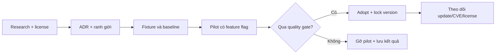

# Kế hoạch áp dụng nguồn mở

## Trạng thái thật (bảng đối chiếu; rà toàn văn 2026-11-18)

> **Rà lại 2026-11-17.** Bảng dưới và bảng OS0 từng mang **hai hàng** cho OSS-003 và hai hàng cho
> OSS-004, nói ngược nhau (một hàng viết trước relicense, một hàng sau), do một lần gộp nhánh. Mỗi cặp
> đã được gộp thành một hàng theo trạng thái hiện tại. Hàng OS7 và hàng OSS-072 được cập nhật: MRCA đã
> merge vào thân cây ở #75. Số thành phần của `NOTICE` và SBOM nằm ở STATE §1, không chép ở đây.
>
> **Rà toàn văn 2026-11-18, cập nhật 2026-11-22.** Mọi trạng thái trong trang đã được đối chiếu với mã, CI và danh sách PR.
> Các mục có ngày bên dưới vẫn là bản ghi của ngày đó; chỗ nào bản ghi ấy nay đã sai có một dòng *Rà
> 2026-11-18* ngay tại chỗ. Bốn điều đổi cách đọc cả trang: **QĐ-C đã hoàn tất trên thân cây** (`hexf-parse`
> rời cây phụ thuộc ở thẻ R1c `#127`, và dòng cuối `utf8-chars` đóng bằng QĐ-C2 tại PR `#175` ngày 2026-11-19 nên
> [`licensing/UNRESOLVED.md`](../../licensing/UNRESOLVED.md) = 0); **nén đường
> đơn trong tracker phả hệ đã bật** từ 2026-07-27; **xuất Newick đã có lệnh IPC**; và hợp đồng IPC nay
> ở [`IPC_CONTRACT.md`](../reference/IPC_CONTRACT.md), không còn ở `PROJECT.md`.

Kế hoạch này được lập 2026-07-24. Bảng dưới là đối chiếu giữa kế hoạch và code, để phiên sau không
đọc một `[x]` không tồn tại thành việc đã xong. Bằng chứng chi tiết nằm ở
[§ Điều đã thay đổi](../research/OPEN_SOURCE_LANDSCAPE.md#điều-đã-thay-đổi-kể-từ-2026-07-24)
trong khảo sát.

> **Bản đầu của mục này (2026-07-26, sáng) mở đầu bằng *"chưa có mục nào được thực thi"*.** Câu đó
> đúng khi viết và **sai vài giờ sau**: OSS-010 đã ship trong cùng ngày. Giữ lại ghi chú này vì
> chính nó là bài học — một tài liệu trạng thái viết bằng câu tuyệt đối sẽ hết hạn nhanh hơn tài
> liệu viết theo từng mục có ngày.

| Mục | Kế hoạch nói | Thực tế | Xử lý |
|---|---|---|---|
| OSS-003 license | Blocker quản trị duy nhất | Relicense **`MIT OR Apache-2.0`** (2026-08-08), thay bản proprietary 2026-07-26; `NOTICE` + văn bản license bên thứ ba **sinh tự động**, có gate CI (2026-07-27) | **Đóng phần kỹ thuật (2026-11-19).** `LICENSE-MIT` + `LICENSE-APACHE` + `NOTICE` + `CONTRIBUTING.md`; phạm vi code/asset/`.anmw` tách trong README. `hexf-parse` rời cây phụ thuộc ở R1c (`#127`), dòng cuối `utf8-chars` đóng bằng chọn Apache-2.0 (QĐ-C2, PR `#175`), [`UNRESOLVED.md`](../../licensing/UNRESOLVED.md) = 0 (câu hỏi pháp lý hẹp xem `STATE_OF_THE_PROJECT.md` §1.c và `licensing/README.md`) |
| OSS-004 inventory | Tạo inventory ban đầu | ✅ **Đã có cho dependency code (2026-07-27):** [`sbom.cdx.json`](../../sbom.cdx.json), CycloneDX 1.5 đã validate schema, sinh từ lockfile | Inventory **dep code** tự động xong; inventory **model/dataset/asset** vẫn thủ công và vẫn nợ |
| OSS-010 Criterion | Adopt | ✅ **XONG 2026-07-26** — `dev-dependency` + `src-tauri/benches/tick_systems.rs`, 16 số đo thật | Xem [§ OSS-010 đã ship](#oss-010-đã-ship-2026-07-26) |
| OSS-011 tracing | Adopt | ⬜ Không có trong `Cargo.toml` | Giữ, nay là mục OS1 đáng làm tiếp |
| OSS-012 cargo-deny | Adopt sau khi chọn license | ✅ **XONG 2026-08-08** — `src-tauri/deny.toml` + bước CI; `cargo deny check` xanh cả bốn mục | Mở khoá được nhờ OSS-003: trước khi có license của chính dự án thì không có allow-list nào để check |
| OSS-013 lychee | Adopt | ✅ `scripts/check_docs_links.mjs` **đã là gate CI** | **Đóng — superseded** |
| OS2 oracle | 2–3 tuần | ⬜ Chưa bắt đầu; OSS-021 bị chặn bởi OSS-020 | Giữ thứ tự, ghi rõ blocker |
| OS3 BVH/meshopt | Pilot | Tiền đề bị code bác bỏ | **Park** — xem OS3 |
| OS4 Rapier | Pilot có feature flag | Lịch tick đã có một thứ tự tổng (F-041, #65) và adapter thí nghiệm tái lập được; một lượt chạy **app** tái lập được thì chưa có | Tiền điều kiện cứng vẫn giữ — xem OS4 |
| OS5 Arrow | Khi ≥100 MB/run | Trigger **chưa đạt** | Giữ Defer |
| OS7 phả hệ | *(mới)* | ✅ OSS-070 Newick, OSS-071 `simplify`, OSS-071b nén trong tracker sống (2026-07-26/27); ✅ OSS-072 MRCA trên thân cây (#75, 2026-11-16). ⬜ OSS-073 | Việc còn lại là OSS-073 (line of descent), nay không còn bị chặn |

### OSS-010 đã ship (2026-07-26)

Criterion vào làm `dev-dependency` với `default-features = false`, cộng
[`src-tauri/benches/tick_systems.rs`](../../src-tauri/benches/tick_systems.rs). Bảng số và cách diễn
giải: [`docs/how-to/BENCHMARKING.md`](../how-to/BENCHMARKING.md).

Ba điều đáng ghi lại, vì chúng đổi cách đọc các mục khác trong kế hoạch này:

1. **Phần cứng mục tiêu đã đổi.** Nay là Intel Core i5-14600KF; khai báo Dell Vostro 3530 cũ **không
   còn hiệu lực**. Máy capture và máy mục tiêu là một, nên số đo tính là đo-trên-máy-đích.
   *Rà 2026-11-18:* chủ dự án quyết ngày 2026-11-17 rằng i5-14600KF là **máy đo** và Dell Vostro 3530 là
   **máy tối thiểu** dự án nhắm chạy được. Câu "không còn hiệu lực" chỉ đúng cho vai máy đo; chưa có số
   đo engine nào trên Vostro.
2. **§3.2 vẫn chưa đóng, nhưng không còn vì phần cứng.** Cái đo được là **cận dưới của một tick**,
   không phải khung hình: chưa gồm suy luận não, lập lịch ECS, emit, va chạm, trao đổi chất. Ba hàng
   đắt nhất trong `BENCHMARK_BASELINE.md` vẫn đòi in-app tick capture.
3. **Một finding mới, chưa giải quyết.** Con số ~4,2 ms trong doc comment của
   `ResourceField::REGROWTH_STRIDE` **không tái lập** — release build cho ~0,36 ms, thấp hơn ~12
   lần. Việc stride vẫn đúng (đo được 3,97×); chỉ con số biện minh cho nó là chưa đối chứng được.
   *Rà 2026-11-18:* đã đóng ở #101. Con số ~4,2 ms là chi phí của một bản debug, chưa bao giờ là chi phí
   release; doc comment đã sửa và bench giữ đường cũ để so.

**Mục OS1 đáng làm tiếp là OSS-011 (`tracing`)**, nhưng nó **không** còn nằm trên đường tới hạn P0
như OSS-010 từng nằm. Ưu tiên cao hơn lúc đó là OSS-070 (xuất Newick), nay đã xong; ưu tiên cao hơn
hôm nay là OSS-073 — xem "Ba hành động tiếp theo".

## Mục tiêu

Tận dụng nguồn mở để tăng độ tin cậy khoa học, hiệu năng và khả năng bảo trì mà vẫn
giữ bốn thuộc tính: một nguồn sự thật, tái lập theo seed, build desktop gọn và có thể
gỡ bỏ từng tích hợp. Kế hoạch này bổ trợ
[`WORLD_SIMULATION_PLAN.md`](../../WORLD_SIMULATION_PLAN.md), không thay thế nó.

## Nguyên tắc quyết định

Mỗi tích hợp đi qua chuỗi:



Một pilot không được coi là “adopted” cho đến khi có owner, lock version, NOTICE cần
thiết, test, benchmark, migration/rollback và cập nhật tài liệu nguồn sự thật.

## Trình tự tích hợp

### OS0 — Quản trị tài liệu và giấy phép

**Thời lượng:** 1–2 ngày. **Phụ thuộc:** không. **Trạng thái:** xong về cấu trúc (OSS-001 đến OSS-004). Đã đóng phần `hexf-parse` / `UNRESOLVED.md` (R1c `#127` + PR `#175`, 2026-11-19); còn nợ inventory cho model, dataset, asset. Tiêu chí "≤ 2 lần nhấp" của OSS-001 chưa từng được đo.

| ID | Công việc | Bằng chứng hoàn tất |
|---|---|---|
| OSS-001 | Dùng `README.md` và `docs/README.md` làm hai điểm vào duy nhất | Mọi tài liệu chuẩn có đường đi ≤ 2 lần nhấp |
| OSS-002 | Ban hành quy tắc Diátaxis, metadata, ADR và deprecation | Link nội bộ hợp lệ; không có hai nguồn sự thật |
| OSS-003 | Người duy trì chọn license cho chính Anima Engine | ✅ **Xong (2026-08-08; đóng văn bản thiếu 2026-11-19).** Cấp phép kép `MIT OR Apache-2.0`: `LICENSE-MIT`, `LICENSE-APACHE`, `CONTRIBUTING.md` (inbound = outbound, không CLA), `license` trong `[workspace.package]` và cả hai `package.json`, phạm vi code/asset/`.anmw` tách trong `README.md`. Bản proprietary 2026-07-26 đã bị thay thế. `NOTICE` và `licensing/THIRD_PARTY_LICENSES.txt` sinh tự động và có gate CI từ 2026-07-27. `hexf-parse` 0.2.1 đã rời cây ở R1c (`#127`); dòng cuối `utf8-chars` 3.0.7 đóng bằng chọn Apache-2.0 (QĐ-C2, PR `#175`), `UNRESOLVED.md` = 0 (câu hỏi pháp lý hẹp xem `STATE_OF_THE_PROJECT.md` §1.c) |
| OSS-004 | Tạo inventory dependency ban đầu | ✅ **Xong cho dependency code (2026-07-27).** `sbom.cdx.json` — CycloneDX 1.5, purl + SPDX + biểu đồ phụ thuộc, sinh từ lockfile đã ghim và validate với schema chính thức. Lỗ hổng cũ (`burn`/`burn-wgpu` vắng khỏi ma trận tới 2026-07-26) không tái diễn được cho dep runtime. ⬜ **Chưa:** inventory model / dataset / asset |

**Gate:** license của mọi thành phần bên thứ ba phải được xác minh **theo đúng tag/commit** trước
khi thêm. Với cấp phép kép `MIT OR Apache-2.0`, thành phần **GPL/AGPL vẫn chặn cứng cho mọi đường
tiếp xúc với code** — nhận chúng vào thì không thể tiếp tục chào nhánh MIT. Ngược lại **MPL-2.0 và
LGPL nay là câu hỏi mở** thay vì mặc định "không" — xem
[chính sách nguồn mở](../governance/OPEN_SOURCE_POLICY.md).

### OS1 — Tooling ít rủi ro

**Thời lượng:** 3–5 ngày. **Phụ thuộc:** OS0. **Trạng thái: 3/4 xong (2026-08-08).** Còn OSS-011.

| ID | Công việc | Kiểm tra / tiêu chí | Trạng thái |
|---|---|---|---|
| OSS-010 | Thêm Criterion cho tick, spatial query và artifact encode/decode | Benchmark chạy headless, lưu machine metadata và baseline | ✅ **XONG 2026-07-26** |
| OSS-011 | Khai báo trực tiếp `tracing` và quy ước correlation ID | Không log mỗi entity/tick mặc định; overhead tắt < 2% | ⬜ Mục OS1 còn lại đáng làm nhất |
| OSS-012 | Thêm `cargo-deny` cho **licenses/bans/sources** | CI chặn license/source ngoài policy | ✅ **Xong 2026-08-08.** `src-tauri/deny.toml`: allow-list 13 license đọc từ graph thật (`all-features`, ba target desktop), 5 crate **MPL-2.0** liệt kê **từng cái** để một MPL mới làm đỏ gate thay vì lọt; `unknown-git`/`unknown-registry` = deny; wildcard = deny (trừ path dep nội bộ). Advisory vẫn do `cargo audit` sở hữu. `deny.toml` **không** soi gương danh sách ignore của `.cargo/audit.toml` (cargo-deny đi theo đồ thị đã phân giải và từ chối ignore cho crate vắng khỏi đồ thị, nên `ignore = []`), và tắt `unmaintained` để hai gate không mâu thuẫn. Danh sách ignore hiện hành nằm ở `src-tauri/.cargo/audit.toml` |
| OSS-013 | ~~Thêm lychee cho Markdown~~ | — | ✅ **Superseded** bởi [`scripts/check_docs_links.mjs`](../../scripts/check_docs_links.mjs) |

**OSS-010 — bằng chứng hoàn tất, đã kiểm.** Bench phủ `integrate_physics_system`,
`rebuild_spatial_grid_system`, `ResourceField::step_regrowth{,_gated,_gated_strided}`,
`DynamicFields::step_{water,soil,erosion}`, `a2c_loss` và `WorldArtifact::{to,from}_bytes`/`checksum`
— tất cả gọi được ngoài Tauri, không cần GPU, không boot app. Machine metadata và 16 số đo thật nằm
trong [`benchmark_report.json`](../../benchmark_report.json) dưới tiền tố `criterion/`;
`scripts/bench_baseline.mjs` đọc thẳng từ output của Criterion.

**Gate đã xác minh:** `cargo tree --no-default-features -e normal` cho **0 kết quả** cho `criterion`
— nó là `dev-dependency` nên vô hình với đồ thị mà gate tách feature (G2 #2) thật sự kiểm. `fmt`,
`clippy --all-targets` ở cả hai cấu hình feature, và `cargo test --features desktop` đều xanh —
**673 pass / 0 fail, đo lịch sử ngày 2026-07-26**, tức lúc OSS-010 land. Số hiện tại ở
[`STATE_OF_THE_PROJECT.md` §1](STATE_OF_THE_PROJECT.md#1-bảng-bằng-chứng-có-thẩm-quyền). Cách gỡ ghi ở [`BENCHMARKING.md`](../how-to/BENCHMARKING.md) §"Tắt / gỡ".

**Một guard được thêm cùng lúc, vì nó chặn đúng loại hỏng im lặng repo này quan tâm:** `target/` bị
gitignore, nên chạy `bench_baseline.mjs` trên một clone mới sẽ thay report đầy số thật bằng proxy —
và kết quả vẫn validate, vẫn trông như baseline. Script nay từ chối và exit ≠ 0, trừ khi
`ANIMA_BENCH_ALLOW_PROXY_ONLY=1`.

### OS2 — Bộ oracle khoa học ngoại tuyến

**Thời lượng:** 2–3 tuần. **Phụ thuộc:** M0, M1 và `WorldArtifact` ổn định.

| ID | Công việc | Phụ thuộc | Bằng chứng |
|---|---|---|---|
| OSS-020 | Định nghĩa `scientific-fixture` manifest: source, version, license, units, seed, checksum | OSS-003 | JSON Schema + fixture mẫu |
| OSS-021 | Adapter Landlab cho lưới lưu vực nhỏ | OSS-020 | Flow direction/accumulation và water balance golden fixture |
| OSS-022 | Adapter pyrealm cho grass productivity | OSS-020 | Xu hướng GPP theo ánh sáng/nhiệt/ẩm nằm trong tolerance |
| OSS-023 | Adapter Virtual Ecosystem cho scenario tích hợp nhỏ | OSS-021, OSS-022 | So sánh miền hợp lệ cho nước–đất–producer |
| OSS-024 | Runner SALib đọc batch output của Anima | M2 scenario runner | Báo cáo Sobol/Morris ổn định theo seed |
| OSS-025 | Gắn provenance vào fixture đã rút gọn | OSS-021–024 | Có script tái tạo; không commit cache môi trường Python |

**Gate:** oracle chỉ chạy trong research/CI tùy chọn; runtime Tauri không phụ thuộc
Python. So sánh invariant, thứ tự xu hướng và tolerance có lý do khoa học, không ép
hai mô hình khác nhau cho ra giá trị tuyệt đối giống nhau.

> **Trạng thái 2026-07-26.** Chưa bắt đầu. **OSS-021 (Landlab) bị chặn bởi OSS-020** — định dạng
> `scientific-fixture` chưa tồn tại — cộng một chi phí vận hành chưa trả: cần môi trường Python trên
> một máy dev đang có ràng buộc tài nguyên thật. Trạng thái đúng là *"đã duyệt, chưa làm, đang bị
> chặn"*, không phải *"đã loại"*.
>
> Khoảng trống mà OSS-021 nhắm vào là **có thật và đã định vị được**: `downstream[i]` trong
> [`dynamic_fields.rs`](../../src-tauri/src/core/dynamic_fields.rs) là steepest-descent đơn hướng,
> không có flow accumulation; và `step_erosion` là công thức cục bộ **không vận chuyển trầm tích**.
> Lý do đầy đủ vì sao đây là oracle chứ không phải dependency nằm ở
> [khảo sát §3.1](../research/OPEN_SOURCE_LANDSCAPE.md).

### OS3 — Pilot truy vấn không gian và LOD — **PARK (2026-07-26)**

**Thời lượng:** 1–2 tuần. **Phụ thuộc:** baseline M1.

> **Park, không phải huỷ.** Cả hai pilot của giai đoạn này đứng trên một tiền đề mà code hiện tại
> bác bỏ: không có `THREE.Raycaster` nào trong `src/`, cao độ địa hình lấy giải tích qua
> `sampleElevation`, và LOD theo khoảng cách **đã có** ở
> [`chunkLod.ts`](../../src/components/Landscape/utils/chunkLod.ts). Bằng chứng ở
> [F1](../research/OPEN_SOURCE_LANDSCAPE.md) và [F3](../research/OPEN_SOURCE_LANDSCAPE.md).
>
> **Trigger mở lại:** OSS-030 (đo đường hiện tại) vẫn đáng làm và nay thuộc về OSS-010 — Criterion
> là công cụ đo. OSS-031/OSS-032 chỉ mở lại khi phép đo đó cho thấy raycast/ngân sách tam giác thật
> sự là nút thắt. Lịch không phải trigger.

| ID | Công việc | Kiểm tra / tiêu chí |
|---|---|---|
| OSS-030 | Benchmark raycast/picking hiện tại trên 3 mật độ terrain | CPU time, allocation, memory |
| OSS-031 | Prototype `three-mesh-bvh` sau adapter nội bộ | Feature flag; cùng hit point/normal trong tolerance |
| OSS-032 | Prototype `meshoptimizer` cho một chunk chuẩn | Kích thước, decode time, silhouette/normal/UV |
| OSS-033 | ADR adopt/reject từng pilot | Lợi ích ≥ 20% ở workload mục tiêu hoặc lý do khác được định lượng |

**Rollback:** adapter không để kiểu dữ liệu của thư viện lan ra component sản phẩm;
tắt flag quay về đường cũ và vẫn đọc artifact hiện có.

### OS4 — Pilot vật lý Rapier

**Thời lượng:** 2–4 tuần. **Phụ thuộc:** M5 animal motion và benchmark ổn định, **cộng tiền điều
kiện cứng dưới đây (thêm 2026-07-26)**.

> **Không mở pilot trước khi đường physics/CPG sống đã tất định.**
> [`DETERMINISM_CONTRACT.md`](../reference/DETERMINISM_CONTRACT.md) §5 ghi rằng physics/CPG chạy
> song song nên một run liền mạch còn **không khớp chính nó** — đó là thứ đang chặn gate
> `an_inhabited_run_replays_from_its_trace_without_a_human` của
> [ADR-0004](../decisions/ADR-0004-observer-as-declared-intervention.md).
>
> *Rà 2026-11-18:* tiền điều kiện vẫn giữ, nhưng lý do đã đổi. Từ F-041 (#65) lịch tick có một thứ tự
> tổng và adapter thí nghiệm headless tái lập được. Cái chưa có là một lượt chạy **app** tái lập được
> (uuid, đồng hồ thật, AI ngoài) và gate O3 của ADR-0004, hiện chưa tồn tại dưới dạng test.
>
> Lý do là logic, không phải thận trọng: OSS-040 đòi "chốt fixture và kết quả solver hiện tại" làm
> đường cơ sở. Một đường cơ sở không lặp lại được thì phép so sánh side-by-side ở OSS-042 không có
> nghĩa — bất kỳ sai khác nào cũng quy được cho nhiễu.
>
> Thêm nữa, solver hiện tại không phải rigid-body tổng quát: `resolve_joints_system`
> ([`physics/dynamics.rs`](../../src-tauri/src/physics/dynamics.rs)) là điều khiển khớp lái bởi
> `CpgOscillator`. Rapier không thay được phần đó mà không thiết kế lại tầng vận động — xem
> [F2](../research/OPEN_SOURCE_LANDSCAPE.md).

| ID | Công việc | Kiểm tra / tiêu chí |
|---|---|---|
| OSS-040 | Chốt fixture 100/1.000 tác nhân và collision cases | Kết quả solver hiện tại, seed, tick budget |
| OSS-041 | Viết `PhysicsBackend` nhỏ, giữ backend hiện tại | Không để handle Rapier thành component lưu trữ công khai |
| OSS-042 | Chạy side-by-side Rapier bằng feature flag | Collision correctness, determinism, CPU, memory, save/load |
| OSS-043 | ADR adopt/partial/reject | Không critical regression; lợi ích đủ bù chi phí build/nâng cấp |

Rapier không mặc nhiên sở hữu hunger, energy, damage hay nguyên nhân tử vong; các luật
đó vẫn ở simulation domain.

### OS5 — Dữ liệu thí nghiệm

**Thời lượng:** 1–2 tuần khi cần. **Phụ thuộc:** M2/M8.

| ID | Công việc | Trigger |
|---|---|---|
| OSS-050 | Đo JSON/CSV batch export | ≥ 100 MB mỗi run hoặc phân tích I/O thành nút thắt đo được |
| OSS-051 | Pilot Arrow/Parquet ở output adapter | Chỉ khi OSS-050 kích hoạt |
| OSS-052 | So sánh schema evolution/tooling/size/time | ADR adopt/reject |

Arrow/Parquet không thay `WorldArtifact` hoặc save-game. Nếu chưa vượt trigger, giữ
JSON/CSV để debug và trao đổi dễ hơn.

### OS6 — Mẫu kiến trúc cho quy mô lớn

**Thời lượng:** 3–5 tuần, gắn M9. **Phụ thuộc:** profiler xác nhận nút thắt.

- Học cohort/energy-budget từ Madingley.
- Học modular experiment từ MABE2.
- Học observation/action/task/replay từ Neural MMO.
- Học scheduler/module benchmark từ BioDynaMo.

Đầu ra là ADR, prototype nội bộ và benchmark; không import engine thứ hai.

### OS7 — Phả hệ và bằng chứng tiến hoá (mới, 2026-07-26)

**Thời lượng:** 1–2 tuần. **Phụ thuộc:** không có blocker ngoài — toàn bộ là code nội bộ.

Giai đoạn này không thêm **một** dependency nào; nó lấy *thuật toán* và *định dạng* thay vì thư
viện. Lý do nằm ở [khảo sát §5](../research/OPEN_SOURCE_LANDSCAPE.md).

| ID | Công việc | Phụ thuộc | Bằng chứng hoàn tất | Trạng thái |
|---|---|---|---|---|
| OSS-070 | Xuất Newick từ đồ thị lineage sẵn có | không | Một parser bên thứ ba (`ape`/DendroPy) đọc được output; test từ chối cây có chu trình, node mồ côi hoặc nhiều gốc | ✅ **XONG 2026-07-26** — DendroPy 5.0.10 đọc được; đã nối IPC bằng lệnh `export_phylogenetic_tree` |
| OSS-071 | `simplify()` kiểu tskit: prune nhánh không còn hậu duệ sống | OSS-070 | Bộ nhớ lineage trở thành O(cá thể sống), không phải O(tổng từng sống); quan hệ tổ tiên của phần giữ lại **không đổi** | ✅ **Xong 2026-07-27** (`57a8246`): thuật toán, nối vào tracker sống, và nén đường đơn **đã bật** sau khi `LineageNode.cumulative_mutations: Option<u32>` ship. Cận `2·samples` đã đo; xem STATE §3.15.1 |
| OSS-072 | Truy vấn MRCA | OSS-071 | Test trên cây đã biết đáp án; tất định | ✅ 2026-11-16, #75: `evolution/mrca.rs`, lệnh `get_lineage_mrca`; đáp án là một **tập** |
| OSS-073 | Giao thức đo "line of descent" kiểu Avida | OSS-072 | Bám được dòng dõi của genotype thống trị cuối run | ⬜ |

**Vì sao đáng làm sớm:** [`evolution/lineage.rs`](../../src-tauri/src/evolution/lineage.rs) lưu mỗi
lần sinh sản kèm **bản sao đầy đủ** `MorphologyGenotype` và **không bao giờ prune**. Đó là đường
tăng bộ nhớ không có trần với một run dài. *(Đó là lý do lúc lập kế hoạch, 2026-07-26. Từ 2026-07-27
tracker trong bộ nhớ được `compact` mỗi 50 epoch; Neo4j không bị đụng.)* OSS-070 là món rẻ nhất trong toàn kế hoạch
(0 dependency) và lợi ích lớn nhất của nó không phải là interop mà là **kiểm tra độc lập tính đúng
của phả hệ**.

#### OSS-070 — đã ship phần serializer (2026-07-26)

[`src-tauri/src/evolution/newick.rs`](../../src-tauri/src/evolution/newick.rs) +
[`tests/newick_export_tests.rs`](../../src-tauri/tests/newick_export_tests.rs) và các unit test trong
`newick.rs`. `to_newick` nhận đúng thứ `LineageTracker::get_lineage_graph` trả về, nên chạy được với cả
tracker in-memory lẫn bản restore từ Neo4j.

**Quyết định thiết kế phải nói rõ, vì nó là một đánh đổi chứ không phải chi tiết:** `Crossover` cho
một cá thể **hai** cha mẹ, nên lineage là **DAG**, còn Newick chỉ biểu diễn **cây**. Export giữ
**một** cha mẹ và **đếm** số cạnh không biểu diễn được, trả về ở `dropped_parent_edges`. Đếm thay vì
bỏ im lặng chính là toàn bộ vấn đề: một export lặng lẽ cắt một nửa phả hệ có crossover vẫn parse
được, vẫn vẽ ra được, và vẫn sai. Cha mẹ nào sống sót được chọn theo **id nhỏ nhất**, không theo thứ
tự cạnh — vì thứ tự khác nhau giữa tracker in-memory (push order) và Neo4j (query order).

**Một defect thật do chính test bắt được, ghi lại vì nó dễ tái phát:** kiểm tra generation ban đầu
chạy **trước** kiểm tra chu trình. Nhưng generation không thể tăng đơn điệu vòng quanh một chu
trình, nên **mọi chu trình đều kéo theo đảo generation** — và báo lỗi generation cho một đồ thị có
vòng lặp là báo triệu chứng thay vì nguyên nhân, dẫn người đọc tới một node có bản ghi hoàn toàn
bình thường. Thứ tự nay là: chu trình trước, generation sau.

**Chân "parser bên thứ ba" của DoD đã chạy được.** Gate là **hai nửa trên cùng một file**, và
không nửa nào đứng một mình có giá trị:

```bash
cargo test --test newick_export_tests   # export vẫn sinh ra đúng fixture
python scripts/verify_newick.py         # DendroPy đồng ý fixture là một cây hợp lệ
```

Fixture: [`src-tauri/tests/fixtures/newick/lineage_forest.nwk`](../../src-tauri/tests/fixtures/newick/lineage_forest.nwk).
Nửa Rust ghim output vào file; nửa Python bắt DendroPy đọc **cùng file đó**. Round-trip thuần Rust
chỉ chứng minh serializer nhất quán với chính nó; một parser đọc file cũ không chứng minh gì về code
hiện tại.

Lineage của fixture cố tình khó chịu: hai gốc, một crossover có cạnh không biểu diễn được, một nhãn
chứa dấu cách và một nhãn chứa dấu hai chấm. Một fixture dựng từ chuỗi gọn gàng chỉ chứng minh
export chạy đúng ở ca chưa ai nghi ngờ.

**Đã kiểm rằng gate này thật sự đỏ được** (một gate chưa từng đỏ thì chưa phải gate), bằng cách phá
fixture theo hai cách:

- **Lồng ngoặc ngược chiều** — vẫn là Newick *hợp lệ*, nên parser đọc trót lọt; nhưng khẳng định về
  topology bắt được, và đây là loại lỗi mà so chuỗi phía Rust không thấy.
- **Bỏ quote quanh nhãn có dấu hai chấm** — DendroPy từ chối phân tích. Đây đúng là điều quy tắc
  quote tồn tại để chặn: `child:two` không quote sẽ bị đọc thành branch length và **cắt cụt tên**
  chứ không báo lỗi, trừ khi phần còn lại không phải số. Kiểm chứng từ bên ngoài.

`dendropy` là **dev-only, không có gì trong sản phẩm phụ thuộc Python**. Thiếu nó thì script thoát
kèm hướng dẫn cài, và nửa Rust của gate vẫn chạy.

**Chưa nối vào IPC.** `to_newick` hiện là hàm thư viện, chưa có lệnh Tauri nào gọi. Đó là việc riêng
và cần cập nhật hợp đồng IPC ở `PROJECT.md`; không gộp vào đây.

*Rà 2026-11-18:* đã nối. Lệnh `export_phylogenetic_tree` gọi `to_newick`, và hợp đồng IPC nay ở
[`IPC_CONTRACT.md`](../reference/IPC_CONTRACT.md). `simplify` chưa có lệnh riêng: nó chạy bên trong
`compact`.

#### OSS-071 — đã ship phần thuật toán (2026-07-26)

[`src-tauri/src/evolution/simplify.rs`](../../src-tauri/src/evolution/simplify.rs) +
[`tests/lineage_simplify_tests.rs`](../../src-tauri/tests/lineage_simplify_tests.rs) (13 test) và 6
unit test. Hai bước, và **bước hai mới là bước chặn được bộ nhớ**:

1. **Prune** — bỏ node không có hậu duệ nào trong tập sample (thường là quần thể sống).
2. **Nén đường đơn** — node không phải sample, đúng 1 cha và 1 con thì bị nối tắt.

**Bước 1 một mình không đủ**, và điều đó được biến thành phép đo chứ không phải lời khẳng định:
tổ tiên của quần thể sống vẫn kéo về tận genesis, nên prune chỉ bỏ nhánh tuyệt chủng và giữ nguyên
mọi thân cây. Test `pruning_without_compression_would_not_have_been_enough` đo cả hai và đòi chênh
> 3×. Trên cây nhị phân sâu 10 (2.047 node, 16 cá thể sống): còn **31 node** = 16 sample + 15 điểm
rẽ nhánh, đúng cận `2·samples`.

*Rà 2026-11-18:* hàm `get_mutations_count` nhắc trong đoạn dưới và ở mục OSS-071b đã bị gỡ ở `57a8246`.
Số đếm nay lấy từ `LineageNode.cumulative_mutations` trong `get_lineage_graph`.

**Chỗ suýt sai âm thầm, và là lý do `SimplifiedEdge` không có `relation_type`:**
`get_mutations_count` trong `commands/evolution.rs` **đếm cạnh `Mutate` dọc đường tổ tiên** để ra con
số đột biến hiển thị trên UI. Gộp 5 cạnh `Mutate` thành 1 cạnh `Mutate` là **giữ đúng kiểu mà làm số
đếm thành 1 thay vì 5** — hữu hạn, hợp lý, sai gấp năm. Nên cạnh mang `events`/`mutations`/
`crossovers`, và là **kiểu riêng** chứ không mở rộng `LineageRelation` (đã persist vào save state và
Neo4j — không nhét khái niệm phân tích vào định dạng lưu trữ).

Hai chỗ **từ chối nén** vì cùng lý do đó: node crossover (2 cha — nối tắt phải chọn một và vứt cái
kia), và hình thoi (nén sẽ gộp hai đường tổ tiên khác nhau thành một cạnh rồi cộng số đếm như thể
chúng nối tiếp).

**Kiểm chứng bằng OSS-070, đúng như DoD nêu.** `newick.rs` được tách thêm `to_newick_from` nhận cặp
(cha, con), để một lineage đã simplify xuất được Newick **mà không ai phải bịa ra một
`relation_type`** — `to_newick` nay là wrapper mỏng nên hai đường không thể lệch. Test
`the_simplified_lineage_is_still_a_tree_a_newick_parser_would_accept` dùng nó để chốt kết quả vẫn
không chu trình, không cạnh mồ côi, không đảo generation.

#### OSS-071b — đã nối vào tracker sống (2026-07-26)

`LineageTracker::compact(samples)` thay thế thật bộ nhớ của `InMemoryLineageTracker`, và được gọi ở
thread tiến hoá mỗi `COMPACT_EVERY_EPOCHS` (50) epoch.

*Rà 2026-11-18:* đoạn "nén TẮT" dưới đây là hiện trạng ngày 2026-07-26. Nén đã bật ngày 2026-07-27
(`57a8246`), sau khi số đếm đột biến tích luỹ theo node ship.

**Chạy với nén TẮT.** Đây là giới hạn có chủ ý, không phải làm dở. Nén là bước đạt cận O(alive),
nhưng nó xoá những node mà consumer hiện tại **vẫn đang đọc**: đồ thị lineage UI vẽ lấy thẳng từ
tracker, và `get_mutations_count` trong `commands/evolution.rs` đi qua `RelationType` **từng cạnh** —
thứ một cạnh đã nén không thể mang. Bật nén cho tầng lưu trữ đòi lưu trước một **số đếm đột biến
tích luỹ theo node**, tức đổi `LineageNode`, mà kiểu đó nằm trong save state. Trong lúc chờ, compaction
bỏ các nhánh tuyệt chủng — **đúng chỗ genotype nằm** — và giữ nguyên thân cây.

**Tập sample là phần phải đúng, và nó KHÔNG phải "ai đang sống".** Mọi `lineage_id` trong archive
MAP-Elites đều có thể được chọn làm cha ở epoch sau, và một elite không nhất thiết là tổ tiên của ai
đang sống. Prune theo liveness sẽ xoá đúng node mà lần sinh sản kế tiếp gọi tên.

**Hazard đó từng là hỏng âm thầm; nay thì không.** `add_reproduction` trước đây ghi cạnh vô điều
kiện, nên một sample bị sót sẽ tạo **cạnh mồ côi** — và cạnh mồ côi làm hỏng **toàn bộ** đồ thị, vì
cả `to_newick` lẫn `simplify` đều từ chối xử lý một đồ thị chứa nó. Một lần ghi sai là đầu độc export
và mọi lần compaction sau. Nay nó **từ chối ghi** cạnh có cha không tồn tại và báo lỗi nêu tên cha đó:
mất một liên kết tổ tiên thay vì mất cả đồ thị. Đó chính là thứ khiến compaction an toàn để bật.

**Neo4j không bị đụng.** Chỉ bộ nhớ trong co lại. Hệ quả cần biết: khi Neo4j online,
`get_lineage_graph` đọc từ database nên vẫn trả **đồ thị đầy đủ** — compaction đổi thứ bản fallback
giữ, không đổi thứ một run online báo cáo.

Gate: [`tests/lineage_compaction_tests.rs`](../../src-tauri/tests/lineage_compaction_tests.rs) (9
test), gồm control âm `compacting_against_every_node_removes_nothing` — nếu `compact` xoá bất kể tập
sample thì mọi khẳng định khác vẫn xanh trong khi nó âm thầm phá dữ liệu.

**Thứ tự là bắt buộc, không phải gợi ý:** không có MRCA thì không có gì để xuất ra một cây có
nghĩa, nên OSS-073 không thể đi trước OSS-072.

**Ranh giới license:** Newick là *định dạng*, `ape`/`ggtree` không được nhập code — nên license của
chúng không liên quan. Avida là copyleft: chỉ tham khảo qua bài báo, không đọc source rồi viết lại.

## Ma trận ánh xạ với roadmap mô phỏng

| Roadmap | Tích hợp hỗ trợ | Không được thay thế |
|---|---|---|
| M0 Rules/units/determinism | Criterion, tracing, cargo-deny | `SIMULATION_RULES.md` |
| M1 Authoritative world | Criterion, three-mesh-bvh pilot | `WorldArtifact` và Rust authority |
| M2 Scenario/causality | SALib, tracing | Domain causal ledger |
| M3 Climate/water/soil | Landlab, Virtual Ecosystem | Rust runtime model |
| M4 Plants | pyrealm, Virtual Ecosystem | Producer components/systems |
| M5–M7 Animals/food web | Rapier pilot, Madingley reference | Energy/behavior/death rules |
| M8 Disturbance/experiments | SALib, Arrow trigger | Scenario schema |
| M9 Scale/LOD | meshoptimizer, ABM references | Một ECS authority |
| Phả hệ / bằng chứng tiến hoá (OS7) | Newick (định dạng), thuật toán `simplify` kiểu tskit, giao thức đo kiểu Avida | `LineageTracker` là nguồn sự thật; không nhập code copyleft |

## Tiêu chí bắt buộc cho mỗi PR tích hợp

- Link ADR và issue/task ID.
- Upstream URL, version/tag/commit và SPDX license.
- Loại dùng: runtime, dev-only, offline tool, code copied, data hoặc asset.
- Benchmark trước/sau với workload và máy chạy.
- Test correctness, determinism, serialization và cross-language nếu liên quan.
- Ngân sách CPU/memory/binary size.
- Cờ bật/tắt hoặc kế hoạch rollback.
- Cập nhật `NOTICE`/credits và inventory nếu license yêu cầu.
- Owner và lịch kiểm tra update.
- Không có finding critical/high của các gate bản đồ liên quan.

## Ba hành động tiếp theo

> **Cập nhật 2026-11-17, sửa 2026-11-18, cập nhật 2026-11-22.** Ba việc đánh số bên dưới viết ngày 2026-07-26 và **cả ba đã đổi trạng thái**:
> (1) số đếm đột biến theo node đã ship ngày 2026-07-27 và nén đã bật; (2) OSS-072 MRCA đã merge vào
> thân cây ở #75; (3) licence của dự án đã đóng bằng relicense ngày 2026-08-08. Việc nối xuất Newick vào
> IPC cũng đã có: lệnh `export_phylogenetic_tree`. Mục `hexf-parse` / `UNRESOLVED.md` (từng nêu ở đợt rà 2026-11-18)
> nay cũng **đã đóng** (`hexf-parse` rời cây ở R1c `#127`, và `utf8-chars` đóng ở PR `#175` ngày 2026-11-19).
> Hai hành động tiếp theo của kế hoạch này hôm nay là:
>
> 1. **OSS-073** — giao thức đo "line of descent" kiểu Avida. MRCA không còn chặn nó. Kế hoạch swarm
>    gọi là thẻ S5.
> 2. **Inventory cho model / dataset / asset** — phần còn nợ của OSS-004.
>
> OSS-011 (`tracing`) vẫn mở và vẫn ở ưu tiên thấp. Hai câu ở cuối danh sách đánh số bên dưới cũng đã
> hết hiệu lực: nối xuất Newick vào IPC đã xong, và con số ~4,2 ms đã được đối chứng (#101).

> **Cập nhật 2026-07-26 (lần 4).** ~~OSS-010 Criterion~~, ~~OSS-070 Newick~~ và ~~OSS-071 thuật toán
> `simplify`~~ đều đã **xong** trong cùng ngày. Danh sách 2026-07-24 gốc giữ ở cuối làm bản ghi.

1. **Lưu số đếm đột biến tích luỹ theo node**, để bật được nén trên tầng lưu trữ. Đây là thứ duy
   nhất còn chặn cận O(alive): `get_mutations_count` hiện suy ra con số bằng cách đi qua
   `RelationType` từng cạnh, nên một cạnh đã nén phá nó. Lưu sẵn số đếm làm phép đi đó thành thừa
   **và** nhanh hơn. Cần thêm một trường vào `LineageNode` (nằm trong save state) — dùng
   `Option<u32>` chứ không phải `u32`, vì mặc định `0` sẽ đọc thành "không có đột biến" cho mọi
   save cũ, đúng kiểu sai âm thầm mà cả chuỗi việc này đi tránh.
2. **OSS-072 — truy vấn MRCA.** Phụ thuộc OSS-071, nay đã mở khoá. Đây là thứ mở đường cho OSS-073
   (giao thức đo "line of descent" kiểu Avida), và là thứ hiện **không trả lời được** câu "hai cá
   thể này rẽ nhánh ở đâu".
3. **Đóng phần còn nợ của OSS-003:** tách phạm vi license cho code / model / dataset / asset.
   (`NOTICE` và văn bản license đã xong 2026-07-27; đợt hai cùng ngày đóng 31/32 bằng kho vendor
   [`licensing/upstream/`](../../licensing/upstream/), còn lại **1** thành phần trong
   [`UNRESOLVED.md`](../../licensing/UNRESOLVED.md) — quyết định pháp lý, không phải của generator.)

Ngoài ba việc trên: **OSS-011 (`tracing`)** vẫn mở nhưng đã bị hạ ưu tiên — nó là observability kỹ
thuật, không sinh bằng chứng khoa học nào. Và **nối `to_newick`/`simplify` vào IPC** cần một thay đổi
hợp đồng ở `PROJECT.md`.

Một mục **không** nằm trong ba việc trên nhưng đã mở: đối chứng con số ~4,2 ms trong doc comment của
`ResourceField::REGROWTH_STRIDE`, thứ mà bench không tái lập được (~0,36 ms). Nó là finding, chưa
phải lỗi đã xác định.

<details>
<summary>Danh sách cũ (2026-07-24) — giữ làm bản ghi</summary>

1. **Quyết định license của Anima Engine** và phạm vi riêng cho code, model, dataset,
   screenshot/asset. Đây là blocker quản trị duy nhất trước khi nhận code bên ngoài.
2. Tạo ADR cho **OS1**, chốt baseline rồi thêm Criterion, tracing, lychee và cargo-deny
   thành các PR nhỏ độc lập.
3. Sau khi `WorldArtifact` ổn định, tạo một fixture lưu vực 32×32 để chạy Landlab và
   một fixture grass productivity để chạy pyrealm; chỉ lưu output rút gọn + provenance.

</details>

Danh sách và bằng chứng nghiên cứu nằm trong
[`OPEN_SOURCE_LANDSCAPE.md`](../research/OPEN_SOURCE_LANDSCAPE.md).
